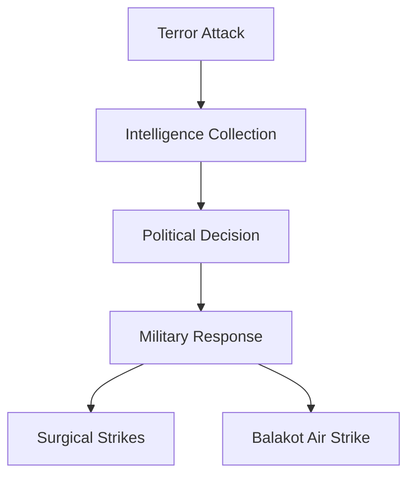

# Counter-Terror Operations

## Why It Matters

Counter-terror operations are military actions conducted against terrorist organizations, terrorist infrastructure, or cross-border terror networks.

These operations represent an important evolution in India's security strategy, demonstrating the ability to conduct precise, intelligence-driven responses against terrorist threats.

Studying these operations helps understand:

- Counter-terrorism doctrine
- Cross-border security challenges
- Intelligence and surveillance capabilities
- Precision military operations
- National security decision-making

---

## Quick Facts

| Item | Details |
|--------|---------|
| Coverage | Major Indian counter-terror operations |
| Time Period | 2016–Present |
| Focus | Cross-border counter-terror actions |
| Key Domains | Intelligence, Special Forces, Air Power |
| Learning Goal | Understand modern counter-terror strategy |

---

## Covered Operations

| Operation | Year | Purpose |
|-----------|------|---------|
| Surgical Strikes | 2016 | Target terrorist launch pads across the Line of Control |
| Balakot Air Strike | 2019 | Strike terrorist infrastructure in Pakistan |

---

## Timeline


---

## Repository Structure

```text
counter-terror-operations
├── surgical-strikes-2016.md
└── balakot-air-strike.md
```

---

## Evolution of Counter-Terror Response



---

## Key Themes

### Intelligence-Led Operations

Modern counter-terror missions depend heavily on intelligence gathering, surveillance, and target identification.

### Precision Strikes

Operations are designed to achieve specific objectives while minimizing collateral damage.

### Deterrence

These actions aim to impose costs on terrorist organizations and their support networks.

### Escalation Management

Counter-terror operations require balancing military objectives with broader strategic stability.

---

## Learning Path

Recommended study order:

1. Surgical Strikes (2016)
2. Balakot Air Strike (2019)

---

## Quick Revision

- Surgical Strikes were conducted in 2016.
- Balakot Air Strike was conducted in 2019.
- Both operations targeted terrorist infrastructure.
- Intelligence and precision targeting were critical components.
- These operations influenced India's modern counter-terror doctrine.

---

## Key Concepts

### Easy

1. When were the Surgical Strikes conducted?
2. What was the objective of the Balakot Air Strike?
3. Which operation involved air power?
4. Why are counter-terror operations important?

### Intermediate

1. How do counter-terror operations differ from conventional warfare?
2. What role does intelligence play in such operations?
3. Why are precision strikes strategically significant?
4. What challenges arise in cross-border counter-terror actions?

### Advanced

1. Analyse the evolution of India's counter-terror strategy since 2016.
2. Evaluate the role of deterrence in counter-terror operations.
3. Compare Surgical Strikes and the Balakot Air Strike from an operational perspective.