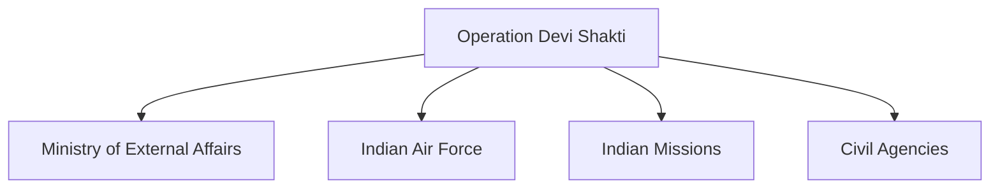

# Operation Devi Shakti

## Why It Matters

Operation Devi Shakti was India's evacuation mission conducted in 2021 following the rapidly changing security situation in Afghanistan.

The operation demonstrated India's ability to conduct emergency evacuations under highly uncertain conditions while coordinating diplomatic, military and logistical resources.

It remains one of the most significant overseas evacuation operations undertaken by India in recent years.

---

## Quick Facts

| Item | Details |
|----------|----------|
| Operation Name | Operation Devi Shakti |
| Year | 2021 |
| Location | Afghanistan |
| Type | Evacuation Operation |
| Objective | Safe Evacuation of People from Afghanistan |
| Lead Agencies | Government of India and Ministry of External Affairs |
| Outcome | Successful Evacuation |

---

## Background

In 2021, Afghanistan experienced major political and security changes following the withdrawal of foreign military forces.

The rapidly evolving situation created significant challenges for foreign nationals and vulnerable groups present in the country.

India launched Operation Devi Shakti to evacuate Indian citizens and other eligible individuals.

---

## Objectives

- Ensure the safety of Indian citizens
- Evacuate people from Afghanistan
- Coordinate international transit arrangements
- Provide emergency assistance
- Facilitate safe return to India

---

## Operational Overview

---

## Multi-Agency Coordination

The operation required extensive coordination among diplomatic, military and administrative institutions.

---

## Role of Diplomacy

Diplomatic efforts helped:

- Coordinate evacuation routes
- Facilitate international cooperation
- Assist stranded individuals
- Support transit and movement arrangements

---

## Role of the Indian Air Force

The Indian Air Force supported:

- Strategic airlift missions
- Emergency transportation
- Long-distance evacuation flights
- Humanitarian assistance efforts

---

## Challenges Faced

- Rapidly changing security conditions
- Limited evacuation windows
- Complex international coordination
- Transportation challenges
- Large-scale logistical requirements

---

## Strategic Importance

Operation Devi Shakti demonstrated:

- Overseas evacuation capability
- Crisis-management effectiveness
- Strategic airlift capability
- Diplomatic coordination capacity
- Humanitarian commitment

---

## Comparison with Other Evacuation Operations

| Operation | Year | Location |
|----------|----------|----------|
| Operation Rahat | 2015 | Yemen |
| Operation Devi Shakti | 2021 | Afghanistan |
| Operation Ganga | 2022 | Ukraine |

---

## Key Lessons

- Importance of contingency planning
- Need for rapid decision-making
- Value of diplomatic engagement
- Importance of strategic airlift capability
- Effective inter-agency coordination

---

## Legacy

Operation Devi Shakti demonstrated India's ability to respond effectively to international crises and protect its citizens during rapidly evolving security situations.

---

## Quick Revision

- Operation Devi Shakti was conducted in 2021.
- It focused on evacuation from Afghanistan.
- It required extensive diplomatic coordination.
- The Indian Air Force played an important role.
- The operation demonstrated crisis-response capability.
- It remains a major overseas evacuation mission.

---

## Key Concepts

### What was Operation Devi Shakti?

India's evacuation mission from Afghanistan in 2021.

### Why was the operation launched?

To safely evacuate people during a rapidly changing security situation.

### Which organizations played major roles?

The Ministry of External Affairs, Indian Air Force and other government agencies.

### Why is Operation Devi Shakti important?

It demonstrated India's overseas evacuation and crisis-management capability.

### What is the main lesson from the operation?

Successful evacuations require rapid coordination, diplomacy and logistical planning.
