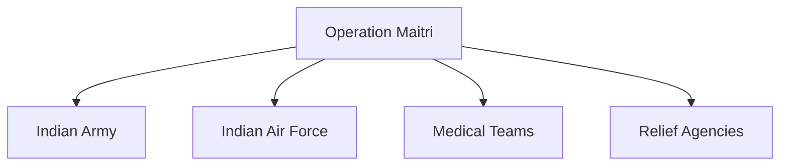

# Operation Maitri

## Why It Matters

Operation Maitri was a major humanitarian assistance and disaster-relief mission conducted by India following the devastating Nepal earthquake in 2015.

The operation demonstrated India's ability to rapidly mobilize military, medical and logistical resources to support a neighbouring country during a humanitarian crisis.

It remains one of the most significant disaster-relief operations in South Asia.

---

## Quick Facts

| Item | Details |
|----------|----------|
| Operation Name | Operation Maitri |
| Year | 2015 |
| Location | Nepal |
| Type | Humanitarian Assistance and Disaster Relief |
| Objective | Rescue, Relief and Humanitarian Support |
| Participants | Indian Armed Forces and Government Agencies |
| Outcome | Successful Relief Operation |

---

## Background

In April 2015, a powerful earthquake struck Nepal, causing extensive loss of life, injuries and damage to infrastructure.

Given the close geographic, cultural and economic ties between India and Nepal, India launched Operation Maitri to provide immediate assistance.

---

## Objectives

- Conduct search and rescue operations
- Deliver humanitarian assistance
- Provide medical support
- Supply relief materials
- Assist recovery efforts
- Support the people of Nepal

---

## Operational Overview

---

## Multi-Agency Response

The operation involved close coordination among military and civilian organizations.

---

## Role of the Indian Army

The Indian Army supported:

- Search and rescue missions
- Relief distribution
- Engineering assistance
- Ground-level humanitarian operations

---

## Role of the Indian Air Force

The Indian Air Force supported:

- Airlift operations
- Transportation of relief materials
- Evacuation missions
- Rapid deployment of personnel

---

## Medical and Humanitarian Support

Relief efforts included:

- Emergency medical care
- Field medical facilities
- Food distribution
- Water and essential supplies
- Assistance to affected communities

---

## India–Nepal Cooperation

Operation Maitri highlighted:

- Strong bilateral relations
- Regional cooperation
- Humanitarian partnership
- Disaster-response collaboration

---

## Challenges Faced

- Damaged infrastructure
- Difficult terrain
- Large affected population
- Weather conditions
- Urgent logistical requirements
- Communication disruptions

---

## Strategic Importance

Operation Maitri demonstrated:

- Rapid-response capability
- Humanitarian commitment
- Airlift capability
- Disaster-management effectiveness
- Regional leadership during crises

---

## Key Lessons

- Importance of rapid deployment
- Value of airlift capability
- Need for disaster preparedness
- Importance of coordination among agencies
- Role of humanitarian assistance in regional stability

---

## Legacy

Operation Maitri is regarded as one of India's most significant humanitarian assistance and disaster-relief missions and remains an important example of regional cooperation during a crisis.

---

## Quick Revision

- Operation Maitri was conducted in 2015.
- It was launched after the Nepal earthquake.
- The Indian Army and Air Force played major roles.
- The operation focused on rescue and relief.
- It demonstrated India's disaster-response capability.
- It strengthened India–Nepal humanitarian cooperation.

---

## Key Concepts

### What was Operation Maitri?

India's humanitarian assistance and disaster-relief mission after the 2015 Nepal earthquake.

### Why was Operation Maitri launched?

To provide rescue, relief and humanitarian support to Nepal.

### Which services played major roles?

The Indian Army and Indian Air Force.

### Why is Operation Maitri important?

It demonstrated India's rapid disaster-response capability and regional humanitarian commitment.

### What is the main lesson from Operation Maitri?

Rapid coordination and deployment are critical during large-scale disasters.