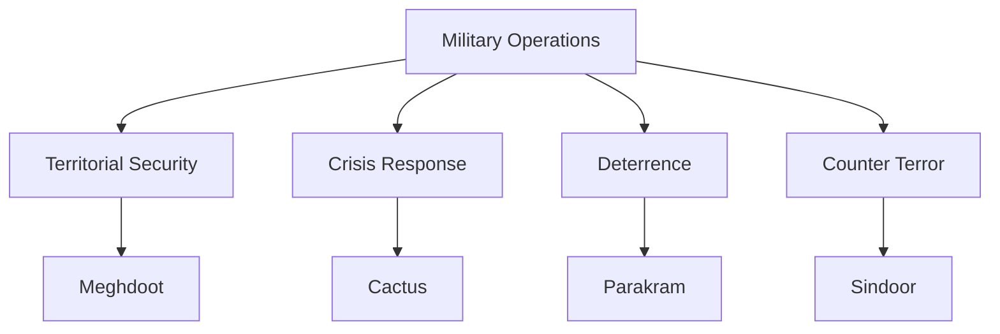

# Military Operations

## Why It Matters

Military operations are planned actions conducted by the Armed Forces to achieve specific strategic, operational, or tactical objectives.

Unlike full-scale wars, military operations are usually focused on a defined mission such as securing territory, deterrence, evacuation, crisis response, or limited military action.

Studying these operations helps understand:

- Indian military decision-making
- Joint operations and coordination
- Strategic objectives and outcomes
- Military preparedness and readiness
- Evolution of defence doctrine

---

## Quick Facts

| Item | Details |
|--------|---------|
| Coverage | Major Indian military operations |
| Time Period | 1984–Present |
| Domains | Land, Air, Maritime, Joint Operations |
| Focus Areas | Deterrence, Territory Security, Crisis Response |
| Learning Goal | Understand operational-level military actions |

---

## Covered Operations

| Operation | Year | Purpose |
|-----------|------|---------|
| Operation Meghdoot | 1984 | Secure key positions in Siachen Glacier |
| Operation Cactus | 1988 | Defeat coup attempt in Maldives |
| Operation Parakram | 2001-02 | Large-scale military mobilization |
| Operation Sindoor | 2025 | Counter-terror military operation |
|
| Major Military Operations | Reference | Overview of important Indian military operations |

---

## Timeline


---

## Repository Structure

```text
military-operations
├── major-military-operations.md
├── operation-meghdoot.md
├── operation-cactus.md
├── operation-parakram.md
└── operation-sindoor.md
```

---

## Types of Military Operations



---

## Key Themes

### High-Altitude Warfare

Operation Meghdoot demonstrated the importance of controlling strategic heights in mountainous terrain.

### Rapid Deployment

Operation Cactus showcased India's ability to deploy forces quickly beyond its borders.

### Strategic Deterrence

Operation Parakram highlighted military mobilization as a tool of coercive diplomacy.

### Precision Operations

Modern operations increasingly rely on intelligence, surveillance, and precision targeting.

---

## Learning Path

Recommended study order:

1. Operation Meghdoot
2. Operation Cactus
3. Operation Parakram
4. Operation Sindoor
5. Major Military Operations

---

## Quick Revision

- Operation Meghdoot secured key Siachen positions.
- Operation Cactus prevented a coup in Maldives.
- Operation Parakram was a major military mobilization after the Parliament attack.
- Operation Sindoor demonstrated modern precision military response.
- Military operations differ from full-scale wars in scope and objectives.

---

## Interview Questions

### Easy

1. What was Operation Meghdoot?
2. Which operation was conducted in Maldives?
3. What was Operation Parakram?
4. Why was Operation Sindoor launched?

### Intermediate

1. Why is Operation Meghdoot strategically important?
2. What lessons emerged from Operation Parakram?
3. How did Operation Cactus demonstrate India's regional role?
4. How do military operations differ from wars?

### Advanced

1. Compare the objectives of Meghdoot, Cactus, Parakram, and Sindoor.
2. Analyse the role of military operations in India's defence strategy.
3. Evaluate how operational lessons influence military doctrine.