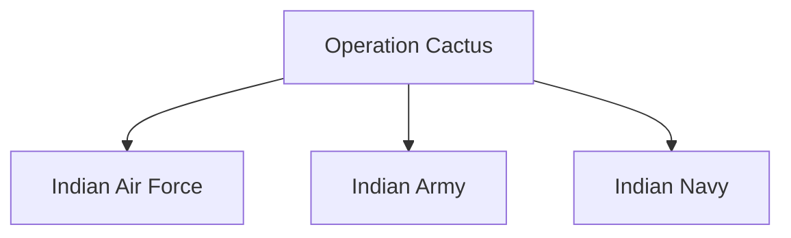

# Operation Cactus

## Why It Matters

Operation Cactus was one of India's most successful rapid military intervention operations. Conducted in 1988, it demonstrated India's ability to respond quickly to a security crisis in its neighbourhood and highlighted the growing importance of air mobility, joint operations and regional security cooperation.

The operation is often cited as an example of India's capability to act as a security provider in the Indian Ocean region.

---

## Quick Facts

| Item | Details |
|----------|----------|
| Operation Name | Operation Cactus |
| Year | 1988 |
| Location | Maldives |
| Type | Military Intervention |
| Lead Force | Indian Armed Forces |
| Objective | Restore Legitimate Government |
| Outcome | Successful |

---

## Background

In November 1988, armed mercenaries attempted to overthrow the government of the Maldives.

The Maldivian government requested assistance from India to restore order and protect the country's leadership.

India responded rapidly and launched Operation Cactus.

---

## Why India Intervened

- Protect regional stability
- Support a friendly neighbouring nation
- Prevent a successful coup attempt
- Maintain security in the Indian Ocean region
- Demonstrate rapid-response capability

---

## Operational Overview

---

## Execution of the Operation

### Rapid Response

Indian forces were mobilized quickly after receiving the request from the Maldivian government.

### Airlift Operations

Military aircraft transported troops over a long distance in a short period.

### Securing Key Locations

Forces secured important government and strategic locations.

### Restoration of Order

The coup attempt was defeated and the legitimate government remained in control.

---

## Joint Operations Concept

The operation demonstrated effective coordination among multiple military services.

---

## Strategic Importance

Operation Cactus demonstrated:

- Rapid force projection capability
- Effective military mobility
- Regional security commitment
- Strong diplomatic and military coordination
- Ability to conduct out-of-country operations

---

## Impact on Regional Security

The operation strengthened:

- India-Maldives relations
- Regional confidence in India
- Maritime security cooperation
- India's role in the Indian Ocean region

---

## Key Lessons

- Importance of rapid decision-making
- Value of strategic airlift capability
- Importance of joint military operations
- Need for regional security cooperation
- Significance of military readiness

---

## Legacy

Operation Cactus remains one of the most successful examples of India's rapid military intervention capability and is frequently studied as a model crisis-response operation.

---

## Quick Revision

- Operation Cactus took place in 1988.
- It was conducted in the Maldives.
- The objective was to defeat a coup attempt.
- India rapidly deployed military forces.
- The operation successfully restored stability.
- It demonstrated India's regional security role.

---

## Key Concepts

### What was Operation Cactus?

A military operation conducted by India in 1988 to defeat a coup attempt in the Maldives.

### Why was it important?

It demonstrated India's rapid-response and regional-security capabilities.

### Which country requested assistance?

The Maldives.

### What was the outcome?

The legitimate government remained in power.

### What is the main lesson from Operation Cactus?

Rapid deployment and joint operations can decisively influence a security crisis.