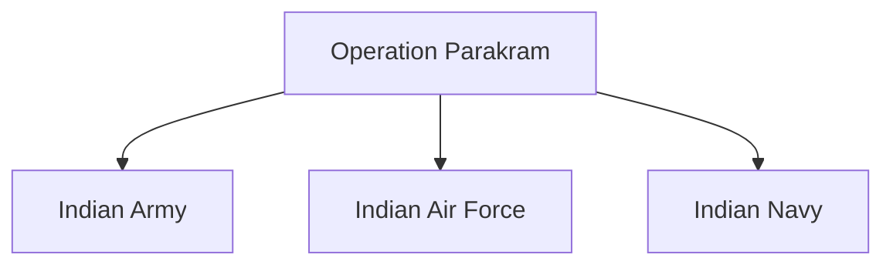

# Operation Parakram

## Why It Matters

Operation Parakram was one of the largest military mobilizations in India's history. Conducted between 2001 and 2002, it demonstrated India's ability to rapidly mobilize military forces following a major national-security crisis.

The operation significantly influenced India's military doctrine, strategic planning and future approaches to crisis response.

---

## Quick Facts

| Item | Details |
|----------|----------|
| Operation Name | Operation Parakram |
| Period | 2001–2002 |
| Type | Strategic Military Mobilization |
| Trigger | Indian Parliament Attack |
| Participants | Indian Armed Forces |
| Objective | Strategic Deterrence and Military Readiness |
| Outcome | Large-Scale Force Mobilization |

---

## Background

In December 2001, terrorists attacked the Indian Parliament in New Delhi.

The attack was viewed as a major national-security challenge and led to heightened tensions between India and Pakistan.

India responded by initiating a large-scale military mobilization known as Operation Parakram.

---

## Objectives

- Demonstrate military readiness
- Strengthen strategic deterrence
- Increase pressure on hostile actors
- Prepare for potential military contingencies
- Signal national resolve

---

## Operational Overview

---

## Scale of Mobilization

Operation Parakram involved:

- Large troop deployments
- Air Force readiness measures
- Naval preparedness activities
- Strategic positioning of military assets

It became one of the largest military mobilizations in South Asia after the 1971 war.

---

## Joint Services Participation

---

## Strategic Significance

The operation demonstrated:

- Military readiness
- Large-scale force projection capability
- Strategic signaling capability
- Joint-force coordination
- National-security preparedness

---

## Lessons Learned

### Mobilization Time

One major lesson was the time required for large-scale military mobilization.

### Need for Faster Response

Military planners recognized the importance of developing capabilities for quicker and more flexible responses.

### Joint Operations

The operation highlighted the importance of coordination among the Army, Navy and Air Force.

---

## Impact on Military Doctrine

Operation Parakram influenced future discussions on:

- Rapid mobilization
- Integrated operations
- Strategic readiness
- Crisis-response planning

---

## Challenges

- Sustaining long deployments
- Logistical requirements
- Strategic uncertainty
- Escalation management
- High operational costs

---

## Long-Term Impact

Operation Parakram contributed to:

- Improved military planning
- Better readiness mechanisms
- Enhanced operational coordination
- Greater focus on rapid response capabilities

It remains an important case study in military mobilization and deterrence.

---

## Legacy

Although it did not result in full-scale war, Operation Parakram had a lasting influence on India's strategic thinking and military preparedness.

---

## Quick Revision

- Operation Parakram followed the 2001 Parliament attack.
- It was one of India's largest military mobilizations.
- All three armed services participated.
- The operation emphasized deterrence and readiness.
- It influenced future military doctrine.
- It highlighted the importance of rapid mobilization.

---

## Key Concepts

### What was Operation Parakram?

A large-scale military mobilization conducted after the 2001 Parliament attack.

### Why was it launched?

To demonstrate readiness, deterrence and national resolve.

### Why is it important?

It influenced future military planning and operational doctrine.

### What was the main lesson?

The need for faster and more flexible military response capabilities.

### Why is Operation Parakram still studied?

It remains one of the most important examples of strategic military mobilization in modern India.