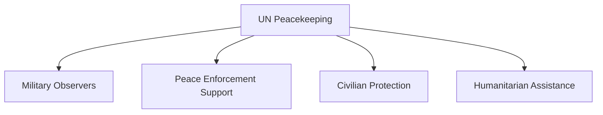

# Peacekeeping

## Why It Matters

Peacekeeping operations help maintain international peace and security in conflict-affected regions.

India has been one of the world's largest and most consistent contributors to United Nations peacekeeping missions since independence.

Participation in peacekeeping missions demonstrates India's commitment to global stability, multilateral cooperation, and responsible international engagement.

Studying peacekeeping helps understand:

- India's role in the United Nations
- International conflict management
- Military diplomacy
- Civilian protection and humanitarian assistance
- Global security cooperation

---

## Quick Facts

| Item | Details |
|--------|---------|
| Coverage | United Nations Peacekeeping Missions |
| Time Period | 1950s–Present |
| Organization | United Nations |
| India's Role | Troop, police, and observer contributor |
| Learning Goal | Understand India's contribution to global peace and security |

---

## Covered Content

| Topic | Description |
|---------|-------------|
| UN Peacekeeping Missions | Overview of India's participation in UN operations |

---

## Timeline


---

## Repository Structure

```text
peacekeeping
└── un-peacekeeping-missions.md
```

---

## Types of Peacekeeping Operations



---

## Key Themes

### Conflict Resolution

Peacekeeping missions help reduce violence, monitor ceasefires, and support political settlements.

### Civilian Protection

Modern peacekeeping operations often focus on protecting civilians in conflict zones.

### International Cooperation

Peacekeeping requires coordination among multiple countries, international organizations, and local authorities.

### India's Global Role

India's participation strengthens its reputation as a responsible stakeholder in international affairs.

---

## Learning Path

Recommended study order:

1. UN Peacekeeping Missions
2. India's Contributions
3. Major Missions and Case Studies
4. Challenges of Modern Peacekeeping

---

## Quick Revision

- India is one of the largest contributors to UN peacekeeping missions.
- Peacekeeping supports international peace and security.
- Missions include military, police, and observer deployments.
- Civilian protection is a major objective of modern operations.
- Peacekeeping enhances India's global diplomatic profile.

---

## Interview Questions

### Easy

1. What is peacekeeping?
2. Which organization conducts UN peacekeeping missions?
3. Why is India involved in peacekeeping operations?
4. What are military observers?

### Intermediate

1. How do peacekeeping operations differ from combat operations?
2. What roles do Indian personnel perform in UN missions?
3. Why is civilian protection important in modern peacekeeping?
4. What challenges do peacekeeping forces face?

### Advanced

1. Analyse India's contribution to UN peacekeeping missions.
2. Evaluate the effectiveness of modern peacekeeping operations.
3. Explain how peacekeeping supports India's foreign policy objectives.