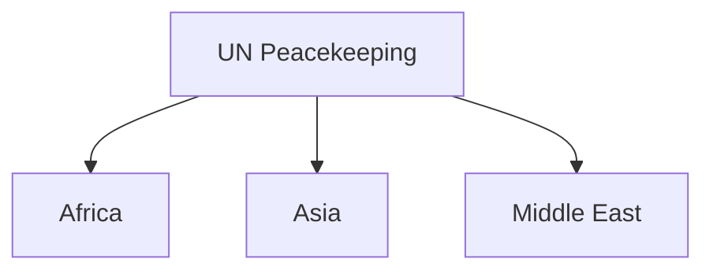
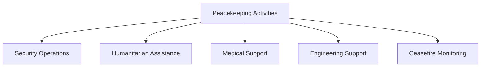

# UN Peacekeeping Missions

## Why It Matters

India has been one of the largest and most consistent contributors to United Nations peacekeeping operations.

Indian military personnel have served across multiple continents, helping maintain peace, protect civilians, support humanitarian efforts and stabilize conflict-affected regions.

India's participation in peacekeeping missions reflects its commitment to international peace, multilateral cooperation and global responsibility.

---

## Quick Facts

| Item | Details |
|----------|----------|
| Domain | International Security |
| Organization | United Nations |
| India's Role | Troop Contributor |
| Mission Types | Peacekeeping and Stabilization |
| Geographic Coverage | Africa, Asia, Middle East and Other Regions |
| Strategic Importance | Global Peace and Diplomacy |

---

## What Is UN Peacekeeping?

UN peacekeeping involves the deployment of military personnel, police and civilian experts to help maintain peace and security in areas affected by conflict.

Peacekeeping operations typically support:

- Ceasefire monitoring
- Civilian protection
- Humanitarian assistance
- Political stabilization
- Peace agreement implementation

---

## India's Peacekeeping Journey

---

## Why India Participates

India contributes to peacekeeping missions to:

- Support international peace
- Promote global stability
- Strengthen multilateral cooperation
- Assist conflict-affected populations
- Contribute to humanitarian efforts
- Enhance international partnerships

---

## Major Areas of Deployment

Many of India's largest peacekeeping deployments have taken place in Africa.

---

## Roles Performed by Indian Personnel

| Role | Purpose |
|----------|----------|
| Peacekeeping Patrols | Maintain Stability |
| Civilian Protection | Protect Vulnerable Populations |
| Medical Assistance | Humanitarian Support |
| Engineering Support | Infrastructure Development |
| Logistics Support | Mission Sustainment |
| Training Assistance | Capacity Building |

---

## Types of Peacekeeping Activities

---

## Humanitarian Contributions

Indian peacekeepers have frequently contributed through:

- Medical camps
- Civilian assistance
- Infrastructure support
- Emergency relief efforts
- Community engagement programmes

---

## Importance for India

UN peacekeeping helps India:

- Strengthen diplomatic influence
- Build international goodwill
- Demonstrate military professionalism
- Support global stability
- Enhance international partnerships

---

## Challenges Faced by Peacekeepers

- Operating in conflict zones
- Complex political environments
- Humanitarian crises
- Resource constraints
- Security threats
- Difficult terrain and weather conditions

---

## Impact on the Indian Armed Forces

Peacekeeping missions provide experience in:

- International operations
- Joint-force coordination
- Humanitarian assistance
- Crisis management
- Multinational cooperation

---

## Strategic Significance

India's peacekeeping contributions strengthen both its international standing and its commitment to global peace.

---

## Future Outlook

- Continued participation in UN missions
- Greater use of technology in peacekeeping
- Enhanced training capabilities
- Increased focus on civilian protection
- Stronger international cooperation

---

## Quick Revision

- India is one of the major contributors to UN peacekeeping missions.
- Peacekeeping supports stability in conflict-affected regions.
- Indian personnel serve in military, medical and humanitarian roles.
- Many deployments have taken place in Africa.
- Peacekeeping strengthens India's global reputation.
- These missions support international peace and security.

---

## Key Concepts

### What is UN peacekeeping?

UN operations designed to help maintain peace and stability in conflict-affected regions.

### Why does India participate in peacekeeping missions?

To support international peace, stability and humanitarian objectives.

### What roles do Indian peacekeepers perform?

Security, humanitarian, medical, engineering and stabilization roles.

### Why are peacekeeping missions important?

They help prevent conflict escalation and support long-term stability.

### How do peacekeeping missions benefit India?

They strengthen diplomacy, international influence and operational experience.