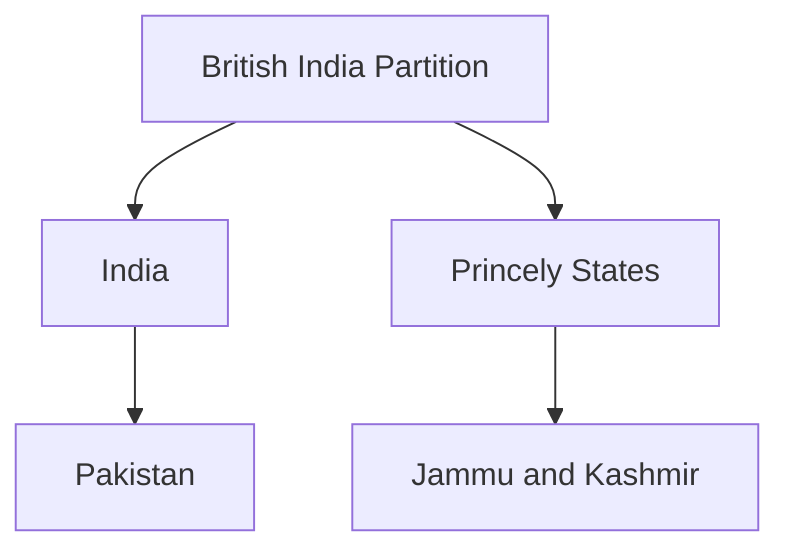
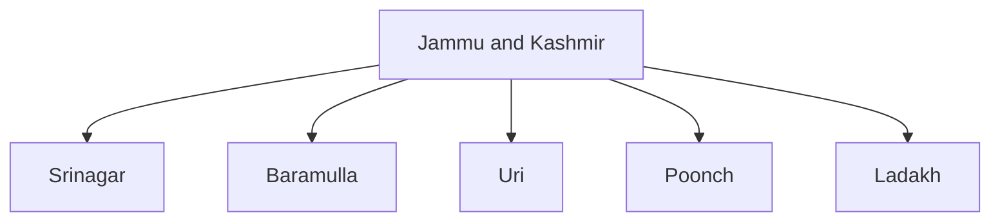
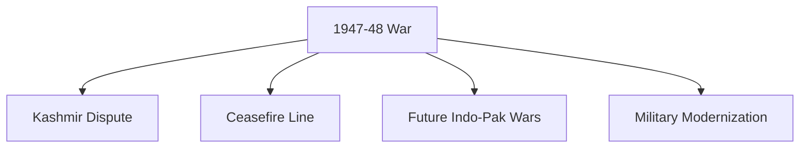

# First Indo-Pak War (1947–48)

## Why It Matters

The First Indo-Pak War was the first major military conflict between India and Pakistan after independence.

The war was fought over the princely state of Jammu and Kashmir and laid the foundation for one of South Asia's most enduring geopolitical disputes.

The conflict is important because:

- It shaped the future of Jammu and Kashmir.
- It led to the creation of the Line of Control's predecessor, the Ceasefire Line.
- It established the strategic importance of Kashmir in India-Pakistan relations.
- It was the first large-scale combat operation of the Indian Armed Forces after independence.
- It continues to influence regional security and diplomacy.

---

## Quick Facts

| Item | Details |
|--------|---------|
| Conflict | First Indo-Pak War |
| Duration | 1947–1948 |
| Region | Jammu and Kashmir |
| Countries | India and Pakistan |
| Trigger | Tribal invasion of Jammu and Kashmir |
| Indian Prime Minister | Jawaharlal Nehru |
| Governor-General | Lord Mountbatten |
| Result | UN-mediated ceasefire |
| Major Outcome | Division of Jammu and Kashmir |

---

## Timeline

| Date | Event |
|--------|--------|
| August 1947 | India and Pakistan become independent |
| October 1947 | Tribal invasion begins |
| October 1947 | Instrument of Accession signed |
| October 1947 | Indian troops airlifted to Srinagar |
| January 1948 | India approaches the United Nations |
| January 1949 | Ceasefire comes into effect |

---

## Background

### Partition of India

British India was divided into India and Pakistan in 1947.

Princely states were given the option to join either country.

### Jammu and Kashmir

Jammu and Kashmir was ruled by Maharaja Hari Singh.

The state had not immediately joined either India or Pakistan after independence.

---

## Tribal Invasion

### Operation Gulmarg

Armed tribal forces supported from Pakistan entered Jammu and Kashmir in October 1947.

Objectives included:

- Capturing Srinagar
- Forcing accession to Pakistan
- Seizing strategic territory

---

## Instrument of Accession

Facing the invasion, Maharaja Hari Singh requested military assistance from India.

India required formal accession before deploying troops.

### 26 October 1947

The Instrument of Accession was signed.

Jammu and Kashmir officially acceded to India.

---

## Airlift to Srinagar

One of the most significant military airlift operations in Indian history.

### Objective

Defend Srinagar and prevent its capture.

### Outcome

Indian troops secured the airport and stabilized the situation.

---

## Major Areas of Fighting

### Srinagar

### Baramulla

### Uri

### Poonch

### Ladakh

---

## Key Military Operations

| Operation | Significance |
|------------|-------------|
| Defence of Srinagar | Prevented collapse of Kashmir administration |
| Relief of Poonch | Protected isolated regions |
| Ladakh Operations | Secured eastern areas |
| Zoji La Operations | Enabled breakthrough in high-altitude warfare |

---

## Battle of Zoji La

### Importance

Zoji La connects Kashmir Valley with Ladakh.

### Significance

Indian forces used tanks at extremely high altitude, an unprecedented military achievement at the time.

---

## Key Personalities

| Name | Role |
|--------|------|
| Maharaja Hari Singh | Ruler of Jammu and Kashmir |
| Jawaharlal Nehru | Prime Minister of India |
| Lord Mountbatten | Governor-General of India |
| Sheikh Abdullah | Kashmiri political leader |
| General K. M. Cariappa | Senior Indian military commander |

---

## United Nations Involvement

### January 1948

India referred the matter to the United Nations.

### UN Resolution

The UN called for:

- Ceasefire
- Withdrawal of forces
- Political settlement process

---

## Ceasefire

### 1 January 1949

A UN-mediated ceasefire came into effect.

The ceasefire line divided the region into areas controlled by India and Pakistan.

---

## Impact on India

### Security Lessons

- Importance of rapid military deployment
- Need for mountain warfare capability
- Strategic value of air mobility

### Political Impact

The Kashmir issue became a long-term national security challenge.

---

## Long-Term Consequences

---

## Current Relevance

The conflict continues to influence:

- Jammu and Kashmir politics
- India-Pakistan relations
- Border security policy
- National security strategy

---

## Quick Revision

- First Indo-Pak War fought in 1947-48.
- Triggered by tribal invasion of Jammu and Kashmir.
- Instrument of Accession brought Jammu and Kashmir into India.
- Indian troops were airlifted to Srinagar.
- UN-mediated ceasefire took effect in 1949.
- Ceasefire Line became the basis for later border arrangements.
- Kashmir remained a central issue in India-Pakistan relations.

---

## Key Concepts

### Easy

1. What triggered the First Indo-Pak War?
2. Who signed the Instrument of Accession?
3. When did Jammu and Kashmir accede to India?
4. When did the ceasefire take effect?

### Intermediate

1. Why was the Srinagar airlift important?
2. What was the role of the United Nations?
3. Why was Zoji La strategically important?
4. What was the significance of the Ceasefire Line?

### Advanced

1. Analyse the strategic importance of the First Indo-Pak War.
2. Evaluate the military lessons learned from the conflict.
3. Explain how the war shaped India-Pakistan relations.
4. Discuss the long-term consequences of the Kashmir dispute.