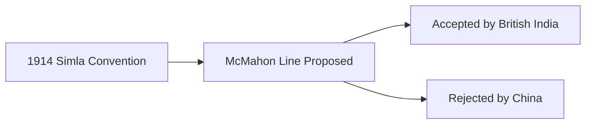
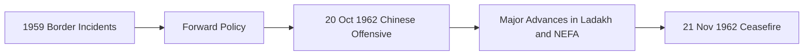
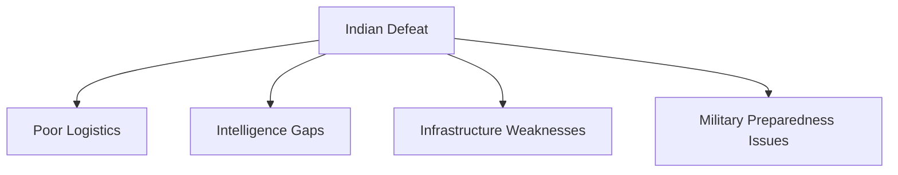

# 1962 Sino-Indian War

## Why It Matters

The 1962 Sino-Indian War was India's first major military conflict after independence and remains one of the most significant events in modern Indian military history.

The war exposed weaknesses in India's defence preparedness, intelligence assessment, military logistics, infrastructure, and political decision-making.

Its lessons directly influenced:

- Expansion of the Indian Army
- Modernisation of defence planning
- Strengthening of border infrastructure
- Creation of mountain warfare capabilities
- Long-term India-China security policies

The conflict continues to shape India's approach toward border security and relations with China.

---

## Quick Facts

| Item | Details |
|--------|---------|
| Conflict | Sino-Indian War |
| Year | 1962 |
| Duration | 20 October – 21 November 1962 |
| Countries | India and China |
| Main Fronts | Ladakh (Western Sector), NEFA (Eastern Sector) |
| Present-Day NEFA | Arunachal Pradesh |
| Indian Prime Minister | Jawaharlal Nehru |
| Chinese Leader | Mao Zedong |
| Result | Chinese military victory |
| Ceasefire | 21 November 1962 |
| Lasting Impact | Major reforms in Indian defence policy |

---

## Background

### Border Disputes

India and China inherited undefined Himalayan borders from the colonial period.

Two major disputed regions became flashpoints:

| Region | Dispute |
|----------|---------|
| Aksai Chin | Claimed by India, controlled by China |
| NEFA (Arunachal Pradesh) | Claimed by China, administered by India |

---

### McMahon Line

In the eastern sector, India recognised the McMahon Line as the boundary.

China rejected the legitimacy of the line.

---

### Tibet Factor

China's control of Tibet significantly changed the strategic environment along India's northern borders.

India and China increasingly disagreed over border alignment, security concerns, and territorial claims.

---

### Forward Policy

India adopted the Forward Policy during the late 1950s and early 1960s.

The policy involved establishing small military posts in disputed frontier areas to strengthen territorial claims.

China viewed the policy as provocative and tensions increased.

---

## Timeline of the War

---

## Major Theatres of War

### Western Sector (Ladakh)

Fighting occurred in the Aksai Chin region.

China secured control over Aksai Chin and strengthened its strategic position.

### Eastern Sector (NEFA)

Chinese forces launched major offensives across NEFA.

Indian forces faced severe logistical and operational challenges.

---

## Key Battles

| Battle | Importance |
| -------- | -------- |
| Namka Chu | Early major engagement of the war |
| Tawang | Strategic town captured by Chinese forces |
| Se La | Important defensive position in NEFA |
| Walong | One of the fiercest battles fought by Indian troops |
| Rezang La | Famous last stand by Indian soldiers in Ladakh |

---

## Battle of Rezang La

The Battle of Rezang La remains one of the most celebrated actions in Indian military history.

Soldiers of 13 Kumaon Regiment fought against overwhelming odds and displayed exceptional bravery.

The battle became a symbol of courage, sacrifice, and military professionalism.

---

## Why India Lost

Several factors contributed to India's defeat:

- Inadequate military preparedness
- Poor infrastructure in border areas
- Intelligence failures
- Logistical weaknesses
- Lack of modern equipment
- Operational and command shortcomings

---

## Chinese Ceasefire

On 21 November 1962, China announced a unilateral ceasefire.

Chinese forces withdrew in parts of the eastern sector but retained control of Aksai Chin.

---

## Impact on India

The war triggered major reforms:

- Expansion of the Army
- Increased defence spending
- Improvement of border infrastructure
- Strengthening of intelligence capabilities
- Development of mountain warfare expertise

---

## Long-Term Significance

The 1962 war continues to influence:

- India-China relations
- Border management policies
- Defence planning
- Military modernization
- National security strategy

---

## Quick Revision

- The war was fought between India and China in 1962.
- Main theatres were Ladakh and NEFA.
- China achieved military success and retained Aksai Chin.
- Rezang La became a symbol of Indian military bravery.
- The conflict led to major defence reforms in India.

---

## Interview Questions

### Easy

1. When was the 1962 Sino-Indian War fought?
2. What is Aksai Chin?
3. What was NEFA?
4. What was the outcome of the war?

### Intermediate

1. What were the main causes of the conflict?
2. Explain the Forward Policy.
3. Why is Rezang La important?
4. What weaknesses did the war expose?

### Advanced

1. Analyse the strategic causes of the 1962 war.
2. Evaluate the impact of the conflict on Indian defence policy.
3. Explain how the 1962 war continues to shape India-China relations.