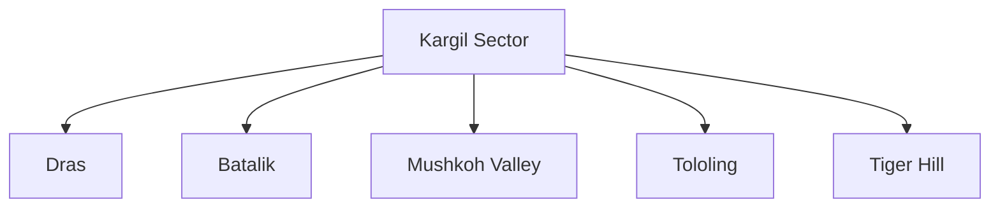
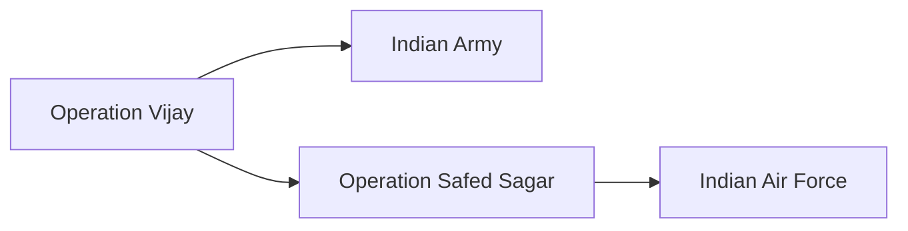
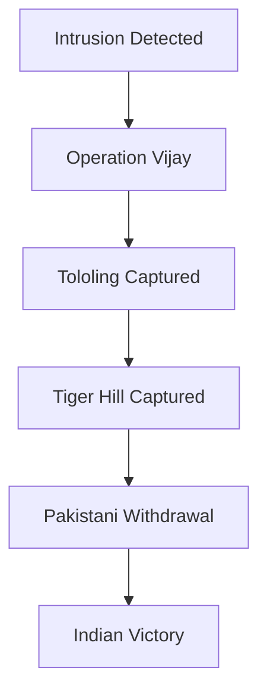
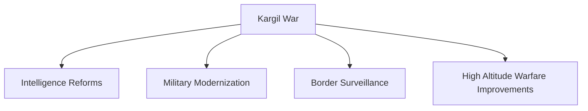

# Kargil War (1999)

## Why It Matters

The Kargil War was fought between India and Pakistan in 1999 in the Kargil-Dras-Batalik sector of Jammu and Kashmir.

It is one of the most important military conflicts in modern Indian history because:

- It occurred after both countries became declared nuclear powers.
- India successfully evicted infiltrating forces from strategic heights.
- It highlighted the importance of intelligence, surveillance, and high-altitude warfare.
- It strengthened India's military modernization efforts.
- It remains a key case study in mountain warfare.

---

## Quick Facts

| Item | Details |
|--------|---------|
| Conflict | Kargil War |
| Codename | Operation Vijay |
| Year | 1999 |
| Duration | May–July 1999 |
| Location | Kargil, Dras, Batalik, Mushkoh |
| Countries | India and Pakistan |
| Indian Prime Minister | Atal Bihari Vajpayee |
| Pakistani Prime Minister | Nawaz Sharif |
| Result | Indian Victory |
| Victory Day | 26 July (Kargil Vijay Diwas) |

---

## Background

### Kashmir Conflict

India and Pakistan have fought multiple wars over Jammu and Kashmir.

The Line of Control (LoC) separates Indian and Pakistani controlled territories.

### Nuclear Tests

| Year | Event |
|------|--------|
| 1998 | India conducted Pokhran-II tests |
| 1998 | Pakistan conducted Chagai tests |

Both nations became overt nuclear powers before the conflict.

---

## Origins of the Conflict

Pakistani troops and militants crossed the Line of Control and occupied high-altitude positions on the Indian side.

Their objectives included:

- Threatening National Highway 1A
- Internationalising the Kashmir issue
- Disrupting Indian military logistics
- Gaining tactical advantage in the region

---

## Discovery of Intrusions

### Local Reports

Shepherds and patrols first reported unusual activity.

### Military Verification

Indian Army patrols confirmed large-scale infiltration.

### Escalation

The conflict rapidly expanded across multiple sectors.

---

## Areas of Fighting

### Dras Sector

### Batalik Sector

### Mushkoh Valley

### Kargil Sector

---

## Operation Vijay

### Objective

Evict infiltrators and restore Indian control over occupied positions.

### Challenges

- Extreme altitude
- Steep mountain terrain
- Harsh weather
- Enemy occupying higher ground

---

## Role of the Indian Air Force

### Operation Safed Sagar

The Indian Air Force supported ground operations.

Responsibilities included:

- Reconnaissance
- Precision strikes
- Supply support
- Target destruction

---

## Major Battles

| Battle | Significance |
|----------|-------------|
| Tololing | Turning point of the war |
| Tiger Hill | Symbolic and strategic victory |
| Point 4875 | Fierce combat operations |
| Batalik Operations | Cleared key infiltrated positions |

---

## Battle of Tololing

### Importance

Tololing overlooked critical supply routes.

### Outcome

Indian forces successfully recaptured the position after intense fighting.

---

## Battle of Tiger Hill

### Strategic Importance

Tiger Hill dominated surrounding terrain.

### Operation

Indian troops conducted difficult night assaults.

### Outcome

Tiger Hill was recaptured by Indian forces.

---

## Heroes of the War

| Name | Award |
|--------|--------|
| Captain Vikram Batra | Param Vir Chakra |
| Lieutenant Manoj Kumar Pandey | Param Vir Chakra |
| Grenadier Yogendra Singh Yadav | Param Vir Chakra |
| Rifleman Sanjay Kumar | Param Vir Chakra |

---

## Captain Vikram Batra

### Unit

13 Jammu and Kashmir Rifles

### Famous Quote

"Yeh Dil Maange More!"

### Contribution

Played a major role in recapturing strategic positions.

---

## International Response

### Diplomatic Pressure

Major powers urged de-escalation.

### United States Position

Pakistan faced significant diplomatic pressure to withdraw.

### Global Perception

India's position received broad international support.

---

## Pakistani Withdrawal

Increasing military and diplomatic pressure led to withdrawal from occupied positions.

### July 1999

Pakistani forces began pulling back.

---

## End of the War

### 26 July 1999

India announced successful completion of Operation Vijay.

---

## Why India Won

### Superior Political Leadership

### Determined Military Response

### Air Force Support

### International Diplomatic Backing

### Effective Logistics and Coordination

---

## Kargil Review Committee

Following the war, India established the Kargil Review Committee.

Key focus areas:

- Intelligence reforms
- Border surveillance
- National security management
- Defence modernization

---

## Impact on India

### Military Reforms

- Improved surveillance systems
- Better intelligence coordination
- Strengthened high-altitude warfare capability
- Modernization of equipment

### National Security Reforms

- Institutional reforms
- Improved strategic planning
- Enhanced border monitoring

---

## Long-Term Consequences

---

## Current Relevance

The lessons of Kargil continue to influence:

- Border security strategy
- Mountain warfare doctrine
- Surveillance systems
- Defence modernization programs
- India-Pakistan security relations

---

## Quick Revision

- Kargil War fought in 1999.
- Operation Vijay was India's military campaign.
- Operation Safed Sagar was the Air Force campaign.
- Major battles included Tololing and Tiger Hill.
- India successfully evicted infiltrators.
- 26 July is observed as Kargil Vijay Diwas.
- Led to significant defence and intelligence reforms.

---

## Interview Questions

### Easy

1. When was the Kargil War fought?
2. What was Operation Vijay?
3. What is Kargil Vijay Diwas?
4. Which mountain peak became a symbol of victory?

### Intermediate

1. Why was Tiger Hill strategically important?
2. What was Operation Safed Sagar?
3. What role did the Line of Control play in the conflict?
4. What were the findings of the Kargil Review Committee?

### Advanced

1. Analyse the strategic causes of the Kargil War.
2. Explain how India achieved victory despite terrain disadvantages.
3. Evaluate the impact of Kargil on India's national security reforms.
4. Discuss the role of diplomacy during the conflict.
