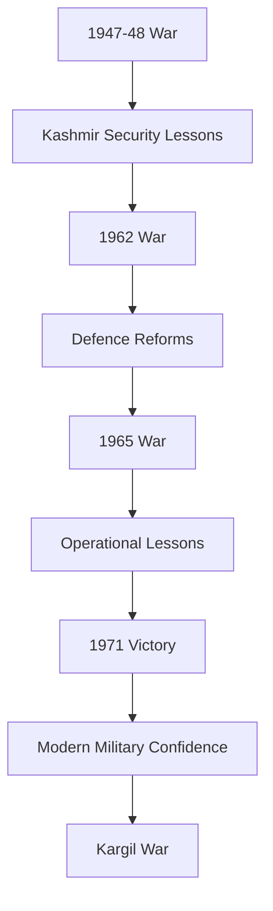

# Wars

## Why It Matters

Wars have played a major role in shaping India's defence policy, military doctrine, force structure, border management, and national security strategy.

Since independence, India has fought multiple wars against external adversaries. These conflicts influenced military modernization, defence reforms, intelligence capabilities, and strategic planning.

## Quick Facts

| Item | Details |
|--------|---------|
| Coverage | Major post-independence wars involving India |
| Primary Opponents | Pakistan, China |
| Time Period | 1947–1999 |
| Major Themes | Borders, Strategy, Military Reforms, Warfare |
| Learning Goal | Understand evolution of Indian military power |

Studying these wars helps understand:

- Evolution of Indian military doctrine
- National security challenges
- Border disputes and conflicts
- Defence modernization efforts
- Strategic and geopolitical decision-making

---

## Covered Wars

| Conflict | Years | Opponent | Outcome |
|-----------|---------|-----------|---------|
| First Indo-Pak War | 1947–48 | Pakistan | Ceasefire and division of Jammu and Kashmir |
| Sino-Indian War | 1962 | China | Chinese victory; major Indian defence reforms |
| Indo-Pak War | 1965 | Pakistan | Military stalemate; Indian strategic advantage |
| Indo-Pak War | 1971 | Pakistan | Decisive Indian victory; creation of Bangladesh |
| Kargil War | 1999 | Pakistan | Indian victory |

---

## Timeline


---

## Repository Structure

```text
wars
├── 1947-48-war.md
├── 1962-war.md
├── 1965-war.md
├── 1971-war.md
└── 1999-kargil-war.md
```

---

## War Progression



---

## Key Themes

### Border Security

Wars have significantly influenced India's border management and military deployment policies.

### Military Modernization

Major conflicts triggered upgrades in equipment, logistics, training, and infrastructure.

### Joint Operations

The Army, Navy, and Air Force increasingly adopted coordinated operations after lessons from earlier wars.

### Strategic Deterrence

Military conflicts shaped India's long-term deterrence and national security posture.

---

## Learning Path

Recommended study order:

1. 1947-48 War
2. 1962 War
3. 1965 War
4. 1971 War
5. Kargil War

This sequence shows India's military evolution from major setbacks to decisive victories and modern warfare.

---

## Quick Revision

- 1947-48: First Indo-Pak War over Jammu and Kashmir.
- 1962: Sino-Indian War exposed defence weaknesses.
- 1965: Demonstrated military recovery after 1962.
- 1971: Creation of Bangladesh and decisive Indian victory.
- 1999: Kargil War restored occupied positions and triggered reforms.
- Every major conflict influenced defence modernization.

---

## Interview Questions

### Easy

1. What was the first major war fought by India after independence?
2. Which war led to the creation of Bangladesh?
3. When was the Kargil War fought?
4. Which war exposed India's defence weaknesses?

### Intermediate

1. How did the 1962 war influence defence reforms?
2. What lessons were learned from the 1965 war?
3. Why is the 1971 war considered a decisive victory?
4. What reforms followed the Kargil War?

### Advanced

1. Compare the strategic outcomes of the 1947-48, 1962, 1965, 1971, and Kargil conflicts.
2. Explain how India's military doctrine evolved across these wars.
3. Analyse the long-term impact of these wars on national security policy.