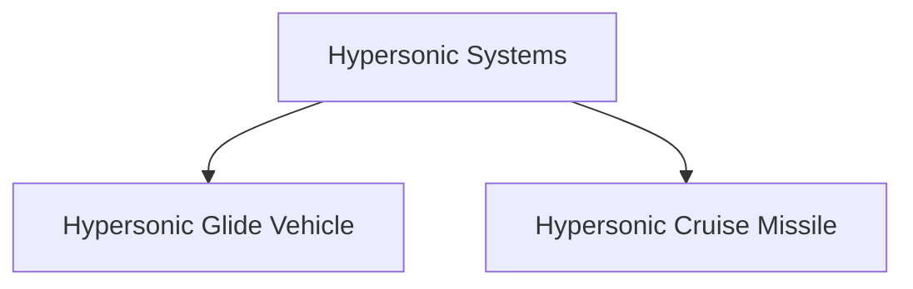

# Hypersonic Programmes

## Why It Matters

Hypersonic technology represents the next major evolution in missile and strategic weapon systems. Hypersonic vehicles travel at extremely high speeds while maintaining maneuverability, making them significantly more difficult to detect, track and intercept.

For India, hypersonic technologies are important for future deterrence, strategic strike capability and technological self-reliance.

---

## Quick Facts

| Item | Details |
|----------|----------|
| Domain | Missile Systems and Future Strategic Weapons |
| Key Technology | Hypersonic Flight |
| Primary Objective | High-Speed Precision Strike |
| Lead Organisation | DRDO |
| Strategic Importance | Future Deterrence Capability |
| Status | Development and Testing |

---

## What Is Hypersonic Technology?

Hypersonic systems are capable of travelling at speeds greater than Mach 5 while maintaining controlled flight.

Unlike traditional ballistic missiles, many hypersonic systems can maneuver during flight, making interception significantly more difficult.

---

## Why Hypersonic Weapons Matter

- Extremely high speed
- Reduced enemy reaction time
- Greater survivability
- Enhanced strike capability
- Increased operational flexibility
- Future strategic deterrence value

---

## Speed Categories

---

## Why Hypersonic Systems Are Difficult to Intercept

Hypersonic systems can maneuver during flight, making trajectory prediction significantly more difficult than traditional ballistic missiles.

---
---

## Types of Hypersonic Systems

### Hypersonic Glide Vehicle (HGV)

- Boosted to high altitude
- Glides toward target
- Highly maneuverable
- Difficult to predict

### Hypersonic Cruise Missile (HCM)

- Powered flight throughout mission
- Sustained hypersonic speed
- Precision strike capability

---

## Indian Hypersonic Programmes

### Hypersonic Technology Demonstrator Vehicle (HSTDV)

The HSTDV is one of India's most important hypersonic research programmes.

Objectives include:

- Scramjet technology development
- High-speed flight testing
- Indigenous hypersonic capability
- Future missile applications

### Importance

The programme serves as a technology foundation for future hypersonic weapon systems.

---

## Scramjet Technology

Scramjet engines allow sustained hypersonic flight by using atmospheric oxygen instead of carrying oxidizers onboard.

---

## Hypersonic vs Traditional Missiles

| Feature | Traditional Missile | Hypersonic System |
|----------|----------|----------|
| Speed | Lower | Much Higher |
| Maneuverability | Limited | High |
| Reaction Time for Target | Higher | Lower |
| Interception Difficulty | Lower | Higher |
| Future Relevance | Current Generation | Next Generation |

---

## Global Hypersonic Competition

Major powers are investing heavily in hypersonic technologies because of their potential impact on future warfare.

Key focus areas include:

- Hypersonic glide vehicles
- Hypersonic cruise missiles
- Advanced propulsion systems
- Missile-defence penetration capability
- Precision long-range strike systems

---

## Strategic Importance for India

Hypersonic technology can help India:

- Strengthen strategic deterrence
- Improve survivable long-range strike capability
- Improve future strike capability
- Enhance indigenous defence technology
- Support advanced military modernization
- Maintain technological competitiveness

---

## Challenges

- Complex engineering requirements
- High development costs
- Extreme heat management
- Advanced materials requirements
- Guidance and control challenges
- Long testing and validation cycles

---

## Future Roadmap

- Advanced HSTDV development
- Indigenous hypersonic weapon systems
- Improved scramjet technologies
- Enhanced guidance systems
- Greater strategic capability
- Integration into future defence architecture

---

## Quick Revision

- Hypersonic systems travel above Mach 5.
- They are faster and more maneuverable than many traditional missiles.
- HSTDV is India's major hypersonic technology programme.
- Hypersonic glide vehicles and hypersonic cruise missiles are the two major categories.
- Scramjet engines are important for sustained hypersonic flight.
- Hypersonic weapons represent a future strategic capability.
- They are difficult to detect and intercept.

---

## Key Concepts

### What is a hypersonic weapon?

A weapon system capable of travelling at speeds greater than Mach 5.

### What is HSTDV?

India's Hypersonic Technology Demonstrator Vehicle programme.

### What is a scramjet?

An air-breathing engine designed for hypersonic flight.

### Why are hypersonic systems important?

They provide high-speed, maneuverable and difficult-to-intercept strike capability.

### Why is India developing hypersonic technologies?

To strengthen future strategic and technological capabilities.