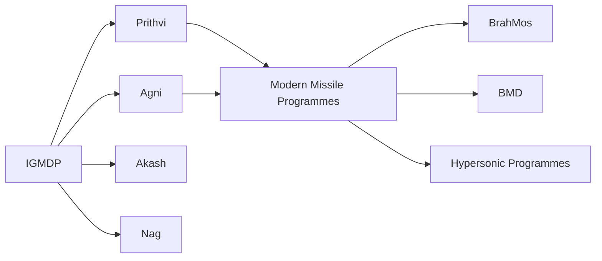
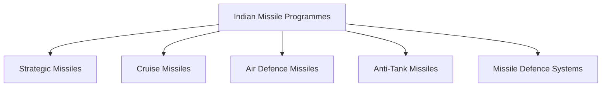
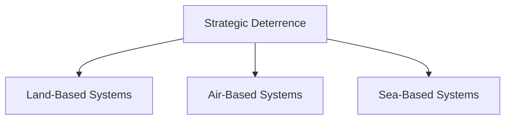
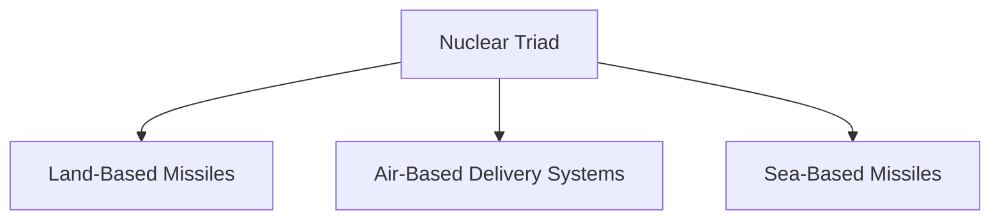

# Missile Programmes Overview

## Why It Matters

Missile programmes are a critical component of India's national-security architecture. They provide deterrence, air defence, battlefield support, maritime strike capability and strategic response options.

India has developed a diverse missile ecosystem ranging from tactical battlefield missiles to long-range strategic systems and advanced missile-defence networks.

---

## Quick Facts

| Item | Details |
|----------|----------|
| Domain | Missile Systems |
| Lead Organisation | DRDO |
| Major Programmes | IGMDP and Successor Programmes |
| Roles | Strategic, Tactical, Air Defence and Maritime Strike |
| Importance | National Security and Deterrence |
| Coverage | Land, Air, Sea and Strategic Deterrence Domains |

---

## Evolution of Indian Missile Programmes

---

## Categories of Missiles

---

## Ballistic vs Cruise Missiles

| Feature | Ballistic Missile | Cruise Missile |
|----------|----------|----------|
| Flight Path | Ballistic Trajectory | Powered Flight |
| Speed | Usually Faster | Generally Slower |
| Role | Strategic Deterrence | Precision Strike |
| Examples | Agni, Prithvi | BrahMos, Nirbhay |

Understanding this distinction is important because the two categories serve different military and strategic purposes.

---

## Strategic Missile Systems

Key systems include:

- Agni Series
- K-Series Missiles
- Hypersonic Strategic Programmes (Future Capability)
- Prithvi Series

These systems support strategic deterrence and national security.

---

## Cruise Missile Systems

Key systems include:

- BrahMos
- Nirbhay

These missiles provide precision-strike capability against land and maritime targets.

---

## Air Defence Missile Systems

Key systems include:

- Akash
- Ballistic Missile Defence Interceptors

These systems protect against aerial and missile threats.

---

## Missile Defence Architecture

India is developing a layered missile-defence architecture to strengthen national security.

---

## Strategic Deterrence Framework

Missile systems play a major role in maintaining credible deterrence.

---

## Nuclear Triad Connection

Missile systems are a critical component of India's nuclear deterrence architecture.

---

## Emerging Technologies

- Hypersonic systems
- Advanced guidance technologies
- Network-centric warfare integration
- Improved missile-defence systems
- Space-security integration

---

## Strategic Importance for India

Indian missile programmes help:

- Strengthen deterrence
- Protect national interests
- Improve military readiness
- Enhance indigenous defence capability
- Support long-term strategic stability

---

## Quick Revision

- India developed major missile systems through the IGMDP.
- Agni supports strategic deterrence.
- K-Series missiles support sea-based deterrence.
- BrahMos provides precision-strike capability.
- Akash strengthens air defence.
- BMD protects against missile threats.
- Future development includes hypersonic technologies.

---

## Key Concepts

### Why are missile programmes important?

They support deterrence, defence and national security.

### What was the IGMDP?

India's Integrated Guided Missile Development Programme.

### Which missile family supports strategic deterrence?

The Agni Series.

### What is BrahMos?

A supersonic cruise missile for precision strike missions.

### Why is missile defence important?

It protects against hostile missile attacks and strengthens national security.
