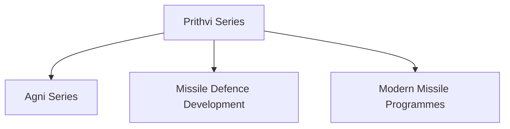

# Prithvi Series

## Why It Matters

The Prithvi Series was India's first indigenous ballistic missile family and one of the earliest successes of the Integrated Guided Missile Development Programme (IGMDP).

The programme played a major role in developing India's missile technology base and laid the foundation for later systems such as the Agni Series.

---

## Quick Facts

| Item | Details |
|----------|----------|
| Name | Prithvi Series |
| Type | Ballistic Missile Family |
| Developed By | DRDO |
| Programme | IGMDP |
| Primary Role | Tactical and Strategic Strike |
| Importance | First Indigenous Ballistic Missile Family |
| Domain | Missile and Strategic Defence |

---

## What Is the Prithvi Series?

The Prithvi Series is a family of short-range ballistic missiles developed by India.

It represented a major milestone in India's journey toward indigenous missile development and strategic self-reliance.

---

## Development Journey

---

## Why Prithvi Is Important

- First indigenous ballistic missile family
- Built India's missile-development ecosystem
- Strengthened strategic capabilities
- Supported defence self-reliance
- Created a foundation for future missile programmes
- Improved deterrence capability

---

## Major Variants

### Prithvi-I

Primarily designed for battlefield-support roles.

### Prithvi-II

Developed with enhanced operational capability and strategic utility.

### Prithvi-III

Represents further evolution of the Prithvi missile family.

---

## Ballistic Missile Concept

Ballistic missiles follow a trajectory that includes launch, midcourse flight and re-entry before reaching the target.

---

## Role in India's Missile Programme

The technologies and experience gained from the Prithvi programme contributed to future missile-development efforts.

---

## Strategic Importance

Prithvi helped India:

- Develop indigenous missile technology
- Build strategic confidence
- Improve defence capability
- Support deterrence objectives
- Strengthen national security

---

## Relationship with IGMDP

The Prithvi Series was one of the flagship projects under the Integrated Guided Missile Development Programme.

The programme also produced:

- Agni
- Akash
- Nag
- Trishul

---

## Legacy

The Prithvi programme is considered a foundational achievement in India's missile-development history and paved the way for more advanced strategic missile systems.

---

## Future Relevance

Although newer missile systems have emerged, the Prithvi programme remains important because it established the technological and industrial foundations of India's missile ecosystem.

---

## Quick Revision

- Prithvi was India's first indigenous ballistic missile family.
- Developed under the IGMDP.
- Includes Prithvi-I, Prithvi-II and Prithvi-III.
- Strengthened India's missile-development capability.
- Helped create the foundation for Agni and later programmes.
- A landmark achievement in defence self-reliance.

---

## Key Concepts

### What is the Prithvi Series?

India's first indigenous family of ballistic missiles.

### Why is Prithvi important?

It laid the foundation for India's missile-development ecosystem.

### Which programme developed Prithvi?

The Integrated Guided Missile Development Programme (IGMDP).

### How is Prithvi connected to Agni?

The experience gained through Prithvi contributed to later missile programmes such as Agni.

### Why is Prithvi historically significant?

It marked a major step toward indigenous strategic missile capability.