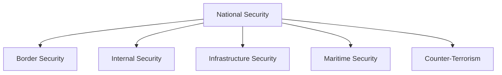
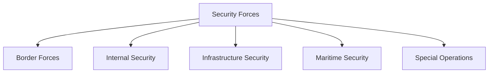

# Paramilitary Forces

## Why It Matters

India's paramilitary forces and related security organizations form a critical pillar of the country's national-security architecture.

They protect international borders, maintain internal security, secure critical infrastructure, combat terrorism, support disaster response and safeguard maritime interests.

These forces operate between the Armed Forces and state police organizations and are essential for maintaining national stability.

---

## Quick Facts

| Item | Details |
|----------|----------|
| Domain | Internal and Border Security |
| Primary Ministry | Ministry of Home Affairs |
| Supporting Ministry | Ministry of Defence (Indian Coast Guard) |
| Coverage | Borders, Internal Security, Infrastructure and Maritime Security |
| Importance | National Security Architecture |
| Operational Scope | Nationwide |

---

## Repository Structure

```text
paramilitary-forces/
├── README.md
├── paramilitary-forces-overview.md
├── assam-rifles.md
├── bsf.md
├── itbp.md
├── ssb.md
├── crpf.md
├── raf.md
├── cobra.md
├── cisf.md
├── nsg.md
└── coast-guard.md
```

---

## Security Architecture



---

## Classification of Forces



---

## Border Security Forces

| Force | Responsibility |
|----------|----------|
| Assam Rifles | India–Myanmar Border |
| BSF | India–Pakistan and India–Bangladesh Borders |
| ITBP | India–China Border |
| SSB | India–Nepal and India–Bhutan Borders |

These forces protect India's land borders and prevent infiltration, smuggling and cross-border threats.

---

## Internal Security Forces

| Force | Responsibility |
|----------|----------|
| CRPF | Internal Security |
| RAF | Riot Control and Crowd Management |
| CoBRA | Anti-Naxal Operations |

These forces support law and order, counter-insurgency operations and national-security missions.

---

## Infrastructure Security

| Force | Responsibility |
|----------|----------|
| CISF | Airports, Metros, Nuclear Facilities and Critical Infrastructure |

CISF protects strategic and economic assets that are vital to national security.

---

## Maritime Security

| Force | Responsibility |
|----------|----------|
| Indian Coast Guard | Coastal Security and Maritime Law Enforcement |

The Coast Guard protects India's coastline, EEZ and maritime interests.

---

## Counter-Terrorism Capability

| Force | Responsibility |
|----------|----------|
| NSG | Counter-Terrorism and Hostage Rescue |

NSG is India's premier counter-terrorism force.

---

## Force Comparison

| Force | Year | Ministry | Primary Role | Area |
|----------|----------|----------|----------|----------|
| Assam Rifles | 1835 | MHA / Army Control | Border Security | Myanmar Border |
| BSF | 1965 | MHA | Border Security | Pakistan & Bangladesh Borders |
| ITBP | 1962 | MHA | Border Security | China Border |
| SSB | 1963 | MHA | Border Security | Nepal & Bhutan Borders |
| CRPF | 1939 | MHA | Internal Security | Nationwide |
| RAF | 1992 | MHA | Riot Control | Nationwide |
| CoBRA | 2008 | MHA | Anti-Naxal Operations | LWE Areas |
| CISF | 1969 | MHA | Infrastructure Security | Strategic Installations |
| NSG | 1984 | MHA | Counter-Terrorism | Nationwide |
| Coast Guard | 1978 | MOD | Maritime Security | Coastline and EEZ |

---

## Importance to National Security

These forces help India:

- Secure international borders
- Maintain internal stability
- Protect strategic infrastructure
- Counter terrorism and insurgency
- Safeguard maritime interests
- Assist during disasters and emergencies

---

## Quick Revision

- Assam Rifles guards the Myanmar border.
- BSF guards Pakistan and Bangladesh borders.
- ITBP guards the China border.
- SSB guards Nepal and Bhutan borders.
- CRPF is India's largest CAPF.
- RAF specializes in riot control.
- CoBRA specializes in anti-Naxal operations.
- CISF protects critical infrastructure.
- NSG conducts counter-terrorism operations.
- Coast Guard protects maritime interests.

---

## Key Concepts

### Which force guards the India–China border?

ITBP.

### Which force protects airports and critical infrastructure?

CISF.

### Which force is responsible for internal security?

CRPF.

### Which force conducts counter-terrorism operations?

NSG.

### Which force protects India's coastline?

The Indian Coast Guard.