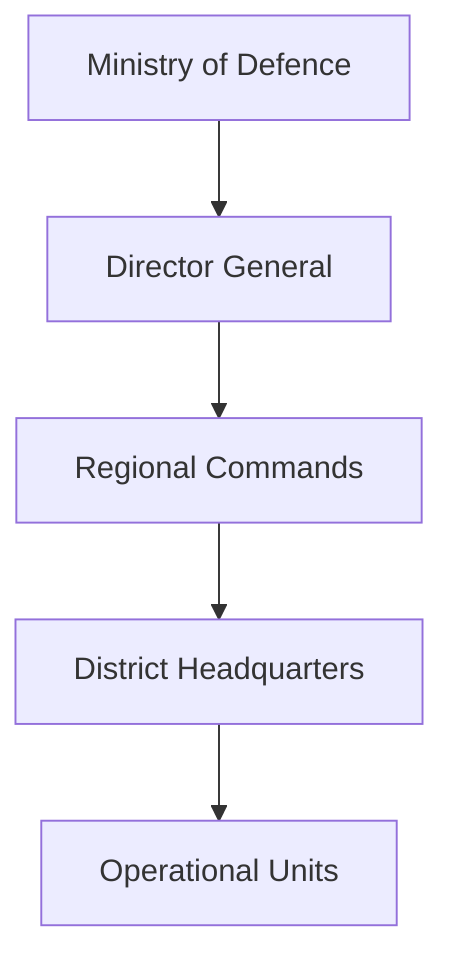
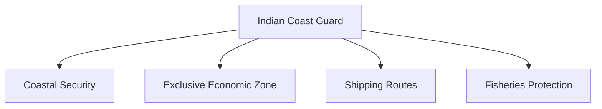
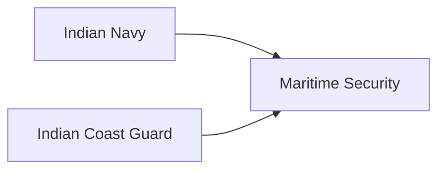

# Indian Coast Guard

## Why It Matters

The Indian Coast Guard (ICG) is India's primary maritime law-enforcement and coastal-security force.

It protects India's maritime interests, enforces maritime laws, combats smuggling, conducts search-and-rescue operations and helps secure the country's vast coastline and Exclusive Economic Zone (EEZ).

As India's maritime trade, energy security and blue-economy interests grow, the Coast Guard has become increasingly important to national security.

---

## Quick Facts

| Item | Details |
|----------|----------|
| Name | Indian Coast Guard |
| Established | 1978 |
| Ministry | Ministry of Defence |
| Headquarters | New Delhi |
| Primary Role | Maritime Law Enforcement and Coastal Security |
| Motto | Vayam Rakshamah (We Protect) |
| Type | Maritime Security Force |

---

## Historical Background

The Indian Coast Guard was established in 1978 to create a dedicated maritime-security force separate from the Indian Navy.

Its creation helped improve coastal surveillance, anti-smuggling operations and maritime law enforcement.

---

## Organisation Structure

---

## Primary Responsibilities

- Coastal security
- Maritime surveillance
- Search and rescue operations
- Anti-smuggling operations
- Protection of fishermen
- Maritime law enforcement
- Environmental protection
- Maritime disaster response

---

## Maritime Security Role

---

## Search and Rescue Operations

The Coast Guard plays a leading role in:

- Maritime rescue missions
- Emergency response at sea
- Disaster assistance
- Coordination with international rescue agencies

Its rescue network covers large areas of the Indian Ocean Region.

---

## Anti-Smuggling and Law Enforcement

Responsibilities include:

- Preventing smuggling
- Countering illegal maritime activities
- Anti-trafficking operations
- Enforcement of maritime regulations

---

## Environmental Protection Role

The Coast Guard assists in:

- Oil-spill response
- Marine pollution control
- Environmental monitoring
- Protection of marine ecosystems

---

## Relationship with the Indian Navy

While the Navy focuses on military operations and warfighting, the Coast Guard focuses on maritime security, law enforcement and rescue operations.

---

## Strategic Importance

The Coast Guard helps India:

- Secure its coastline
- Protect maritime trade routes
- Safeguard marine resources
- Strengthen coastal security
- Improve maritime domain awareness

---

## Challenges

- Expanding maritime traffic
- Smuggling networks
- Illegal fishing activities
- Maritime terrorism
- Environmental incidents
- Large area of responsibility

---

## Future Roadmap

- More offshore patrol vessels
- Enhanced surveillance systems
- Better coastal radar networks
- Improved maritime domain awareness
- Greater technology integration

---

## Quick Revision

- Indian Coast Guard was established in 1978.
- Operates under the Ministry of Defence.
- Responsible for coastal security and maritime law enforcement.
- Conducts search-and-rescue operations.
- Protects India's maritime interests and EEZ.
- Supports environmental protection and anti-smuggling operations.

---

## Key Concepts

### What is the Indian Coast Guard?

India's primary maritime-security and coastal-protection force.

### Why was the Coast Guard established?

To provide dedicated maritime law enforcement and coastal security.

### Which ministry controls the Coast Guard?

The Ministry of Defence.

### How is the Coast Guard different from the Navy?

The Coast Guard focuses on maritime security and law enforcement, while the Navy focuses on military operations and warfighting.

### Why is the Coast Guard important?

It protects India's coastline, maritime trade and marine resources.