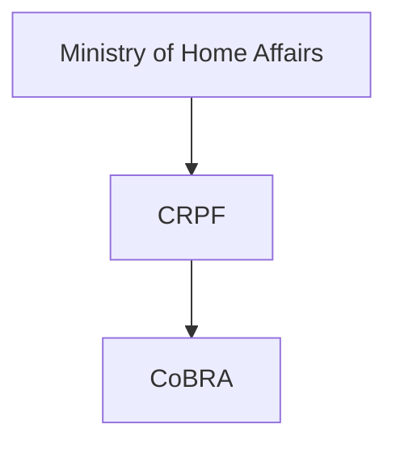
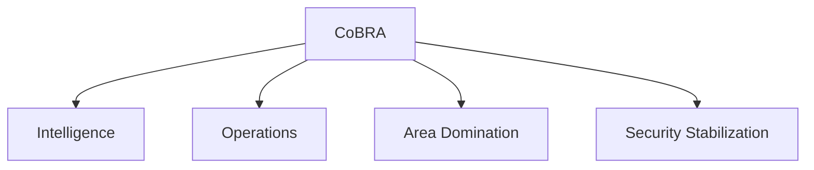
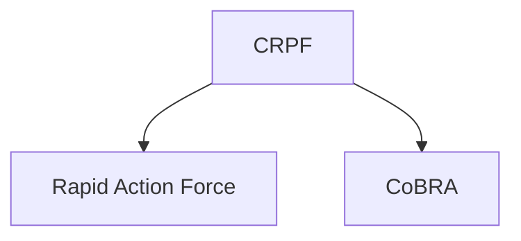

# Commando Battalion for Resolute Action (CoBRA)

## Why It Matters

The Commando Battalion for Resolute Action (CoBRA) is a specialized unit of the Central Reserve Police Force (CRPF) created to conduct operations against Left-Wing Extremism (LWE) and insurgent threats.

CoBRA is trained in jungle warfare, intelligence-based operations and high-risk missions in difficult terrain. It is one of India's most important specialized internal-security forces.

---

## Quick Facts

| Item | Details |
|----------|----------|
| Name | Commando Battalion for Resolute Action (CoBRA) |
| Established | 2008 |
| Parent Force | CRPF |
| Ministry | Ministry of Home Affairs |
| Headquarters | New Delhi |
| Primary Role | Anti-Naxal Operations |
| Specialization | Jungle Warfare |

---

## Historical Background

CoBRA was established in 2008 to strengthen India's capability to combat Left-Wing Extremism and conduct specialized operations in forested and remote regions.

The force was designed to provide highly trained commandos capable of operating in challenging environments.

---

## Organisation Structure

---

## What Is CoBRA?

CoBRA is a specialized commando force within the CRPF that focuses on:

- Anti-Naxal operations
- Jungle warfare
- Intelligence-based missions
- High-risk security operations
- Area domination patrols

---

## Anti-Naxal Operations

CoBRA units play a major role in operations against Left-Wing Extremist groups.

---

## Jungle Warfare Specialization

The force is trained in:

- Jungle combat
- Survival techniques
- Long-range patrols
- Ambush and counter-ambush tactics
- Navigation in difficult terrain

These skills make CoBRA highly effective in forested operational environments.

---

## Intelligence-Based Operations

CoBRA places strong emphasis on intelligence-driven operations to improve effectiveness and reduce risk.

---

## Operational Areas

CoBRA is deployed primarily in regions affected by:

- Left-Wing Extremism
- Insurgency-related violence
- Security challenges in remote and forested areas

---

## Relationship with CRPF

CoBRA functions as a specialized operational arm of the CRPF.

---

## Strategic Importance

CoBRA helps India:

- Combat Left-Wing Extremism
- Improve internal security
- Conduct specialized operations
- Enhance intelligence-led security efforts
- Support stabilization in affected regions

---

## Challenges

- Difficult terrain
- Dense forests
- Remote operational areas
- Evolving insurgent tactics
- Logistics and communication constraints

---

## Future Roadmap

- Advanced surveillance technologies
- Better intelligence integration
- Modern equipment and mobility
- Enhanced jungle-warfare training
- Greater use of technology-enabled operations

---

## Quick Revision

- CoBRA stands for Commando Battalion for Resolute Action.
- Established in 2008.
- Operates under the CRPF.
- Specializes in anti-Naxal operations.
- Expert in jungle warfare.
- Functions under the Ministry of Home Affairs.

---

## Key Concepts

### What is CoBRA?

A specialized CRPF commando force focused on anti-Naxal and jungle-warfare operations.

### Why was CoBRA created?

To strengthen India's capability against Left-Wing Extremism.

### Which organization controls CoBRA?

The CRPF under the Ministry of Home Affairs.

### What is CoBRA's specialization?

Jungle warfare and intelligence-based operations.

### Why is CoBRA important?

It provides specialized capabilities for challenging internal-security operations.