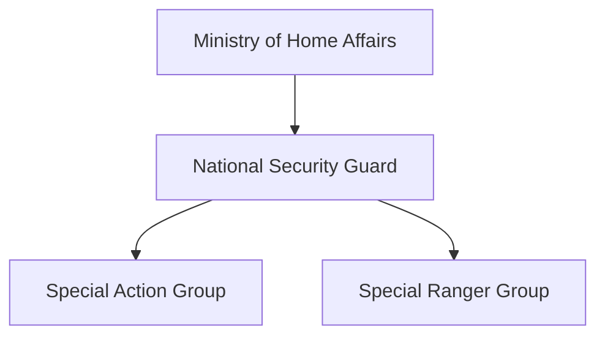

# National Security Guard (NSG)

## Why It Matters

The National Security Guard (NSG) is India's premier counter-terrorism and hostage-rescue force.

Popularly known as the 'Black Cats', the NSG is trained to respond to high-risk terrorist incidents, hostage situations, aircraft hijackings and other national-security emergencies requiring specialized intervention.

The force represents one of India's most elite security organizations and serves as a critical component of the country's counter-terrorism architecture.

---

## Quick Facts

| Item | Details |
|----------|----------|
| Name | National Security Guard (NSG) |
| Established | 1984 |
| Ministry | Ministry of Home Affairs |
| Headquarters | Manesar, Haryana |
| Primary Role | Counter-Terrorism |
| Nickname | Black Cats |
| Type | Federal Contingency Force |

---

## Historical Background

The NSG was established in 1984 following major national-security challenges that highlighted the need for a dedicated counter-terrorism force.

The organization was designed to provide rapid-response capability for terrorist incidents and other high-risk situations.

---

## Organisation Structure

---

## Special Action Group (SAG)

The SAG consists primarily of personnel drawn from the Armed Forces.

Responsibilities include:

- Counter-terrorism operations
- Hostage rescue missions
- Direct action tasks
- High-risk intervention operations

---

## Special Ranger Group (SRG)

The SRG supports NSG operations through:

- Perimeter security
- Operational support
- Area isolation
- Security coordination

---

## Counter-Terrorism Role

NSG is deployed for situations requiring specialized counter-terrorism capability beyond normal law-enforcement resources.

---

## Hostage Rescue Operations

The force is specially trained for:

- Building intervention
- Aircraft intervention
- Hostage rescue
- Close-quarters combat
- Urban counter-terrorism operations

---

## Major Operations

### Operation Black Thunder

NSG played an important role in anti-terror operations associated with Punjab's insurgency period.

### 26/11 Mumbai Attacks

NSG commandos were deployed during the 2008 Mumbai terrorist attacks and conducted operations at multiple locations to neutralize terrorists and rescue hostages.

---

## Training and Capabilities

NSG personnel receive specialized training in:

- Counter-terrorism tactics
- Precision shooting
- Urban warfare
- Explosive handling
- Hostage rescue
- Special operations planning

---

## Strategic Importance

NSG helps India:

- Respond to terrorist incidents
- Conduct hostage-rescue missions
- Strengthen national-security preparedness
- Protect critical targets during emergencies
- Enhance counter-terrorism capability

---

## Challenges

- Evolving terrorist tactics
- Urban-security threats
- Rapid-response requirements
- Technology-enabled threats
- Complex hostage situations

---

## Future Roadmap

- Advanced counter-terrorism equipment
- Better intelligence integration
- Enhanced urban-warfare capability
- Improved rapid-response infrastructure
- Continued modernization and specialized training

---

## Quick Revision

- NSG was established in 1984.
- Known as the Black Cats.
- Operates under the Ministry of Home Affairs.
- India's premier counter-terrorism force.
- Contains SAG and SRG components.
- Played a major role during the 26/11 Mumbai attacks.

---

## Key Concepts

### What is NSG?

India's premier counter-terrorism and hostage-rescue force.

### Why was NSG established?

To provide specialized response capability for terrorist incidents and national-security emergencies.

### What are SAG and SRG?

The primary operational components of the NSG.

### Why is NSG called the Black Cats?

Because of its distinctive black combat uniform and elite special-forces image.

### Why is NSG important?

It provides specialized capabilities for handling high-risk terrorist and hostage situations.