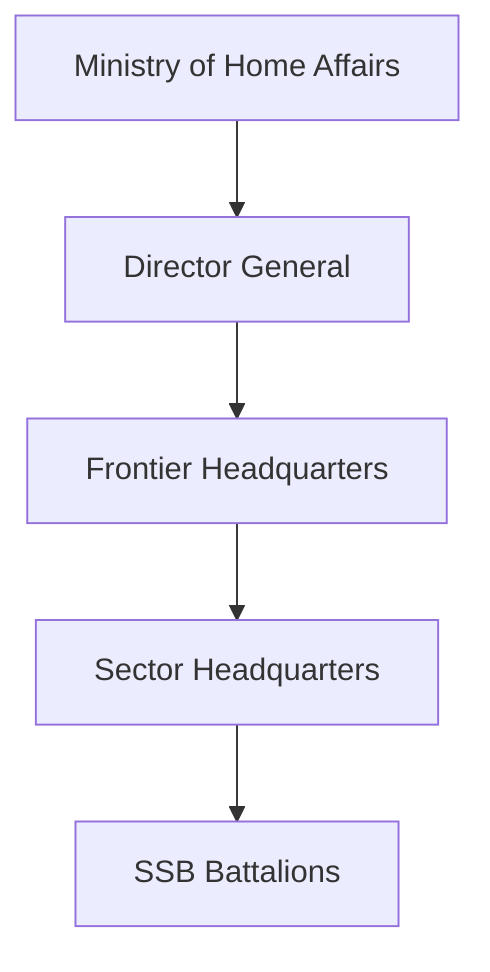
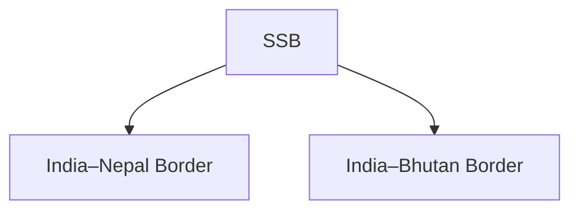

# Sashastra Seema Bal (SSB)

## Why It Matters

The Sashastra Seema Bal (SSB) is India's dedicated border-guarding force responsible for securing the India–Nepal and India–Bhutan borders.

In addition to border security, the force plays an important role in intelligence gathering, preventing trans-border crime, supporting local communities and strengthening national security in border regions.

---

## Quick Facts

| Item | Details |
|----------|----------|
| Name | Sashastra Seema Bal (SSB) |
| Established | 1963 |
| Ministry | Ministry of Home Affairs |
| Headquarters | New Delhi |
| Primary Role | Border Security |
| Borders Guarded | Nepal and Bhutan |
| Type | Central Armed Police Force |

---

## Historical Background

The force was originally raised after the 1962 Sino-Indian War.

Over time, its role evolved and it was assigned responsibility for guarding the India–Nepal and India–Bhutan borders.

---

## Organisation Structure

---

## Primary Responsibilities

- Border guarding
- Border patrols
- Intelligence gathering
- Counter-smuggling operations
- Prevention of illegal crossings
- Support to local administration
- Civic-action programmes

---

## Border Responsibility

SSB guards the open borders shared by India with Nepal and Bhutan.

---

## Border Population Outreach

The force works closely with border communities through:

- Civic-action programmes
- Medical camps
- Awareness campaigns
- Community engagement initiatives

---

## Intelligence and Surveillance

SSB supports national security through:

- Border intelligence collection
- Surveillance activities
- Monitoring illegal movement
- Information sharing with security agencies

---

## Strategic Importance

SSB helps India:

- Secure open borders
- Prevent trans-border crime
- Improve border management
- Strengthen local-community engagement
- Enhance national security

---

## Challenges

- Open-border management
- Smuggling networks
- Human trafficking
- Illegal migration
- Difficult terrain in some sectors

---

## Future Roadmap

- Better surveillance systems
- Smart border technologies
- Enhanced intelligence capability
- Improved communication networks
- Greater technology integration

---

## Quick Revision

- SSB was established in 1963.
- Operates under the Ministry of Home Affairs.
- Guards the India–Nepal border.
- Guards the India–Bhutan border.
- Focuses on border security and intelligence.
- Works closely with border communities.

---

## Key Concepts

### What is SSB?

India's border-security force for the Nepal and Bhutan borders.

### Why is SSB important?

It secures open borders and helps prevent trans-border crime.

### Which borders does SSB guard?

The India–Nepal and India–Bhutan borders.

### Which ministry controls SSB?

The Ministry of Home Affairs.

### What makes SSB unique?

Its focus on open-border management and community engagement.