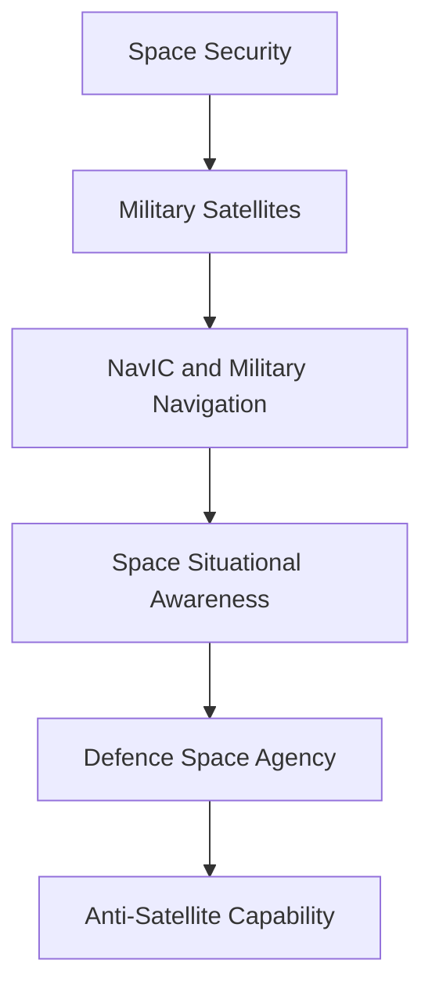
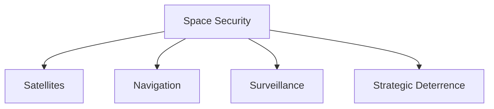

# Space Security

## Why It Matters

Space has become a critical domain for national security, military operations, communications, navigation, surveillance and strategic deterrence.

Modern armed forces depend heavily on satellites for intelligence gathering, precision targeting, navigation, secure communications and early warning capabilities.

India's growing space capabilities support both civilian development and national-security objectives.

---

## Quick Facts

| Item | Details |
|----------|----------|
| Domain | Space Security |
| Importance | National Security and Strategic Deterrence |
| Key Organisations | ISRO, Defence Space Agency |
| Focus Areas | Satellites, Surveillance, Navigation and Space Warfare |
| Operational Domain | Space |

---

## Repository Structure

```text
space-security/
├── README.md
├── anti-satellite-capability.md
├── military-satellites.md
├── navic-and-military-navigation.md
├── defence-space-agency.md
└── space-situational-awareness.md
```

---

## Learning Roadmap



---

## Core Themes

### Military Satellites

Support:

- Communications
- Intelligence gathering
- Navigation
- Surveillance
- Reconnaissance

### NavIC and Military Navigation

Supports:

- Positioning
- Navigation
- Timing services
- Precision operations
- Strategic autonomy

### Space Situational Awareness

Helps monitor:

- Satellites
- Space debris
- Orbital activities
- Potential threats in space
- Collision risks

### Defence Space Agency

Supports:

- Military space coordination
- Space-security planning
- Joint military operations
- Space-domain awareness
- Defence-space capability development

### Counter-Space Capability

Includes:

- Anti-satellite capability
- Space protection measures
- Strategic deterrence mechanisms

---

## Space Security Architecture



---

## Strategic Importance

Space security helps India:

- Protect critical infrastructure
- Support military operations
- Improve situational awareness
- Strengthen deterrence capability
- Enhance national-security preparedness

---

## Quick Revision

- Space is a critical military domain.
- Military satellites support communications, navigation and intelligence.
- NavIC provides indigenous navigation capability.
- Defence Space Agency coordinates military space activities.
- Satellites support communications and surveillance.
- Navigation systems support military operations.
- Space situational awareness improves preparedness.
- Anti-satellite capability supports deterrence.
- Space security is increasingly important for modern warfare.

---

## Key Concepts

### Why is space security important?

Modern military operations depend heavily on space-based systems.

### What are military satellites used for?

Communications, navigation, surveillance and intelligence.

### What is space situational awareness?

The ability to monitor objects and activities in space.

### What is anti-satellite capability?

The capability to disable or destroy hostile satellites.

### Why is space becoming a security domain?

Because military, economic and strategic systems increasingly depend on space infrastructure.
