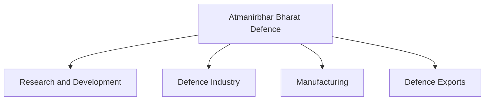

# Atmanirbhar Bharat in Defence

## Why It Matters

Atmanirbhar Bharat in Defence is India's initiative to reduce dependence on foreign military imports and build a strong indigenous defence-industrial ecosystem.

The objective is not only to manufacture defence equipment within India but also to develop domestic research, innovation, production and export capabilities.

A self-reliant defence sector strengthens national security, improves strategic autonomy and supports economic growth.

---

## Quick Facts

| Item | Details |
|----------|----------|
| Initiative | Atmanirbhar Bharat |
| Domain | Defence Self-Reliance |
| Lead Ministry | Ministry of Defence |
| Objective | Indigenous Defence Capability |
| Focus Areas | Research, Manufacturing and Exports |
| Importance | Strategic Independence |

---

## What is Atmanirbhar Bharat in Defence?

Atmanirbhar Bharat in Defence aims to create a defence ecosystem where India can:

- Design defence systems
- Develop military technologies
- Manufacture defence equipment
- Reduce import dependence
- Increase defence exports

The initiative supports long-term military modernization and national security.

---

## Why Self-Reliance Matters

A country that can develop and produce critical defence systems has greater strategic flexibility during crises and conflicts.

---

## Key Objectives

- Reduce defence imports
- Strengthen domestic manufacturing
- Promote indigenous technology development
- Encourage private-sector participation
- Increase defence exports
- Build a globally competitive defence industry

---

## Major Pillars

---

## Role of DRDO

DRDO supports Atmanirbhar Bharat through:

- Indigenous technology development
- Missile programmes
- Radar systems
- Electronic warfare systems
- Defence innovation initiatives

DRDO forms the technological backbone of defence self-reliance.

---

## Role of Indian Defence Industry

The defence industry includes:

- Public Sector Undertakings (PSUs)
- Private defence companies
- Startups
- MSMEs
- Research institutions

Together they contribute to the development and production of defence equipment.

---

## Positive Indigenisation Lists

The Ministry of Defence periodically releases lists of defence equipment that are targeted for indigenous procurement.

Objectives include:

- Encouraging domestic production
- Reducing imports
- Supporting Indian industry
- Accelerating self-reliance

---

## Defence Exports

Growing defence exports help strengthen India's defence-industrial base and international partnerships.

---

## Benefits of Atmanirbhar Bharat in Defence

- Greater strategic autonomy
- Reduced import dependence
- Stronger national security
- Technology development
- Employment generation
- Export growth
- Industrial development

---

## Challenges

- Advanced technology gaps
- Long development cycles
- High research costs
- Global competition
- Manufacturing scale requirements
- Supply-chain challenges

---

## Future Roadmap

- Advanced indigenous platforms
- Stronger defence-industrial ecosystem
- Increased defence exports
- Greater private-sector participation
- Enhanced research and innovation
- Improved global competitiveness

---

## Quick Revision

- Atmanirbhar Bharat promotes defence self-reliance.
- Focuses on indigenous design and manufacturing.
- Supports strategic autonomy.
- DRDO plays a major role in technology development.
- Encourages private-sector participation.
- Aims to increase defence exports.

---

## Key Concepts

### What is Atmanirbhar Bharat in Defence?

India's initiative to achieve greater self-reliance in defence technologies and manufacturing.

### Why is defence self-reliance important?

It reduces dependence on foreign suppliers and strengthens national security.

### Which organisation drives defence technology development?

DRDO.

### What is the goal of indigenisation?

To develop and manufacture defence equipment within India.

### How does Atmanirbhar Bharat support national security?

By improving strategic autonomy and strengthening domestic defence capability.
