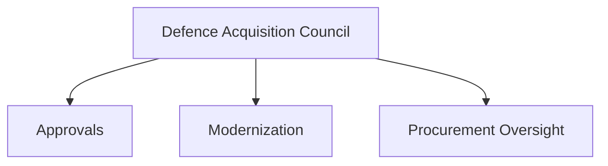
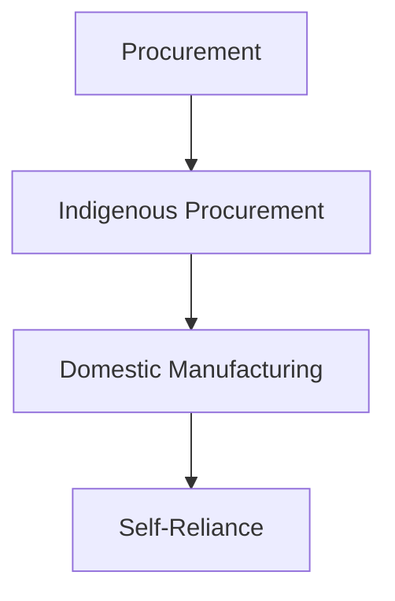

# Defence Procurement Process

## Why It Matters

The defence procurement process is the mechanism through which India acquires military equipment, platforms, weapons and technologies required by the Armed Forces.

A well-functioning procurement system ensures that the Indian Army, Indian Navy and Indian Air Force receive the capabilities needed to maintain operational readiness and support long-term modernization.

The procurement process also plays a major role in promoting indigenous defence manufacturing and strategic self-reliance.

---

## Quick Facts

| Item | Details |
|----------|----------|
| Domain | Defence Acquisition |
| Lead Ministry | Ministry of Defence |
| Apex Body | Defence Acquisition Council (DAC) |
| Objective | Capability Development |
| Focus | Procurement and Modernization |
| Importance | Military Readiness |

---

## What is Defence Procurement?

Defence procurement refers to the process of identifying military requirements, evaluating solutions, approving acquisitions and inducting equipment into service.

The process aims to ensure transparency, efficiency and capability enhancement.

---

## Procurement Lifecycle

---

## Need Identification

The procurement cycle begins when the Armed Forces identify capability gaps or future operational requirements.

Examples include:

- Fighter aircraft
- Warships
- Submarines
- Missile systems
- Air-defence systems
- Surveillance platforms

---

## Acceptance of Necessity (AoN)

AoN is a formal approval that confirms a military requirement exists and procurement can proceed.

It is a critical step before acquisition activities begin.

---

## Defence Acquisition Council (DAC)

The DAC is the highest decision-making body for defence acquisitions and is chaired by the Defence Minister.

---

## Procurement Categories

### Buy (Indian)

Priority is given to equipment designed, developed and manufactured in India.

### Buy and Make

Combines foreign technology with domestic production.

### Buy and Make (Indian)

Encourages indigenous manufacturing with technology support where required.

### Buy (Global)

Used when suitable domestic solutions are unavailable.

---

## Trials and Evaluation

Potential systems undergo:

- Technical evaluation
- Field trials
- Performance testing
- Operational assessment

These steps help ensure that equipment meets military requirements.

---

## Contract Signing

Following successful evaluation and approvals, contracts are finalized with vendors.

The contract defines:

- Cost
- Delivery schedule
- Technical requirements
- Support obligations

---

## Delivery and Induction

After delivery, equipment is integrated into operational units.

---

## Role of Atmanirbhar Bharat

Modern procurement policies increasingly prioritize indigenous defence production.

---

## Strategic Importance

The procurement process helps India:

- Modernize the Armed Forces
- Improve military readiness
- Strengthen defence self-reliance
- Enhance operational capability
- Support long-term strategic planning

---

## Challenges

- Long acquisition timelines
- Rapid technological change
- Cost escalation risks
- Complex testing requirements
- Balancing imports and indigenization

---

## Future Roadmap

- Faster procurement cycles
- Greater indigenous content
- Increased private-sector participation
- Technology-focused acquisitions
- Better long-term capability planning

---

## Quick Revision

- Procurement begins with capability requirements.
- AoN is a key approval stage.
- DAC is the apex acquisition body.
- Trials and evaluation verify performance.
- Contracts lead to delivery and induction.
- Procurement increasingly supports Atmanirbhar Bharat.

---

## Key Concepts

### What is defence procurement?

The process of acquiring military equipment and capabilities.

### What is Acceptance of Necessity (AoN)?

Formal approval that allows a procurement proposal to proceed.

### Which body oversees major acquisitions?

The Defence Acquisition Council (DAC).

### Why are trials important?

They ensure equipment meets operational requirements.

### How does procurement support self-reliance?

By prioritizing indigenous design, development and manufacturing.
