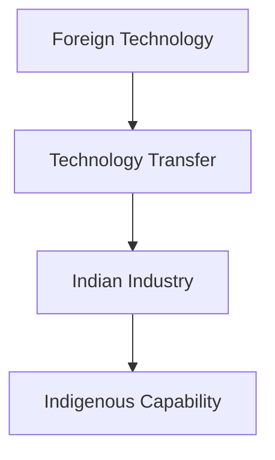

# Defence Offset Policy

## Why It Matters

The Defence Offset Policy is a mechanism used to leverage major defence purchases for the development of India's domestic defence-industrial ecosystem.

The policy aims to ensure that large defence contracts contribute to technology transfer, industrial capability development, skill enhancement and long-term defence self-reliance.

It has been an important component of India's efforts to strengthen indigenous defence manufacturing and reduce dependence on imports.

---

## Quick Facts

| Item | Details |
|----------|----------|
| Policy | Defence Offset Policy |
| Domain | Defence Procurement |
| Objective | Industrial and Technological Development |
| Linked To | Defence Acquisitions |
| Focus Areas | Technology, Manufacturing and Capability Development |
| Importance | Defence Self-Reliance |

---

## What is a Defence Offset?

A defence offset is an obligation imposed on foreign defence suppliers to invest, source products or transfer technology into the domestic economy as part of a defence contract.

The objective is to generate long-term benefits beyond the purchase of military equipment.

---

## Why Were Offsets Introduced?

Offsets were introduced to:

- Strengthen domestic industry
- Encourage technology transfer
- Develop manufacturing capability
- Promote defence self-reliance
- Create employment opportunities
- Build long-term industrial capacity

---

## How Defence Offsets Work

---

## Direct Offsets

Direct offsets involve activities directly related to defence production.

Examples include:

- Defence manufacturing
- Component production
- Defence-system integration
- Supply-chain development

These activities directly strengthen defence capability.

---

## Indirect Offsets

Indirect offsets may involve broader industrial or technological activities that contribute to economic and industrial development.

They support capability creation beyond specific defence programmes.

---

## Technology Transfer

Technology transfer is one of the most important expected benefits of defence offsets.

---

## Industrial Development

Offsets can help:

- Build supplier networks
- Improve manufacturing capability
- Strengthen defence ecosystems
- Encourage investment
- Support innovation

These benefits contribute to long-term industrial growth.

---

## Relationship with Atmanirbhar Bharat

Offsets support broader defence self-reliance objectives.

---

## Benefits of the Offset Policy

- Technology access
- Industrial development
- Supply-chain growth
- Skill development
- Increased domestic participation
- Stronger defence ecosystem

---

## Strategic Importance

The policy helps India:

- Improve defence-industrial capability
- Reduce import dependence
- Strengthen manufacturing capacity
- Promote technology absorption
- Support long-term modernization

---

## Challenges

- Technology-transfer limitations
- Implementation complexity
- Measuring long-term impact
- Absorption capability constraints
- Global competition

---

## Future Roadmap

- Greater focus on advanced technologies
- Improved industrial partnerships
- Stronger domestic manufacturing capability
- Better technology absorption
- Alignment with self-reliance goals

---

## Quick Revision

- Defence offsets are linked to major defence contracts.
- They promote technology transfer and industrial development.
- Support domestic manufacturing capability.
- Strengthen defence self-reliance.
- Contribute to Atmanirbhar Bharat objectives.
- Help develop India's defence-industrial ecosystem.

---

## Key Concepts

### What is a defence offset?

An obligation requiring foreign defence suppliers to contribute to domestic industrial or technological development.

### Why are offsets important?

They help strengthen indigenous capability and reduce import dependence.

### What is technology transfer?

The sharing of technical knowledge, expertise or production capability.

### How do offsets support self-reliance?

By strengthening domestic manufacturing and technological capability.

### What is the ultimate objective of defence offsets?

To create long-term defence-industrial and technological capability within India.
