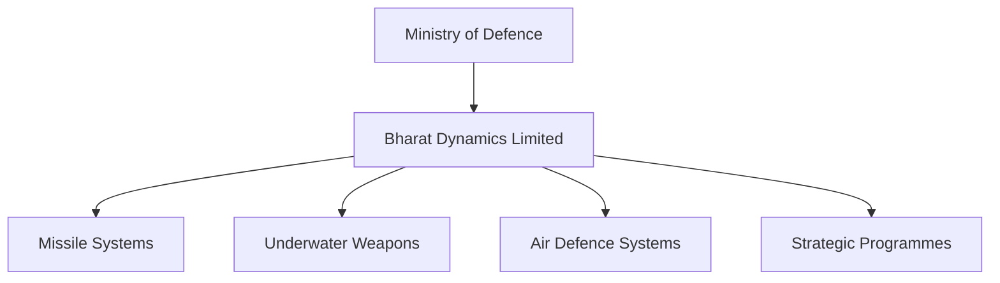

# Bharat Dynamics Limited (BDL)

## Why It Matters

Bharat Dynamics Limited (BDL) is one of India's most important defence manufacturing companies. It is the primary missile production agency of India and plays a major role in supporting the Indian Armed Forces with indigenous missile systems, underwater weapons, and strategic defence equipment.

BDL is a key pillar of India's defence self-reliance and Atmanirbhar Bharat initiative.

---

## Quick Facts

| Item | Details |
|--------|--------|
| Full Name | Bharat Dynamics Limited |
| Established | 1970 |
| Headquarters | Hyderabad, Telangana |
| Ministry | Ministry of Defence |
| Ownership | Government of India Defence PSU |
| Category | Defence Manufacturing Company |
| Listed On | NSE and BSE |
| Primary Focus | Missiles and Strategic Weapon Systems |

---

## Organisation Structure

---

## Why BDL Was Created

India initially depended heavily on foreign suppliers for advanced missile systems.

BDL was established to:

- Manufacture guided missiles for the armed forces
- Support DRDO missile programmes
- Reduce import dependency
- Build indigenous defence manufacturing capability
- Strengthen strategic deterrence

---

## Major Responsibilities

- Manufacturing missile systems
- Production of strategic weapons
- Integration of missile components
- Testing and quality assurance
- Lifecycle support and maintenance
- Technology absorption from DRDO and foreign partners
- Export of defence equipment

---

## Major Missile Systems Produced

| Missile System | Type |
|----------|----------|
| Akash | Surface-to-Air Missile |
| Astra | Air-to-Air Missile |
| Konkurs | Anti-Tank Guided Missile |
| Milan | Anti-Tank Guided Missile |
| Nag | Anti-Tank Guided Missile |
| Helina | Helicopter-Launched Anti-Tank Missile |
| QRSAM | Quick Reaction Surface-to-Air Missile |
| MRSAM Components | Medium Range Surface-to-Air Missile |

---

## DRDO-BDL Relationship

BDL acts as the primary production partner for several DRDO-developed missile programmes.

---

## Manufacturing Facilities

Major production facilities are located in:

- Hyderabad
- Bhanur
- Visakhapatnam
- Ibrahimpatnam
- Amaravati region projects

These facilities support missile assembly, testing, integration, and maintenance activities.

---

## Role in Atmanirbhar Bharat

BDL contributes to self-reliance by:

- Manufacturing indigenous missile systems
- Increasing local content in defence production
- Supporting defence exports
- Strengthening India's defence industrial base
- Reducing dependence on foreign suppliers

---

## Challenges

- Rapid technological changes
- Competition from global defence manufacturers
- Need for higher export penetration
- Supply-chain dependency on specialised components
- Requirement for continuous R&D collaboration

---

## Future Roadmap

- Expansion of missile manufacturing capacity
- Greater defence exports
- Advanced air-defence programmes
- New-generation anti-tank systems
- Integration with emerging defence technologies
- Stronger collaboration with private industry

---

## Quick Revision

- Established in 1970.
- Headquarters in Hyderabad.
- Defence PSU under Ministry of Defence.
- India's primary missile production company.
- Major manufacturing partner for DRDO missile programmes.
- Produces Akash, Astra, Nag, Helina and other missile systems.
- Supports Atmanirbhar Bharat and defence exports.

---

## Key Concepts

### What is Bharat Dynamics Limited?

A Government of India defence public sector company primarily responsible for manufacturing missile systems and strategic weapons.

### Why is BDL important?

It provides indigenous missile production capability and supports India's defence self-reliance.

### Which organisation designs most indigenous missile systems?

DRDO designs many missile systems, while BDL manufactures them.

### Which ministry controls BDL?

The Ministry of Defence.

### What is BDL best known for?

Manufacturing missile systems for the Indian Armed Forces.
