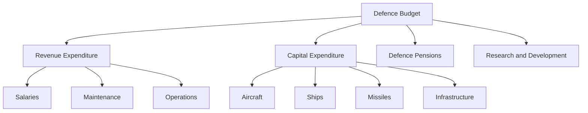
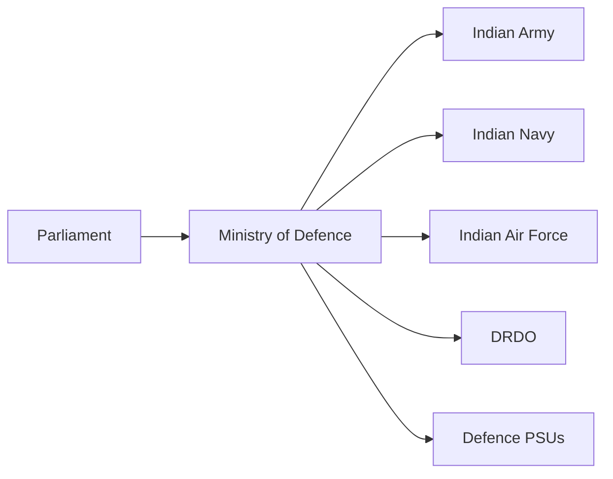

# Defence Budget of India

## Why It Matters

India maintains one of the world's largest armed forces and faces security challenges across land, sea, air, cyber, and space domains.

The defence budget determines how much money is available for military readiness, modernization, salaries, pensions, infrastructure, research, and procurement of new weapons and equipment.

Defence spending directly impacts India's national security and military capability.

---

## Quick Facts

| Item | Details |
|----------|----------|
| Prepared By | Ministry of Defence |
| Approved By | Parliament of India |
| Included In | Union Budget |
| Covers | Army, Navy, Air Force and Defence Organisations |
| Major Components | Revenue Expenditure and Capital Expenditure |
| Objective | National Security and Military Modernization |

---

## Defence Budget Structure

---

## Major Components

### Revenue Expenditure

Used for day-to-day military operations.

Includes:

- Salaries and allowances
- Fuel and logistics
- Equipment maintenance
- Training activities
- Operational readiness

### Capital Expenditure

Used for acquiring new military assets.

Includes:

- Fighter aircraft
- Warships and submarines
- Tanks and artillery
- Missile systems
- Air-defence systems
- Military infrastructure

### Defence Pensions

Provides pension benefits to retired military personnel.

### Research and Development

Supports:

- DRDO programmes
- Indigenous technologies
- Strategic weapon systems
- Future military capabilities

---

## Budget Flow

---

## Major Areas of Spending

| Area | Purpose |
|----------|----------|
| Personnel | Salaries and Allowances |
| Modernization | New Weapons and Platforms |
| Infrastructure | Bases, Roads and Facilities |
| Research | Defence Innovation |
| Logistics | Supply and Operational Support |
| Strategic Forces | Nuclear Deterrence |
| Border Security | Surveillance and Protection |

---

## Importance of Capital Modernization

Modernization spending helps India:

- Replace aging equipment
- Improve combat readiness
- Strengthen deterrence capability
- Enhance technological superiority
- Reduce dependence on imports

---

## Role in Atmanirbhar Bharat

Defence budget allocations increasingly focus on:

- Indigenous procurement
- Domestic defence manufacturing
- Startup participation
- Defence innovation
- Defence exports

This strengthens India's defence industrial ecosystem.

---

## Challenges

- Rising personnel costs
- Balancing pensions and modernization
- Expensive imported systems
- Rapid technological changes
- Multi-front security requirements

---

## Future Roadmap

- Greater indigenous procurement
- Increased defence R&D investment
- AI-enabled military systems
- Cyber and space defence spending
- Advanced missile programmes
- Modernization of all three services

---

## Quick Revision

- Defence budget is part of the Union Budget.
- Managed by the Ministry of Defence.
- Covers Army, Navy, Air Force, DRDO and defence organizations.
- Divided into revenue and capital expenditure.
- Capital expenditure funds modernization.
- Supports Atmanirbhar Bharat and military preparedness.

---

## Key Concepts

### What is the defence budget?

The annual allocation of funds for India's defence and national security requirements.

### What is revenue expenditure?

Money spent on salaries, maintenance, logistics, and day-to-day operations.

### What is capital expenditure?

Money spent on new military equipment, weapons, infrastructure, and modernization.

### Why is modernization important?

It ensures that the armed forces remain technologically capable and combat-ready.

### Why is the defence budget important?

It directly influences India's military strength, preparedness, and national security.
