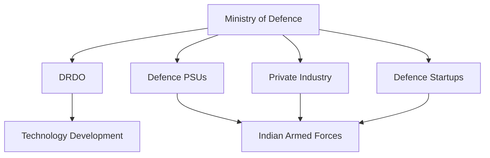

# Defence Production Ecosystem of India

## Why It Matters

India's defence production ecosystem consists of government organizations, defence public sector undertakings, private companies, startups, research institutions, and the armed forces working together to design, develop, manufacture, and maintain military equipment.

A strong defence production ecosystem reduces import dependency, improves national security, generates employment, and supports Atmanirbhar Bharat.

---

## Quick Facts

| Item | Details |
|----------|----------|
| Lead Ministry | Ministry of Defence |
| Objective | Defence Self-Reliance |
| Key Players | DRDO, DPSUs, Armed Forces, Private Industry |
| Focus Areas | Weapons, Aircraft, Ships, Electronics, Missiles |
| National Goal | Atmanirbhar Bharat |
| Export Objective | Global Defence Supplier |

---

## Defence Production Ecosystem Overview

---

## Core Components

### Ministry of Defence

Responsible for:

- Defence policy
- Procurement decisions
- Budget allocation
- Strategic planning
- Defence modernization

### DRDO

Responsible for:

- Research and development
- Indigenous technologies
- Missile systems
- Strategic programmes
- Defence innovation

### Defence Public Sector Undertakings (DPSUs)

Major DPSUs include:

| Organisation | Primary Area |
|----------|----------|
| HAL | Aircraft and Aerospace |
| BEL | Defence Electronics |
| BDL | Missile Production |
| MDL | Submarines and Warships |
| GRSE | Naval Shipbuilding |
| GSL | Naval Platforms |

---

### Private Sector

Supports:

- Defence manufacturing
- Components and subsystems
- Advanced engineering
- Aerospace production
- Defence exports

Major participants include large industrial groups and emerging defence companies.

---

### Defence Startups

Focus on:

- Drones
- AI systems
- Robotics
- Autonomous platforms
- Cybersecurity
- Space technologies

---

## Production Flow

---

## Major Production Areas

| Sector | Examples |
|----------|----------|
| Aerospace | Fighter Aircraft, Helicopters |
| Naval Systems | Warships, Submarines |
| Missiles | Akash, Astra, Nag |
| Electronics | Radars, Communications |
| Land Systems | Tanks, Artillery |
| Cyber Systems | Network Security |
| Space Systems | Military Satellites |

---

## Role of Atmanirbhar Bharat

Key objectives:

- Increase indigenous content
- Reduce imports
- Expand defence exports
- Support domestic industry
- Encourage innovation

---

## Defence Corridors

India has established defence industrial corridors to strengthen manufacturing capability.

Major corridors:

- Uttar Pradesh Defence Corridor
- Tamil Nadu Defence Corridor

These attract investment, suppliers, and technology development.

---

## Benefits of Indigenous Production

- Strategic autonomy
- Reduced foreign dependency
- Faster maintenance and support
- Employment generation
- Technology development
- Export opportunities

---

## Challenges

- Advanced technology gaps
- Import dependency in critical components
- Long development cycles
- Global competition
- Supply chain constraints

---

## Future Roadmap

- Higher indigenous content
- Advanced defence exports
- AI-enabled military systems
- Space defence technologies
- Private sector participation
- Global defence manufacturing partnerships

---

## Quick Revision

- Defence production ecosystem includes DRDO, DPSUs, private industry, startups, and armed forces.
- Ministry of Defence provides overall direction.
- DRDO develops indigenous technologies.
- HAL, BEL, BDL, MDL and GRSE are major production organizations.
- Defence corridors support manufacturing growth.
- Atmanirbhar Bharat is the guiding objective.

---

## Key Concepts

### What is the defence production ecosystem?

The complete network of organizations involved in defence research, manufacturing, testing, and support.

### Why is indigenous production important?

It improves self-reliance and reduces dependence on foreign suppliers.

### What role does DRDO play?

DRDO develops technologies and weapon systems for defence applications.

### What are DPSUs?

Government-owned defence manufacturing companies.

### What is the ultimate goal of the ecosystem?

To build a strong, self-reliant, globally competitive defence industry.
