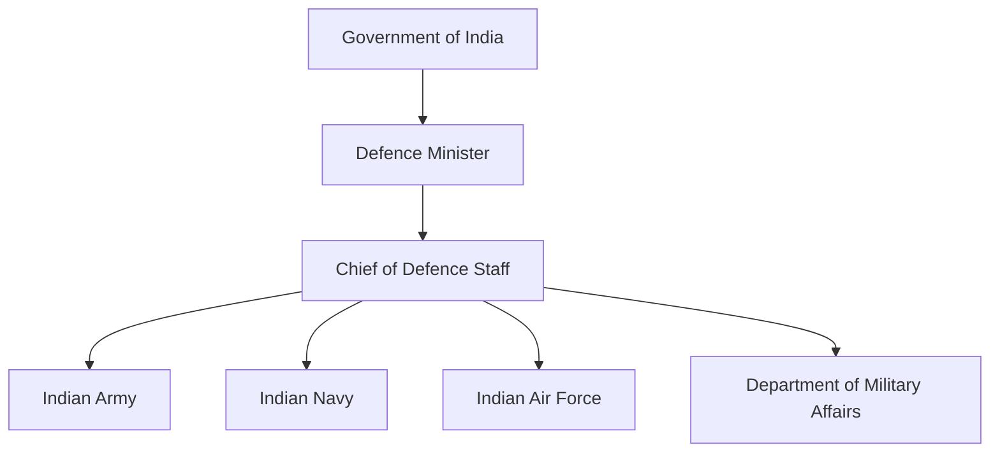
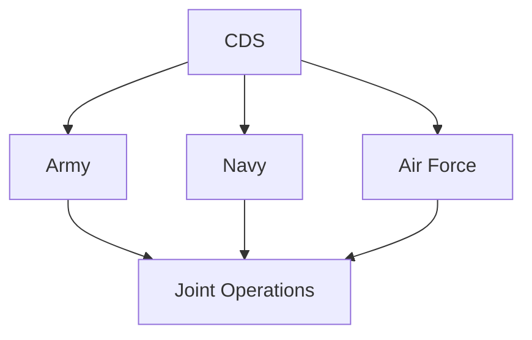

# Chief of Defence Staff (CDS)

## Why It Matters

The Chief of Defence Staff (CDS) is the highest-ranking uniformed military officer in India and serves as the principal military adviser to the Government of India.

The position was created to improve coordination among the Indian Army, Indian Navy and Indian Air Force, strengthen military jointness and support long-term defence reforms.

The CDS is one of the most significant defence reforms undertaken in independent India.

---

## Quick Facts

| Item | Details |
|----------|----------|
| Position | Chief of Defence Staff (CDS) |
| Created | 2019 |
| Reports To | Defence Minister |
| Role | Principal Military Adviser |
| Rank | Four-Star Officer |
| Supports | Jointness and Integration |
| Department | Department of Military Affairs (DMA) |

---

## Why Was the CDS Created?

India traditionally operated through three separate military services.

The need for greater coordination became increasingly evident after multiple defence reviews and reform recommendations.

The CDS position was created to:

- Improve military jointness
- Enhance inter-service coordination
- Support integrated planning
- Promote theatre-command reforms
- Improve resource utilization

---

## Evolution of Defence Reforms

---

## Position in Defence Structure

---

## Primary Responsibilities

- Principal military adviser to the government
- Promote military jointness
- Support integrated capability development
- Improve inter-service coordination
- Assist long-term defence planning
- Facilitate theatre-command reforms

---

## Relationship with the Department of Military Affairs

The CDS functions as the head of the Department of Military Affairs (DMA).

The DMA handles several military-administration matters and supports integration among the Armed Forces.

---

## Military Jointness

Jointness aims to ensure that all services operate together effectively during planning and operations.

---

## Theatre Command Reforms

One of the major objectives associated with the CDS is the development of integrated theatre commands.

Potential benefits include:

- Better coordination
- Faster decision-making
- Efficient resource utilization
- Unified operational planning

---

## Relationship with Defence Organisations

The CDS works closely with:

- Department of Military Affairs
- Integrated Defence Staff
- Armed Forces Special Operations Division
- Defence Space Agency
- Defence Cyber Agency

---

## Strategic Importance

The CDS helps India:

- Strengthen military integration
- Improve defence planning
- Enhance joint operations capability
- Support modernization efforts
- Improve national-security preparedness

---

## Challenges

- Managing inter-service coordination
- Implementing theatre-command reforms
- Balancing service priorities
- Adapting to evolving security threats
- Driving long-term institutional change

---

## Future Roadmap

- Greater military integration
- Expansion of joint structures
- Theatre-command implementation
- Improved capability planning
- Enhanced technology integration

---

## Quick Revision

- CDS was created in 2019.
- Highest-ranking uniformed military officer in India.
- Principal military adviser to the government.
- Heads the Department of Military Affairs.
- Promotes military jointness.
- Supports theatre-command reforms.

---

## Key Concepts

### What is the CDS?

The highest-ranking military officer and principal military adviser to the Government of India.

### Why was the CDS created?

To improve military jointness and inter-service coordination.

### What is the relationship between CDS and DMA?

The CDS serves as the head of the Department of Military Affairs.

### Why is the CDS important?

It strengthens defence integration, planning and joint operations.

### What is military jointness?

The ability of the Army, Navy and Air Force to operate together effectively.
