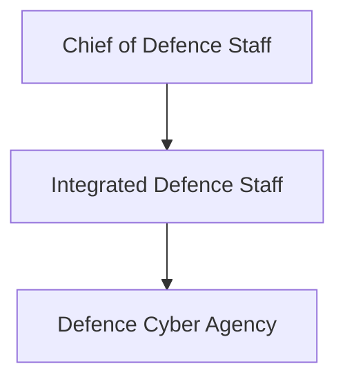
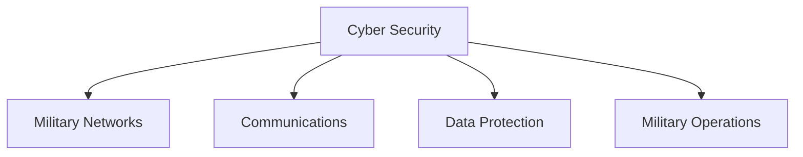
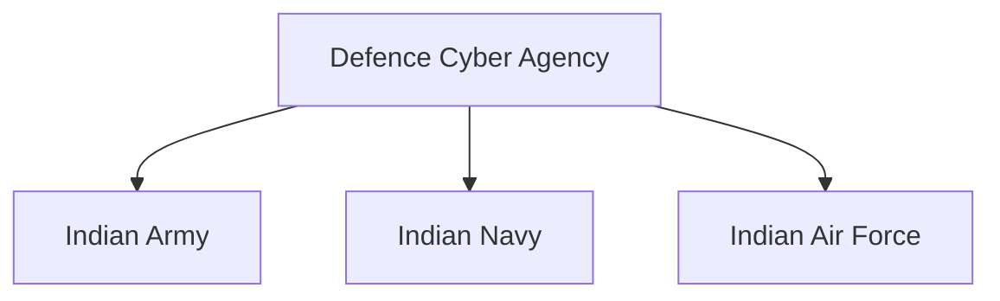

# Defence Cyber Agency (DCA)

## Why It Matters

The Defence Cyber Agency (DCA) is India's tri-service organization responsible for strengthening military cyber-security capabilities and supporting cyber operations.

As modern warfare increasingly depends on digital networks, communications systems, satellites, data infrastructure and connected military platforms, cyber security has become a critical component of national defence.

The DCA represents India's effort to build an integrated military cyber capability for the future battlefield.

---

## Quick Facts

| Item | Details |
|----------|----------|
| Name | Defence Cyber Agency (DCA) |
| Type | Tri-Service Defence Agency |
| Established | 2019 |
| Parent Organisation | Integrated Defence Staff |
| Domain | Cyber Security and Cyber Operations |
| Services Involved | Army, Navy and Air Force |
| Importance | Military Cyber Defence |

---

## What Is the Defence Cyber Agency?

The Defence Cyber Agency is a joint military organization responsible for coordinating cyber-security efforts across the Armed Forces.

It supports cyber defence, cyber preparedness, cyber situational awareness and protection of military digital infrastructure.

---

## Evolution of Cyber Warfare

---

## Position in Defence Structure

---

## Primary Responsibilities

- Military cyber security
- Cyber defence planning
- Protection of defence networks
- Cyber threat monitoring
- Cyber situational awareness
- Joint cyber capability development
- Cyber-security coordination among services

---

## Cyber Security in Modern Warfare

Modern military operations rely heavily on secure digital infrastructure.

---

## Why Cyber Security Matters

Cyber attacks can potentially affect:

- Military communications
- Command-and-control systems
- Intelligence networks
- Logistics systems
- Critical infrastructure
- Operational readiness

---

## Tri-Service Integration

The agency helps ensure a coordinated cyber-security approach across all military services.

---

## Relationship with Other Defence Agencies

The DCA works alongside:

- Integrated Defence Staff
- Defence Space Agency
- Armed Forces Special Operations Division
- Service cyber organizations

Together, these organizations support integrated military operations.

---

## Strategic Importance

The Defence Cyber Agency helps India:

- Strengthen cyber resilience
- Protect military infrastructure
- Improve defence preparedness
- Support future warfare requirements
- Enhance national-security capability

---

## Challenges

- Rapidly evolving cyber threats
- Emerging technologies
- Complex digital ecosystems
- Cyber espionage risks
- Protection of critical military networks

---

## Future Roadmap

- Enhanced cyber-defence capability
- Greater AI-assisted security systems
- Improved cyber situational awareness
- Stronger inter-service integration
- Advanced cyber-security infrastructure

---

## Quick Revision

- DCA was established in 2019.
- It is a tri-service defence agency.
- Operates under the Integrated Defence Staff.
- Focuses on military cyber security.
- Supports protection of defence networks.
- Strengthens cyber preparedness and resilience.

---

## Key Concepts

### What is the Defence Cyber Agency?

India's tri-service military cyber-security organization.

### Why was DCA created?

To strengthen cyber-security coordination across the Armed Forces.

### Which services are involved in DCA?

The Army, Navy and Air Force.

### Why is cyber security important for defence?

Modern military operations depend heavily on secure digital systems and networks.

### How does DCA support national security?

By protecting military cyber infrastructure and improving cyber preparedness.
