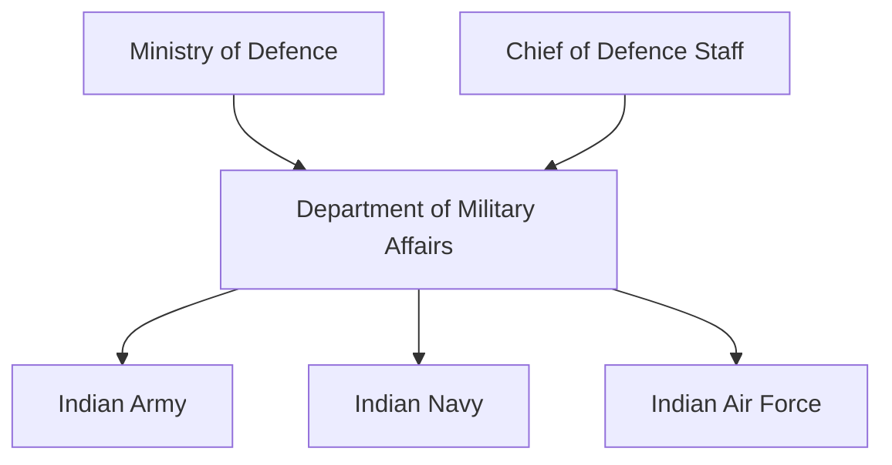
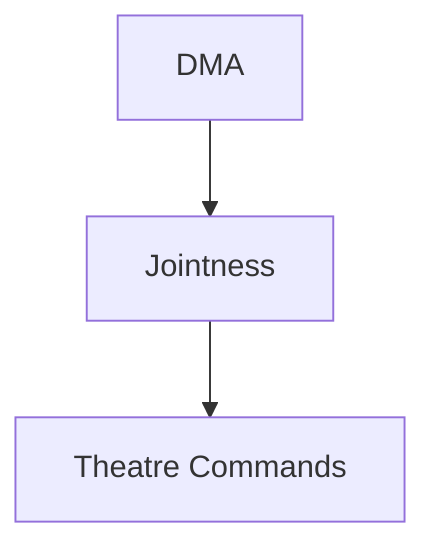

# Department of Military Affairs (DMA)

## Why It Matters

The Department of Military Affairs (DMA) is one of the most significant defence reforms in modern India.

Created in 2019, the DMA was established to improve military jointness, streamline defence administration and strengthen coordination among the Indian Army, Indian Navy and Indian Air Force.

The department serves as a key institution in India's ongoing military-transformation and theatre-command reform efforts.

---

## Quick Facts

| Item | Details |
|----------|----------|
| Name | Department of Military Affairs (DMA) |
| Established | 2019 |
| Ministry | Ministry of Defence |
| Head | Chief of Defence Staff (CDS) |
| Domain | Military Administration |
| Importance | Jointness and Defence Reforms |
| Role | Military Affairs Management |

---

## What Is the DMA?

The Department of Military Affairs is a department within the Ministry of Defence responsible for handling military-related administrative matters and promoting integration among the Armed Forces.

It was created alongside the position of the Chief of Defence Staff (CDS).

---

## Why Was the DMA Created?

The DMA was established to:

- Improve military jointness
- Strengthen inter-service coordination
- Streamline defence administration
- Support theatre-command reforms
- Improve resource utilization
- Enhance military effectiveness

---

## Evolution of Defence Reforms

---

## Position in Defence Structure

---

## Primary Responsibilities

- Military administration
- Jointness initiatives
- Inter-service coordination
- Personnel-related military matters
- Training and staffing coordination
- Defence reform implementation
- Theatre-command support

---

## CDS and DMA Relationship

The CDS serves as the head of the DMA and provides leadership for defence-integration initiatives.

---

## DMA and Military Jointness

Jointness refers to the ability of the Army, Navy and Air Force to work together effectively.

The DMA promotes:

- Joint planning
- Joint training
- Joint logistics
- Joint capability development
- Integrated operational thinking

---

## Theatre Command Reforms

The DMA supports India's efforts to create integrated theatre-command structures.

---

## Relationship with Defence Organisations

The DMA works closely with:

- Chief of Defence Staff
- Integrated Defence Staff
- Armed Forces Special Operations Division
- Defence Space Agency
- Defence Cyber Agency

These organizations collectively strengthen military integration.

---

## Strategic Importance

The DMA helps India:

- Improve military efficiency
- Strengthen joint operations capability
- Enhance defence planning
- Support modernization efforts
- Improve long-term military readiness

---

## Challenges

- Implementing institutional reforms
- Balancing service-specific requirements
- Managing organizational change
- Supporting future warfare requirements
- Advancing theatre-command implementation

---

## Future Roadmap

- Greater military integration
- Enhanced joint structures
- Theatre-command development
- Improved capability planning
- Stronger defence-management systems

---

## Quick Revision

- DMA was established in 2019.
- Functions under the Ministry of Defence.
- Headed by the Chief of Defence Staff.
- Promotes military jointness.
- Supports theatre-command reforms.
- Strengthens defence administration and coordination.

---

## Key Concepts

### What is the DMA?

A department within the Ministry of Defence responsible for military affairs and integration.

### Why was DMA created?

To improve military jointness and defence administration.

### Who heads the DMA?

The Chief of Defence Staff.

### Why is DMA important?

It supports defence reforms, integration and military modernization.

### What is its role in theatre-command reforms?

It helps coordinate and implement initiatives that improve integrated military operations.
