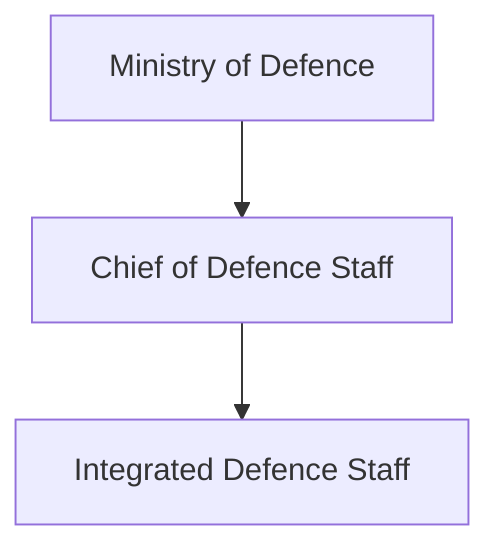
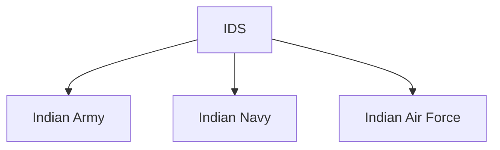
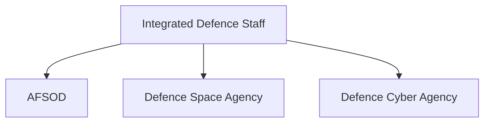

# Integrated Defence Staff (IDS)

## Why It Matters

The Integrated Defence Staff (IDS) is the organization responsible for promoting coordination, integration and jointness among the Indian Army, Indian Navy and Indian Air Force.

It serves as the central tri-service structure that supports joint planning, capability development, strategic coordination and integrated military operations.

IDS plays a critical role in India's defence reforms and the development of future joint-force capabilities.

---

## Quick Facts

| Item | Details |
|----------|----------|
| Name | Integrated Defence Staff (IDS) |
| Established | 2001 |
| Domain | Tri-Service Military Coordination |
| Reports To | Chief of Defence Staff |
| Role | Joint Planning and Integration |
| Coverage | Army, Navy and Air Force |
| Importance | Military Jointness |

---

## What Is IDS?

The Integrated Defence Staff is a tri-service organization that supports coordination among the Armed Forces.

It helps improve joint planning, capability development, operational coordination and long-term defence management.

---

## Why Was IDS Created?

The IDS was established to:

- Improve military jointness
- Enhance inter-service coordination
- Support integrated planning
- Strengthen national-security decision making
- Improve operational effectiveness

---

## Evolution of Military Integration

---

## Position in Defence Structure

---

## Primary Responsibilities

- Joint military planning
- Inter-service coordination
- Capability development support
- Strategic planning support
- Joint training initiatives
- Defence integration efforts
- Support for defence reforms

---

## Tri-Service Coordination

IDS acts as a coordinating mechanism among all three military services.

---

## Support to the Chief of Defence Staff

The IDS supports the CDS by providing:

- Planning assistance
- Strategic assessments
- Coordination mechanisms
- Joint operational support
- Capability-development inputs

---

## Relationship with DMA

The IDS works closely with the Department of Military Affairs to support defence reforms and military integration.

---

## Tri-Service Agencies Under IDS

IDS provides coordination and support for several tri-service organizations.

---

## Strategic Importance

IDS helps India:

- Improve military jointness
- Enhance operational coordination
- Strengthen defence planning
- Support future theatre commands
- Improve resource utilization

---

## Challenges

- Complex inter-service coordination
- Evolving security threats
- Joint capability development requirements
- Defence modernization needs
- Future warfare demands

---

## Future Roadmap

- Greater military integration
- Enhanced joint planning capability
- Support for theatre commands
- Improved interoperability
- Stronger tri-service coordination mechanisms

---

## Quick Revision

- IDS was established in 2001.
- Supports military jointness.
- Coordinates Army, Navy and Air Force activities.
- Works under the Chief of Defence Staff.
- Supports defence reforms and integration.
- Oversees coordination with major tri-service agencies.

---

## Key Concepts

### What is IDS?

A tri-service organization responsible for military coordination and integration.

### Why was IDS created?

To improve joint planning and inter-service cooperation.

### Who does IDS support?

The Chief of Defence Staff and broader defence-integration efforts.

### Which agencies work closely with IDS?

AFSOD, Defence Space Agency and Defence Cyber Agency.

### Why is IDS important?

It serves as the foundation for military jointness and integrated operations.
