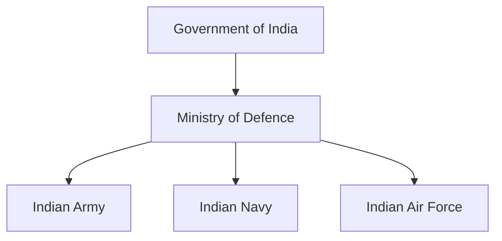
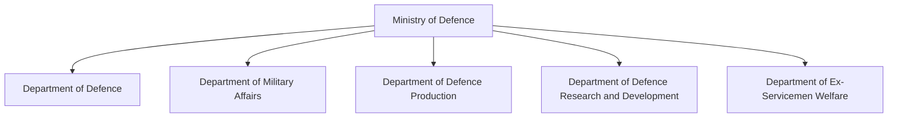
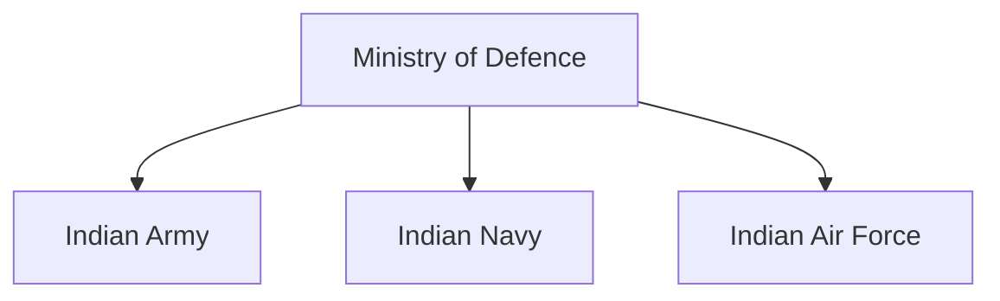

# Ministry of Defence (MoD)

## Why It Matters

The Ministry of Defence (MoD) is the central government ministry responsible for India's national defence and military administration.

It formulates defence policies, manages the Armed Forces, oversees defence modernization, supports military preparedness and coordinates national-security initiatives.

The Ministry of Defence serves as the foundation of India's defence-governance structure.

---

## Quick Facts

| Item | Details |
|----------|----------|
| Name | Ministry of Defence (MoD) |
| Government | Government of India |
| Cabinet Minister | Defence Minister |
| Headquarters | New Delhi |
| Domain | National Defence and Security |
| Responsibility | Defence Administration |
| Importance | Apex Defence Ministry |

---

## Historical Background

The Ministry of Defence evolved from defence-administration structures established during the colonial period.

After independence, it became the principal ministry responsible for managing India's defence affairs and military institutions.

---

## Position in Government Structure

---

## Organisational Structure

---

## Department of Defence (DoD)

Responsible for:

- Defence policy
- Defence planning
- Civil-military coordination
- Strategic administration
- National-security matters

---

## Department of Military Affairs (DMA)

Responsible for:

- Military administration
- Jointness initiatives
- Inter-service coordination
- Military reform implementation

The Chief of Defence Staff serves as the head of the DMA.

---

## Department of Defence Production (DDP)

Responsible for:

- Defence manufacturing
- Defence industrial development
- Indigenous production initiatives
- Defence public-sector enterprises

---

## Department of Defence Research and Development (DDR&D)

Responsible for:

- Defence technology development
- Research programmes
- Defence innovation
- Oversight of DRDO

---

## Department of Ex-Servicemen Welfare (DESW)

Responsible for:

- Veteran welfare
- Pension administration
- Rehabilitation programmes
- Ex-servicemen support initiatives

---

## Relationship with the Armed Forces

The Ministry provides policy direction, administrative support and strategic oversight to the Armed Forces.

---

## Relationship with Defence Organisations

The Ministry works closely with:

- Chief of Defence Staff
- Integrated Defence Staff
- DRDO
- Defence Acquisition Council
- Defence Space Agency
- Defence Cyber Agency

---

## Strategic Importance

The Ministry of Defence helps India:

- Maintain military readiness
- Strengthen national security
- Modernize defence capabilities
- Support defence reforms
- Improve military integration

---

## Challenges

- Rapid technological change
- Defence modernization requirements
- Emerging warfare domains
- Long-term capability planning
- Complex security environment

---

## Future Roadmap

- Greater military integration
- Enhanced indigenous defence production
- Technology-driven modernization
- Stronger cyber and space capabilities
- Continued defence reforms

---

## Quick Revision

- MoD is India's apex defence ministry.
- Responsible for defence administration and policy.
- Oversees the Army, Navy and Air Force.
- Contains five major departments.
- Supports modernization and national security.
- Coordinates defence reforms and strategic planning.

---

## Key Concepts

### What is the Ministry of Defence?

The central government ministry responsible for India's defence and military administration.

### Who heads the Ministry of Defence?

The Defence Minister.

### What are the major departments under the MoD?

DoD, DMA, DDP, DDR&D and DESW.

### Why is the MoD important?

It manages defence policy, military administration and national-security planning.

### How does the MoD support national security?

By overseeing the Armed Forces, modernization programmes and defence institutions.
