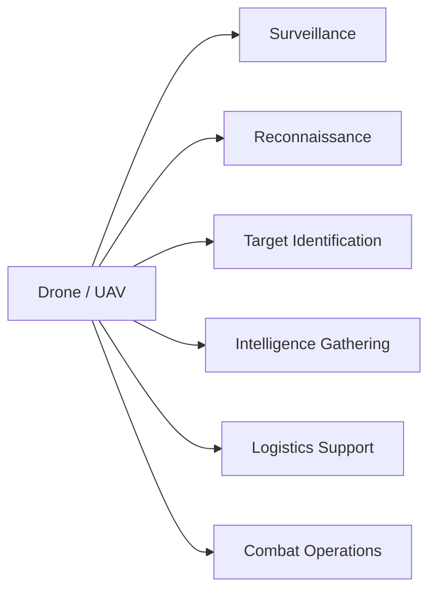
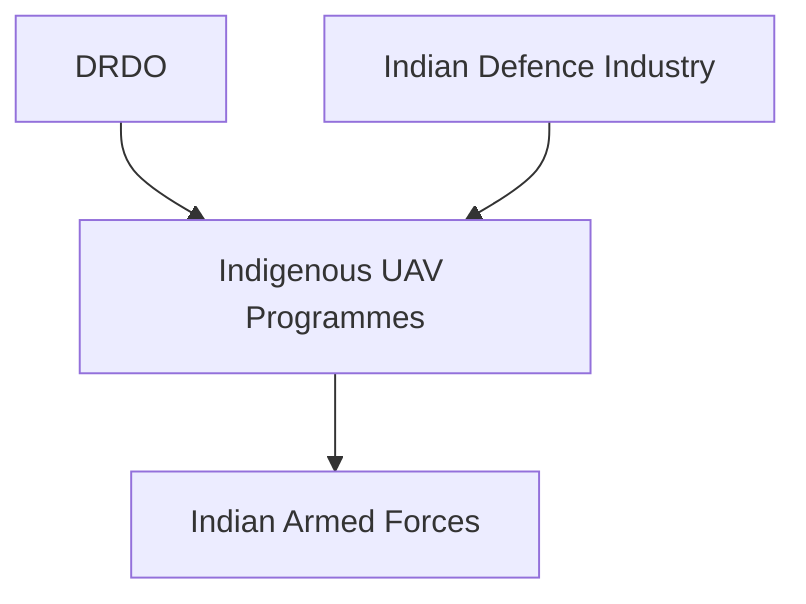

# Drones and UAVs

## Why It Matters

Drones and Unmanned Aerial Vehicles (UAVs) have become one of the most important technologies in modern warfare. They provide surveillance, reconnaissance, targeting, logistics support, and combat capabilities without putting pilots at risk.

India is rapidly expanding its drone ecosystem for military, border-security, and intelligence operations.

---

## Quick Facts

| Item | Details |
|----------|----------|
| Full Form | Unmanned Aerial Vehicle (UAV) |
| Operator | Indian Air Force, Indian Army, Indian Navy |
| Main Purpose | Surveillance, Reconnaissance, Combat Support |
| Key Advantage | No Pilot Required |
| Strategic Value | Persistent Monitoring and Intelligence |
| Future Trend | Autonomous and AI-Enabled Systems |

---

## What Is a Drone?

A drone is an aircraft that operates without a pilot onboard and is controlled remotely or through autonomous systems.

---

## How Drones Support Military Operations

---

## Types of Military Drones

### Surveillance Drones

Used for:

- Border monitoring
- Battlefield observation
- Maritime surveillance
- Intelligence collection

### Combat Drones

Used for:

- Precision strikes
- Target engagement
- Armed reconnaissance

### Logistics Drones

Used for:

- Delivery of supplies
- Support in difficult terrain
- Emergency operations

### Swarm Drones

Used for:

- Coordinated operations
- Saturation attacks
- Advanced battlefield tactics

---

## Major UAVs Used by India

| Platform | Origin | Role |
|----------|----------|----------|
| Heron | Israel | Surveillance UAV |
| Searcher | Israel | Reconnaissance UAV |
| MQ-9B Predator | United States | Long-Endurance Surveillance and Strike |
| TAPAS | India | Indigenous UAV Programme |
| Rustom | India | UAV Development Programme |
| Netra UAV | India | Tactical Surveillance |

---

## Indigenous Drone Development

---

## Role in Border Security

Drones help monitor:

- Line of Control (LoC)
- Line of Actual Control (LAC)
- Coastal regions
- Sensitive military installations

They provide continuous surveillance over areas where physical monitoring is difficult.

---

## Advantages

- Reduced risk to pilots
- Long-endurance operations
- Real-time intelligence
- Lower operating cost than manned aircraft
- Rapid deployment capability
- Enhanced situational awareness

---

## Challenges

- Electronic warfare threats
- GPS jamming
- Cybersecurity risks
- Adverse weather conditions
- Anti-drone systems

---

## Counter-Drone Systems

Modern militaries use:

- Radar detection
- Electronic jamming
- Directed-energy systems
- Anti-drone weapons

These systems help neutralize hostile drones.

---

## Future Roadmap

- AI-enabled drones
- Autonomous operations
- Armed indigenous UAVs
- Swarm drone capabilities
- High-altitude long-endurance platforms
- Greater domestic manufacturing

---

## Quick Revision

- UAV stands for Unmanned Aerial Vehicle.
- Drones are used for surveillance, reconnaissance and combat support.
- Heron and Searcher are major surveillance UAVs.
- MQ-9B Predator provides long-range capability.
- TAPAS and Rustom are indigenous programmes.
- Drones are becoming central to modern warfare.

---

## Key Concepts

### What is a UAV?

An aircraft that operates without a pilot onboard.

### Why are drones important in modern warfare?

They provide intelligence and operational capability without risking pilots.

### Which organisations are developing indigenous UAVs in India?

DRDO and Indian defence industry partners.

### What is the primary military use of drones?

Surveillance and reconnaissance.

### What is the future of military drones?

AI-enabled, autonomous and swarm-based operations.
