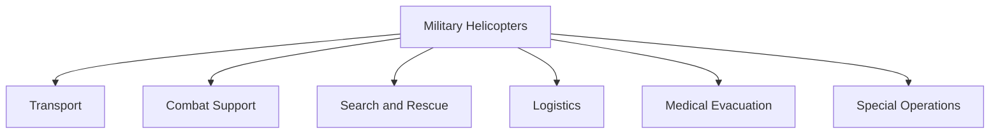
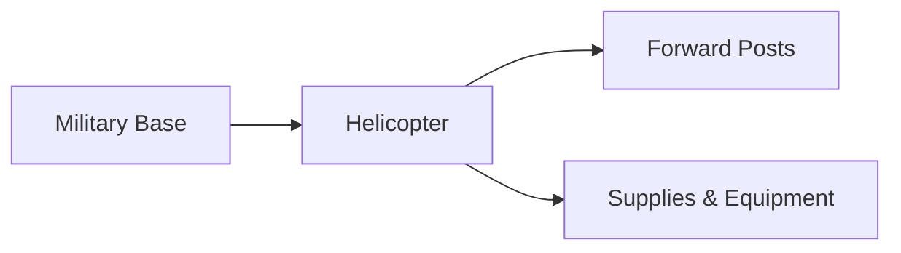

# Helicopters

## Why It Matters

Helicopters provide the Indian Armed Forces with mobility, flexibility, and rapid response capability. Unlike fixed-wing aircraft, helicopters can take off and land vertically, operate in difficult terrain, support frontline troops, conduct rescue missions, and deliver supplies to remote locations.

They are critical for military operations in mountains, deserts, forests, coastal regions, and disaster-affected areas.

---

## Quick Facts

| Item | Details |
|----------|----------|
| Primary Operators | Indian Air Force, Indian Army, Indian Navy |
| Main Role | Transport, Combat Support and Rescue |
| Key Advantage | Vertical Take-Off and Landing |
| Strategic Importance | Mobility and Rapid Response |
| Indigenous Platform | HAL Dhruv |
| Future Focus | Indigenous Combat and Utility Helicopters |

---

## Why Helicopters Are Important

- Operate in difficult terrain
- Support frontline troops
- Conduct rescue operations
- Transport personnel and equipment
- Support special forces missions
- Assist during disasters and emergencies

---

## Major Military Helicopter Roles

---

## Major Helicopters Used by India

| Helicopter | Origin | Primary Role |
|----------|----------|----------|
| HAL Dhruv | India | Utility Helicopter |
| Light Combat Helicopter (LCH) Prachand | India | Attack Helicopter |
| Light Utility Helicopter (LUH) | India | Utility Operations |
| Mi-17 V5 | Russia | Transport Helicopter |
| Apache AH-64E | United States | Attack Helicopter |
| Chinook CH-47F | United States | Heavy-Lift Helicopter |
| Chetak | India/France Origin | Utility Helicopter |
| Cheetah | India/France Origin | High-Altitude Operations |

---

## HAL Dhruv

### Key Features

- Indigenous helicopter
- Multi-role capability
- Military and civilian applications
- Operates in diverse environments

### Importance

Dhruv is one of India's most successful indigenous helicopter programmes.

---

## Light Combat Helicopter (Prachand)

### Key Features

- Indigenous attack helicopter
- Designed for high-altitude warfare
- Armed combat platform
- Supports offensive operations

### Importance

Provides attack capability in mountainous regions.

---

## Apache AH-64E

### Key Features

- Advanced attack helicopter
- Precision strike capability
- Modern sensors and weapons
- Battlefield support platform

### Importance

One of the world's most capable attack helicopters.

---

## Chinook CH-47F

### Key Features

- Heavy-lift capability
- Large cargo transport
- Support for high-altitude operations
- Strategic logistics platform

### Importance

Improves India's ability to move heavy equipment quickly.

---

## Mi-17 V5

### Key Features

- Multi-role transport helicopter
- Troop transport capability
- Disaster relief support
- Logistics operations

### Importance

One of the most widely used military helicopters in India.

---

## Helicopters in High-Altitude Operations

Helicopters are essential for supporting forces deployed in regions such as Ladakh and the Himalayas.

---

## Humanitarian and Disaster Relief Role

Helicopters assist during:

- Floods
- Earthquakes
- Cyclones
- Landslides
- Medical emergencies
- Evacuation operations

---

## Challenges

- Weather limitations
- High maintenance requirements
- Operating costs
- Vulnerability in hostile environments
- Need for continuous modernization

---

## Future Roadmap

- Greater indigenous production
- Expansion of LCH fleet
- Expansion of LUH fleet
- Next-generation avionics
- Improved survivability systems
- Enhanced network-centric capability

---

## Quick Revision

- Helicopters provide mobility and flexibility.
- HAL Dhruv is India's major indigenous utility helicopter.
- Prachand is India's indigenous combat helicopter.
- Apache is a modern attack helicopter.
- Chinook provides heavy-lift capability.
- Mi-17 V5 is a versatile transport helicopter.
- Helicopters are essential for high-altitude and disaster-relief operations.

---

## Key Concepts

### Why are helicopters important in military operations?

They can operate in areas where fixed-wing aircraft cannot.

### What is India's major indigenous helicopter programme?

HAL Dhruv.

### What is Prachand?

India's indigenous Light Combat Helicopter.

### Which helicopter provides heavy-lift capability?

The Chinook CH-47F.

### Why are helicopters important in Ladakh?

They transport troops, supplies and equipment to remote high-altitude locations.
