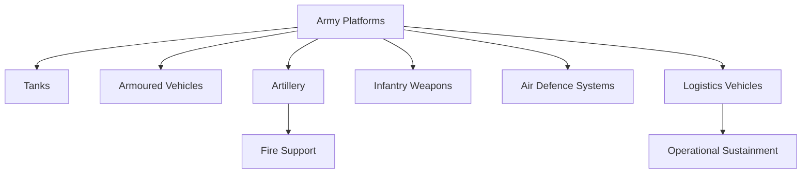

# Army Platforms

## Why It Matters

Army platforms form the backbone of land warfare capabilities. They enable mobility, firepower, protection, surveillance, logistics, and battlefield dominance across diverse operational environments.

The Indian Army operates a wide range of tanks, artillery systems, armoured vehicles, infantry weapons, air-defence systems, and logistics platforms to defend national territory and support military operations.

Understanding these platforms helps explain how modern armies fight, maneuver, sustain operations, and project combat power.

---

## Learning Objectives

After completing this section, you should understand:

- Major categories of Army platforms
- Roles of tanks and armoured vehicles
- Importance of artillery systems
- Infantry weapon capabilities
- Battlefield air-defence systems
- Military logistics and sustainment

---

## Repository Structure

```text
army-platforms
├── README.md
├── tanks.md
├── artillery.md
├── armoured-vehicles.md
├── infantry-weapons.md
├── air-defence-systems.md
└── logistics-vehicles.md
```

---

## Learning Path


---

## Platform Categories

### Tanks

Heavily armoured combat vehicles designed for offensive operations, firepower, protection, and battlefield dominance.

### Armoured Vehicles

Provide troop mobility, protection, reconnaissance capabilities, and battlefield support.

### Artillery

Delivers long-range fire support against enemy positions and strategic targets.

### Infantry Weapons

Weapons used by soldiers during combat operations, including rifles, machine guns, anti-tank systems, and support weapons.

### Air Defence Systems

Protect ground forces and critical assets from aircraft, helicopters, drones, and missile threats.

### Logistics Vehicles

Support transportation, resupply, maintenance, and sustainment of military operations.

---

## Land Warfare Ecosystem



---

## Importance in Modern Warfare

- Offensive operations
- Defensive operations
- Border security
- Mechanized warfare
- Fire support missions
- Rapid deployment and sustainment

---

## Quick Revision

- Tanks provide heavy combat power.
- Armoured vehicles provide mobility and protection.
- Artillery delivers long-range fire support.
- Infantry weapons equip frontline soldiers.
- Air-defence systems protect ground formations.
- Logistics vehicles sustain military operations.

---

## Key Concepts

### Easy

1. What are the major categories of Army platforms?
2. What is the role of a tank?
3. Why is artillery important?
4. What are armoured vehicles used for?

### Intermediate

1. How do tanks and artillery complement each other?
2. Why are logistics vehicles critical for military operations?
3. What role do air-defence systems play in land warfare?
4. How do armoured vehicles improve battlefield effectiveness?

### Advanced

1. Analyse the role of mechanized warfare in modern conflicts.
2. Evaluate the importance of logistics in military campaigns.
3. Explain how different Army platforms work together during operations.
