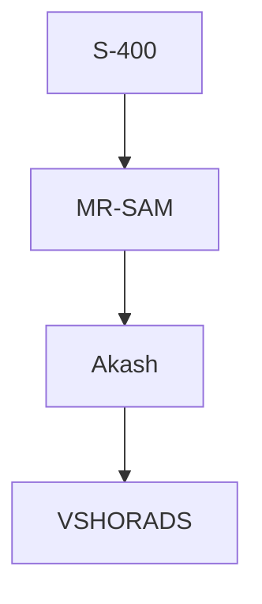
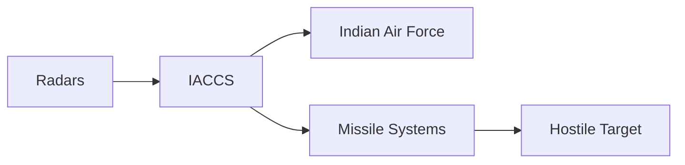

# Air Defence Systems

## Why It Matters

Air Defence Systems protect India from hostile aircraft, helicopters, drones, cruise missiles and other aerial threats. They form a critical layer of national security by detecting, tracking and neutralizing threats before they can reach strategic targets.

Modern air defence is not a single weapon but an integrated network of radars, command systems, missiles and fighter aircraft.

---

## Quick Facts

| Item | Details |
|----------|----------|
| Primary Role | Protection Against Aerial Threats |
| Operators | Indian Air Force, Indian Army, Indian Navy |
| Components | Radars, Missiles, Command Systems |
| Key Objective | Airspace Security |
| Strategic Importance | National Defence |
| Modern Requirement | Integrated Air Defence Network |

---

## What Is Air Defence?

Air defence refers to all measures used to detect, identify, track and destroy airborne threats before they can damage military or civilian targets.

---

## Layered Air Defence Concept

A layered system ensures multiple opportunities to intercept threats.

---

## Major Components of Air Defence

### Radars

Used to:

- Detect aircraft
- Detect missiles
- Track targets
- Provide early warning

### Command and Control Systems

Used to:

- Process information
- Coordinate responses
- Assign targets
- Control missile batteries

### Missile Systems

Used to:

- Intercept hostile aircraft
- Destroy missiles
- Neutralize drones

---

## Integrated Air Defence Network

---

## Integrated Air Command and Control System (IACCS)

### Purpose

- Connects sensors and weapons
- Provides real-time situational awareness
- Coordinates air-defence operations
- Supports rapid decision-making

### Importance

Acts as the digital backbone of India's air-defence network.

---

## Major Air Defence Systems of India

| System | Category |
|----------|----------|
| S-400 Triumf | Long-Range Air Defence |
| MR-SAM | Medium-Range Air Defence |
| Akash | Surface-to-Air Missile |
| Barak-8 | Naval and Land-Based Air Defence |
| QRSAM | Quick-Reaction Air Defence |
| VSHORADS | Very Short-Range Air Defence |

---

## S-400 Triumf

### Key Features

- Long-range air-defence system
- Multi-target engagement capability
- Advanced radar network
- Protection against aircraft and missiles

### Importance

One of India's most capable air-defence systems.

---

## Akash Missile System

### Key Features

- Indigenous system
- Surface-to-air missile
- Mobile deployment capability
- Protects strategic assets

### Importance

Represents India's indigenous air-defence capability.

---

## MR-SAM

### Key Features

- Medium-range interception capability
- Modern radar integration
- Multi-target engagement

### Importance

Provides an important middle layer of defence.

---

## Barak-8

### Key Features

- Advanced interception capability
- Naval and land applications
- Protection against multiple aerial threats

### Importance

Strengthens both maritime and land-based air defence.

---

## QRSAM

### Key Features

- Quick reaction capability
- Mobile deployment
- Battlefield air defence support

### Importance

Protects troops and mobile formations.

---

## Role in National Security

- Protects major cities
- Defends military bases
- Secures strategic infrastructure
- Supports wartime operations
- Protects airspace sovereignty

---

## Emerging Threats

- Swarm drones
- Cruise missiles
- Hypersonic weapons
- Electronic warfare
- Low-observable targets

---

## Future Roadmap

- More indigenous systems
- Advanced radar networks
- AI-enabled threat analysis
- Better drone-defence capability
- Greater network integration
- Multi-layered missile defence

---

## Quick Revision

- Air defence protects India from aerial threats.
- Uses radars, command systems and missiles.
- S-400 is India's premier long-range system.
- Akash is an indigenous missile system.
- IACCS integrates sensors and weapons.
- Layered defence improves interception probability.

---

## Key Concepts

### What is air defence?

A system for detecting and neutralizing aerial threats.

### Why is layered air defence important?

It provides multiple opportunities to intercept hostile targets.

### What is IACCS?

India's Integrated Air Command and Control System.

### What is Akash?

An indigenous surface-to-air missile system.

### What is the role of the S-400?

Long-range protection against aircraft and missile threats.
