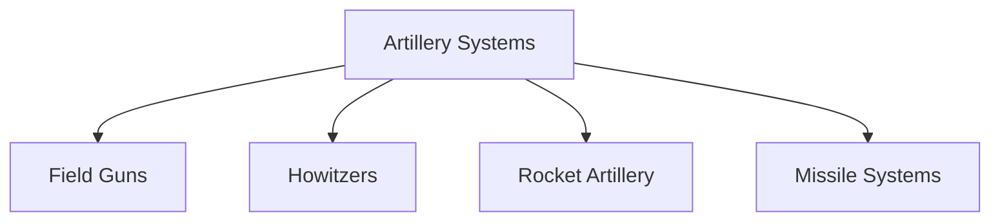
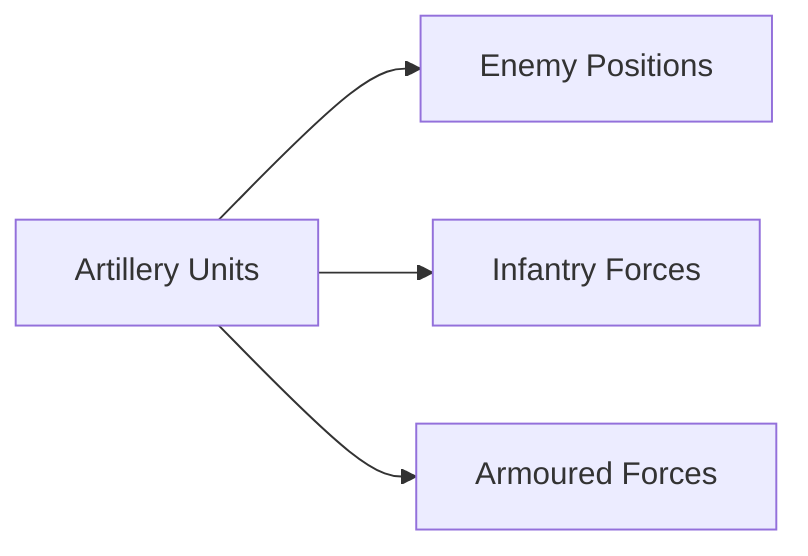

# Artillery Systems

## Why It Matters

Artillery is often called the 'God of War' because it provides long-range firepower that can destroy enemy positions, support advancing troops, and shape the battlefield before direct combat begins.

The Indian Army relies on a combination of guns, howitzers, rocket systems and missile-supported firepower to provide battlefield dominance.

---

## Quick Facts

| Item | Details |
|----------|----------|
| Primary Operator | Indian Army |
| Main Purpose | Long-Range Fire Support |
| Key Advantage | High Firepower |
| Battlefield Role | Offensive and Defensive Support |
| Major Categories | Guns, Howitzers, Rocket Artillery |
| Strategic Importance | Battlefield Dominance |

---

## What Is Artillery?

Artillery consists of large-calibre weapon systems designed to deliver indirect fire against enemy forces, fortifications and strategic targets over long distances.

---

## Types of Artillery

---

## Why Artillery Is Important

- Supports infantry operations
- Supports armoured formations
- Destroys enemy positions
- Provides battlefield suppression
- Enables long-range precision strikes
- Reduces risk to frontline troops

---

## Major Artillery Systems of India

| System | Category |
|----------|----------|
| K9 Vajra | Self-Propelled Howitzer |
| Dhanush | Indigenous Howitzer |
| M777 | Ultra-Light Howitzer |
| Pinaka | Multi-Barrel Rocket Launcher |
| Bofors FH-77B | Field Howitzer |

---

## K9 Vajra

### Key Features

- Self-propelled artillery system
- High mobility
- Rapid deployment capability
- Modern fire-control systems

### Importance

Provides mobile artillery support for mechanized formations.

---

## Dhanush

### Key Features

- Indigenous artillery system
- Long-range fire capability
- Improved accuracy
- Modernized design

### Importance

Represents India's growing self-reliance in artillery production.

---

## M777 Ultra-Light Howitzer

### Key Features

- Lightweight design
- Air transportable
- Suitable for mountain warfare
- Rapid deployment capability

### Importance

Particularly valuable for operations in the Himalayas.

---

## Pinaka Rocket System

### Key Features

- Multi-barrel rocket launcher
- Area saturation capability
- Rapid-fire missions
- Indigenous development

### Importance

Provides powerful long-range battlefield support.

---

## Artillery Support in Combat Operations

---

## Role in Mountain Warfare

Artillery is critical for:

- High-altitude operations
- Border defence
- Fire support in difficult terrain
- Rapid response to hostile activity

Systems such as the M777 are specifically useful in mountainous regions.

---

## Advantages

- Long-range engagement
- High firepower
- Battlefield shaping capability
- Support for combined-arms warfare
- Precision strike potential

---

## Challenges

- Counter-battery fire threats
- Ammunition logistics
- Difficult terrain
- Need for modernization
- Rapid technological evolution

---

## Future Roadmap

- Greater indigenous production
- Advanced precision-guided munitions
- Longer-range artillery systems
- Automated fire-control systems
- Improved battlefield networking
- Enhanced surveillance integration

---

## Quick Revision

- Artillery provides long-range fire support.
- K9 Vajra is a self-propelled howitzer.
- Dhanush is an indigenous artillery system.
- M777 is optimized for mountain warfare.
- Pinaka is India's major rocket artillery system.
- Artillery remains one of the most important battlefield weapons.

---

## Key Concepts

### Why is artillery called the God of War?

Because of its ability to deliver powerful long-range fire support.

### What is the role of artillery?

To support combat operations through indirect fire.

### What is Pinaka?

An indigenous multi-barrel rocket launcher system.

### Why is M777 important?

Its lightweight design makes it ideal for mountain operations.

### What is Dhanush?

An indigenous artillery gun developed for the Indian Army.
