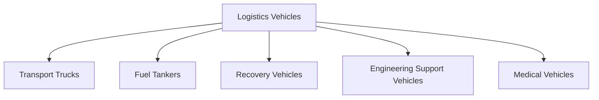
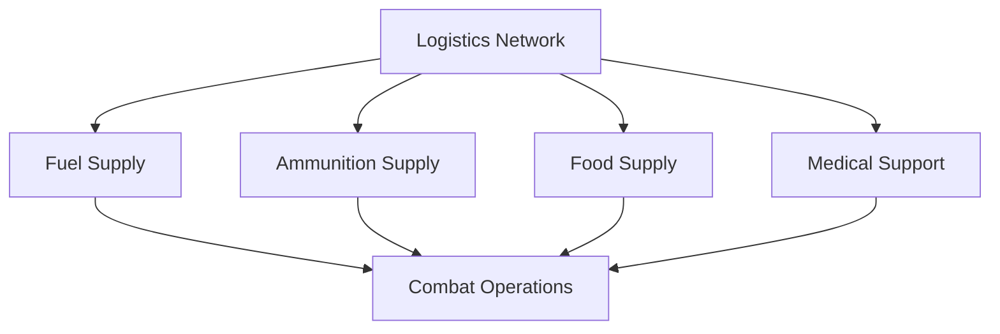

# Logistics Vehicles

## Why It Matters

Logistics vehicles are the backbone of military operations. Armies cannot fight effectively without a continuous supply of fuel, ammunition, food, water, medical support and equipment.

While tanks, artillery and infantry receive most public attention, logistics vehicles ensure that combat units remain operational during both peace and war.

---

## Quick Facts

| Item | Details |
|----------|----------|
| Primary Operator | Indian Army |
| Main Purpose | Military Logistics and Support |
| Key Role | Sustain Combat Operations |
| Major Functions | Transport, Supply and Recovery |
| Strategic Importance | Operational Readiness |
| Battlefield Value | Force Sustainment |

---

## What Are Logistics Vehicles?

Logistics vehicles are military vehicles used to transport personnel, ammunition, fuel, supplies, equipment and recovery assets across operational areas.

---

## Logistics Support Chain

---

## Why Logistics Vehicles Are Important

- Move troops and supplies
- Deliver ammunition
- Transport fuel
- Support disaster-relief operations
- Recover damaged vehicles
- Maintain battlefield momentum

---

## Major Categories of Logistics Vehicles

---

## Transport Vehicles

Used for:

- Troop movement
- Ammunition transport
- Equipment transportation
- General military logistics

### Common Uses

- Border deployments
- Military exercises
- Operational support
- Emergency mobilization

---

## Fuel Tankers

Fuel tankers provide:

- Fuel supply to combat vehicles
- Fuel support for generators
- Support for forward operating bases

Without fuel logistics, military operations can quickly stop.

---

## Recovery Vehicles

Recovery vehicles are used to:

- Recover damaged tanks
- Recover armoured vehicles
- Recover trucks and support vehicles
- Conduct battlefield repair operations

These vehicles help restore combat capability quickly.

---

## Medical Vehicles

Medical logistics platforms support:

- Casualty evacuation
- Emergency medical response
- Battlefield healthcare support
- Disaster-relief operations

---

## Logistics Support During Combat

---

## Role Along India's Borders

Logistics vehicles are critical for:

- Ladakh deployments
- High-altitude operations
- Desert operations
- Counter-insurgency deployments
- Remote military outposts

They ensure continuous support in difficult environments.

---

## Humanitarian and Disaster Relief Operations

Logistics vehicles support:

- Flood relief
- Earthquake response
- Cyclone relief
- Medical assistance missions
- Civil administration support

---

## Challenges

- Difficult terrain
- Extreme weather conditions
- Long supply routes
- High maintenance requirements
- Modern battlefield threats

---

## Future Roadmap

- Modern logistics fleets
- Better mobility platforms
- Digitized logistics management
- Autonomous logistics technologies
- Improved battlefield connectivity
- Greater indigenous manufacturing

---

## Quick Revision

- Logistics vehicles sustain military operations.
- They transport fuel, ammunition, food and equipment.
- Recovery vehicles restore damaged platforms.
- Medical vehicles support casualty evacuation.
- Logistics is essential for combat readiness.
- Military operations depend heavily on uninterrupted logistics support.

---

## Key Concepts

### Why are logistics vehicles important?

They sustain military operations by delivering supplies and support.

### What do logistics vehicles transport?

Troops, fuel, ammunition, equipment and medical supplies.

### What is a recovery vehicle?

A vehicle used to recover damaged military platforms.

### Why is logistics important in warfare?

Without logistics, combat forces cannot continue operations.

### Why are logistics vehicles important in Ladakh?

They support troops operating in remote high-altitude regions.
