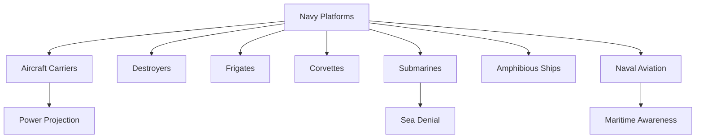

# Navy Platforms

## Why It Matters

Naval platforms are essential for protecting maritime interests, securing sea lines of communication, deterring adversaries, projecting power, and supporting national security objectives.

The Indian Navy operates a diverse fleet of aircraft carriers, destroyers, frigates, corvettes, submarines, amphibious ships, and naval aviation assets to maintain maritime security across the Indian Ocean Region.

Understanding these platforms helps explain how sea power contributes to deterrence, warfighting, maritime domain awareness, and strategic influence.

---

## Learning Objectives

After completing this section, you should understand:

- Major categories of naval platforms
- Roles of aircraft carriers and surface combatants
- Importance of submarines in naval warfare
- Amphibious warfare capabilities
- Naval aviation operations
- Maritime power and sea control concepts

---

## Repository Structure

```text
navy-platforms
├── README.md
├── aircraft-carriers.md
├── destroyers.md
├── frigates.md
├── corvettes.md
├── submarines.md
├── amphibious-ships.md
└── naval-aviation.md
```

---

## Learning Path


---

## Platform Categories

### Aircraft Carriers

Provide sea-based air power, force projection, fleet protection, and strategic reach.

### Destroyers

Large multi-role warships used for air defence, anti-surface warfare, and anti-submarine operations.

### Frigates

Versatile warships designed for escort duties, maritime security, and combat operations.

### Corvettes

Smaller combat vessels optimized for coastal defence and regional maritime operations.

### Submarines

Provide stealth, deterrence, intelligence gathering, and sea-denial capabilities.

### Amphibious Ships

Support troop transport, amphibious assaults, humanitarian assistance, and disaster-relief missions.

### Naval Aviation

Includes maritime patrol aircraft, carrier-based aircraft, helicopters, and unmanned systems.

---

## Maritime Power Ecosystem



---

## Importance in Modern Warfare

- Maritime deterrence
- Sea control operations
- Sea denial operations
- Power projection
- Protection of trade routes
- Humanitarian assistance and disaster relief

---

## Quick Revision

- Aircraft carriers provide sea-based air power.
- Destroyers and frigates are major surface combatants.
- Corvettes support coastal and regional operations.
- Submarines provide stealth and deterrence.
- Amphibious ships support expeditionary operations.
- Naval aviation improves maritime awareness and combat capability.

---

## Key Concepts

### Easy

1. What are the major categories of naval platforms?
2. What is the role of an aircraft carrier?
3. Why are submarines important?
4. What is naval aviation?

### Intermediate

1. How do destroyers and frigates differ?
2. What role do amphibious ships play in military operations?
3. How do submarines support deterrence?
4. Why is maritime domain awareness important?

### Advanced

1. Analyse the role of sea power in national security.
2. Evaluate the importance of aircraft carriers in modern naval strategy.
3. Explain how different naval platforms contribute to maritime operations.
