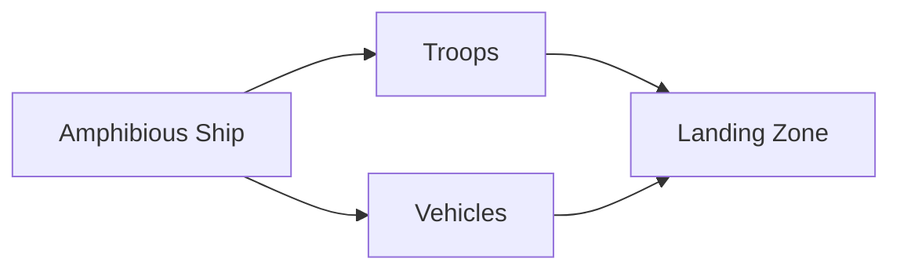
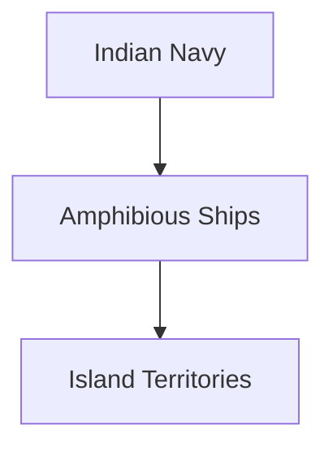
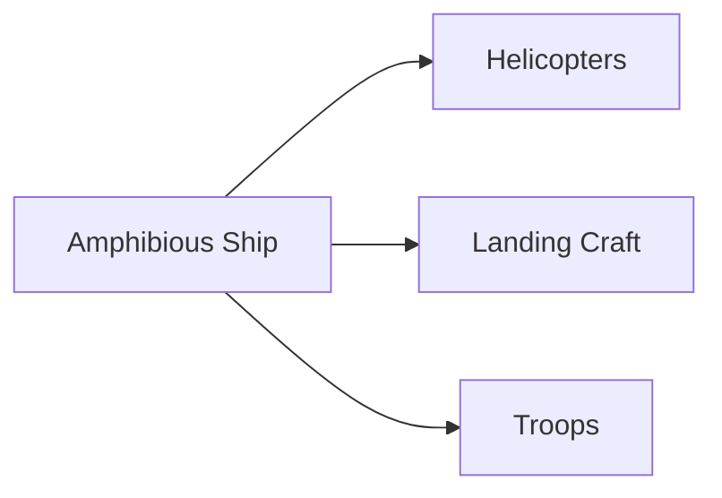

# Amphibious Ships

## Why It Matters

Amphibious ships enable armed forces to transport troops, vehicles, equipment and supplies from sea to land during military operations. They are essential for expeditionary warfare, island operations, disaster relief and humanitarian assistance missions.

For India, amphibious ships are particularly important because of the country's long coastline, island territories and strategic interests across the Indian Ocean Region.

---

## Quick Facts

| Item | Details |
|----------|----------|
| Primary Operator | Indian Navy |
| Main Purpose | Troop and Equipment Landing Operations |
| Key Capability | Sea-to-Shore Force Projection |
| Strategic Role | Amphibious Warfare |
| Secondary Role | Humanitarian Assistance and Disaster Relief |
| Strategic Importance | Rapid Deployment Capability |

---

## What Is an Amphibious Ship?

An amphibious ship is a naval vessel designed to transport and land military forces, vehicles and equipment onto hostile or friendly shores.

These ships act as a bridge between naval and land operations.

---

## Amphibious Operations

---

## Why Amphibious Ships Are Important

- Transport troops rapidly
- Support island operations
- Conduct amphibious assaults
- Deliver military equipment
- Support evacuation missions
- Provide disaster-relief assistance

---

## Major Amphibious Platforms of India

| Platform | Type |
|----------|----------|
| INS Jalashwa | Landing Platform Dock (LPD) |
| Magar Class | Landing Ship Tank (LST) |
| Shardul Class | Landing Ship Tank (LST) |

---

## INS Jalashwa

### Key Features

- Largest amphibious platform in the Indian Navy
- Troop transport capability
- Helicopter operations capability
- Humanitarian assistance support

### Importance

Serves as India's primary amphibious warfare platform.

---

## Magar Class

### Key Features

- Landing ship tank design
- Vehicle transport capability
- Troop deployment support
- Logistics operations support

### Importance

Provides amphibious transport capability for military operations.

---

## Shardul Class

### Key Features

- Indigenous landing ship tank
- Troop and cargo transport capability
- Disaster-relief support
- Amphibious deployment role

### Importance

Strengthens India's indigenous amphibious warfare capability.

---

## Role in Island Operations

These ships are important for supporting:

- Andaman and Nicobar Islands
- Lakshadweep Islands
- Remote coastal regions

---

## Humanitarian Assistance and Disaster Relief (HADR)

Amphibious ships frequently support:

- Cyclone relief
- Tsunami response
- Flood relief
- Medical assistance missions
- Evacuation operations

Their large cargo capacity makes them valuable during emergencies.

---

## Amphibious Task Force

---

## Strategic Importance for India

Amphibious ships help India:

- Protect island territories
- Respond to regional crises
- Support overseas deployments
- Conduct evacuation operations
- Strengthen maritime influence

---

## Challenges

- Limited amphibious fleet size
- Complex logistics requirements
- Need for escort protection
- High operating costs
- Growing regional security demands

---

## Future Roadmap

- Additional Landing Platform Docks (LPDs)
- Improved expeditionary capability
- Enhanced helicopter integration
- Greater indigenous shipbuilding
- Stronger amphibious warfare capability

---

## Quick Revision

- Amphibious ships transport troops and equipment from sea to land.
- INS Jalashwa is India's primary amphibious warfare ship.
- Magar and Shardul classes are landing ship tanks.
- Amphibious ships support military and disaster-relief operations.
- They are important for island territories and rapid deployments.
- Amphibious capability strengthens maritime power projection.

---

## Key Concepts

### What is an amphibious ship?

A naval vessel designed to transport and land troops and equipment ashore.

### Why are amphibious ships important?

They connect naval operations with land operations.

### What is INS Jalashwa?

India's primary amphibious warfare platform.

### What is an LPD?

A Landing Platform Dock used for amphibious operations.

### Why are amphibious ships important for India?

They support island defence, military deployment and disaster-relief missions.
