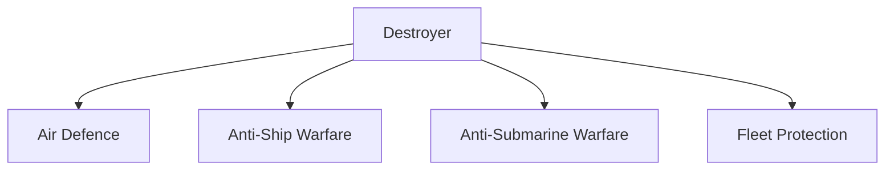
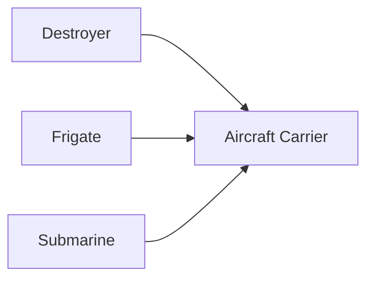
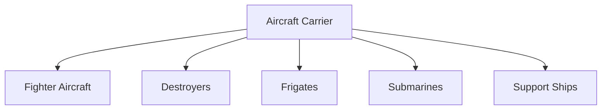

# Destroyers

## Why It Matters

Destroyers are among the most powerful surface combatants in a modern navy. They protect aircraft carriers, defend naval fleets, engage enemy warships, intercept aerial threats and conduct anti-submarine operations.

For India, destroyers form a critical part of maritime power projection and fleet defence in the Indian Ocean Region.

---

## Quick Facts

| Item | Details |
|----------|----------|
| Primary Operator | Indian Navy |
| Main Purpose | Fleet Protection and Multi-Role Warfare |
| Key Capability | Air, Surface and Subsurface Combat |
| Strategic Role | Sea Control |
| Major Weapon | Guided Missiles |
| Strategic Importance | Carrier Battle Group Protection |

---

## What Is a Destroyer?

A destroyer is a heavily armed warship designed to protect naval fleets while conducting air-defence, anti-ship and anti-submarine warfare operations.

Modern destroyers are multi-role combat platforms capable of operating independently or as part of a larger naval task force.

---

## Roles of a Destroyer

---

## Why Destroyers Are Important

- Protect aircraft carriers
- Defend naval task forces
- Engage hostile warships
- Detect and counter submarines
- Provide area air defence
- Project naval power

---

## Major Destroyer Classes of India

| Class | Category |
|----------|----------|
| Visakhapatnam Class | Guided Missile Destroyer |
| Kolkata Class | Guided Missile Destroyer |
| Delhi Class | Guided Missile Destroyer |
| Rajput Class | Earlier Guided Missile Destroyer |

---

## Visakhapatnam Class

### Key Features

- Advanced guided missile destroyer
- Modern sensors and radar systems
- Enhanced stealth features
- Multi-role combat capability

### Importance

Represents the latest generation of Indian destroyer design.

---

## Kolkata Class

### Key Features

- Long-range air-defence capability
- Advanced combat management systems
- BrahMos missile integration
- Fleet protection role

### Importance

Forms a major component of India's frontline naval fleet.

---

## Delhi Class

### Key Features

- Multi-role destroyer
- Air, surface and anti-submarine capability
- Proven operational record

### Importance

Served as the backbone of India's destroyer force for many years.

---

## BrahMos Integration

Many Indian destroyers are equipped with:

- BrahMos supersonic cruise missiles
- Long-range strike capability
- Anti-ship warfare systems
- Precision attack capability

This significantly increases naval combat power.

---

## Destroyers in a Carrier Battle Group

Destroyers provide an important defensive shield around aircraft carriers.

---

## Weapons and Systems

Destroyers typically carry:

- Surface-to-air missiles
- Anti-ship missiles
- Naval guns
- Torpedoes
- Anti-submarine weapons
- Helicopters

---

## Strategic Importance for India

Destroyers help India:

- Protect maritime trade routes
- Maintain regional naval presence
- Secure the Indian Ocean Region
- Support carrier operations
- Strengthen maritime deterrence

---

## Challenges

- High acquisition costs
- Complex maintenance requirements
- Evolving missile threats
- Increasing submarine threats
- Need for continuous modernization

---

## Future Roadmap

- More indigenous warship construction
- Advanced missile systems
- Improved sensors and radars
- Enhanced network-centric warfare capability
- Stronger carrier battle groups

---

## Quick Revision

- Destroyers are major multi-role surface combatants.
- They protect carriers and naval fleets.
- Visakhapatnam Class is India's newest destroyer class.
- Kolkata Class carries BrahMos missiles.
- Destroyers conduct air, surface and submarine warfare.
- They are central to maritime power projection.

---

## Key Concepts

### What is a destroyer?

A heavily armed warship designed for fleet protection and multi-role naval combat.

### Why are destroyers important?

They protect naval fleets from air, surface and underwater threats.

### Which is India's latest destroyer class?

The Visakhapatnam Class.

### What role do destroyers play in carrier battle groups?

They provide defensive protection and combat support.

### Why is BrahMos important for destroyers?

It provides long-range supersonic strike capability.

# Aircraft Carriers

## Why It Matters

Aircraft carriers are among the most powerful military platforms in the world. They function as mobile airbases at sea, allowing a country to project military power far beyond its coastline.

For India, aircraft carriers are critical for protecting maritime interests, securing sea lanes, supporting naval operations and maintaining a strong presence in the Indian Ocean Region.

---

## Quick Facts

| Item | Details |
|----------|----------|
| Primary Operator | Indian Navy |
| Main Purpose | Sea-Based Air Power |
| Key Capability | Mobile Airbase |
| Strategic Role | Power Projection |
| Operational Area | Indian Ocean Region and Beyond |
| Strategic Importance | Maritime Dominance |

---

## What Is an Aircraft Carrier?

An aircraft carrier is a warship designed to carry, launch, recover and support military aircraft while operating at sea.

It acts as a floating airbase capable of conducting air operations without relying on land-based infrastructure.

---

## Aircraft Carrier Battle Group

---

## Why Aircraft Carriers Are Important

- Project power far from home waters
- Protect maritime trade routes
- Support naval air operations
- Strengthen deterrence capability
- Enhance regional influence
- Support humanitarian operations

---

## India's Aircraft Carriers

| Carrier | Status | Type |
|----------|----------|----------|
| INS Vikramaditya | Active Service | Aircraft Carrier |
| INS Vikrant | Active Service | Indigenous Aircraft Carrier |

---

## INS Vikramaditya

### Key Features

- Modified aircraft carrier platform
- Operates carrier-based fighter aircraft
- Supports long-range naval operations
- Major component of India's naval power

### Importance

Served as India's primary aircraft carrier before the induction of INS Vikrant.

---

## INS Vikrant

### Key Features

- Indigenous Aircraft Carrier (IAC)
- Designed and built in India
- Supports carrier-based aviation
- Major milestone in Indian shipbuilding

### Importance

Represents India's growing capability in advanced naval construction and maritime self-reliance.

---

## Carrier-Based Aircraft

Aircraft carriers support:

- Fighter aircraft
- Helicopters
- Surveillance aircraft
- Search and rescue operations

### Major Aircraft

| Aircraft | Role |
|----------|----------|
| MiG-29K | Carrier-Based Fighter |
| MH-60R | Naval Helicopter |
| Kamov Helicopters | Naval Operations |

---

## Aircraft Carrier Operations

---

## Strategic Importance for India

Aircraft carriers help India:

- Maintain presence in the Indian Ocean
- Protect maritime trade routes
- Respond to regional crises
- Support friendly nations
- Conduct humanitarian assistance operations

---

## Challenges

- High acquisition costs
- Complex maintenance requirements
- Need for escort warships
- Evolving anti-ship missile threats
- Requirement for advanced naval aviation

---

## Future Roadmap

- Strengthening carrier battle groups
- Expansion of indigenous shipbuilding capability
- Advanced carrier aviation systems
- Enhanced maritime surveillance integration
- Future carrier development discussions

---

## Quick Revision

- Aircraft carriers are floating airbases.
- They project military power far from shore.
- INS Vikramaditya and INS Vikrant are India's aircraft carriers.
- INS Vikrant is India's indigenous aircraft carrier.
- Carriers operate alongside destroyers, frigates and submarines.
- Aircraft carriers are central to maritime power projection.

---

## Key Concepts

### What is an aircraft carrier?

A warship that operates military aircraft at sea.

### Why are aircraft carriers important?

They provide sea-based air power and long-range military reach.

### Which aircraft carriers are currently operated by India?

INS Vikramaditya and INS Vikrant.

### Why is INS Vikrant significant?

It is India's first indigenously built aircraft carrier.

### What is a carrier battle group?

A formation of warships and support vessels built around an aircraft carrier.
