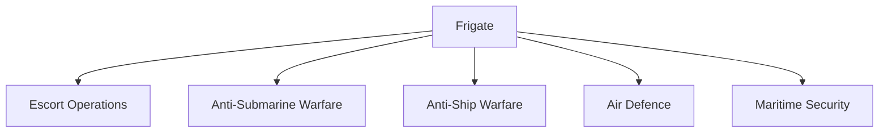
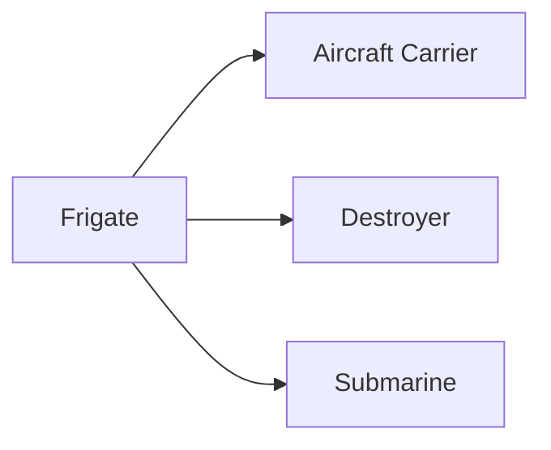

# Frigates

## Why It Matters

Frigates are versatile multi-role warships that form the backbone of many modern naval fleets. They protect larger ships, conduct anti-submarine operations, provide air defence, escort merchant vessels and participate in maritime security missions.

For India, frigates are essential for maintaining naval presence across the Indian Ocean Region and supporting carrier battle groups.

---

## Quick Facts

| Item | Details |
|----------|----------|
| Primary Operator | Indian Navy |
| Main Purpose | Multi-Role Naval Warfare |
| Key Capability | Escort and Fleet Operations |
| Strategic Role | Maritime Security |
| Major Strength | Operational Flexibility |
| Strategic Importance | Sea Control and Fleet Support |

---

## What Is a Frigate?

A frigate is a medium-sized warship designed to perform multiple combat roles, including anti-submarine warfare, anti-ship warfare, air defence and escort operations.

Frigates are among the most versatile vessels in a navy.

---

## Roles of a Frigate

---

## Why Frigates Are Important

- Protect naval task forces
- Escort aircraft carriers
- Hunt submarines
- Secure sea lanes
- Conduct independent patrols
- Support maritime diplomacy

---

## Major Frigate Classes of India

| Class | Type | Key Role |
|----------|----------|----------|
| Shivalik Class | Stealth Frigate | Multi-Role Warfare |
| Talwar Class | Guided Missile Frigate | Fleet Operations |
| Nilgiri Class (Project 17A) | Next-Generation Frigate | Advanced Multi-Role Warfare |
| Brahmaputra Class | Frigate | Escort Operations |

---

## Shivalik Class

### Key Features

- India's first stealth frigate class
- Multi-role combat capability
- Advanced sensors and weapons
- Integrated combat systems

### Importance

Marked a major step in indigenous naval warship design.

---

## Talwar Class

### Key Features

- Guided missile frigate
- Strong anti-ship capability
- Proven operational performance
- Long-range deployment capability

### Importance

Forms a major component of India's frontline frigate fleet.

---

## Nilgiri Class (Project 17A)

### Key Features

- Advanced stealth design
- Improved automation
- Enhanced survivability
- Modern combat management systems

### Importance

Represents the future of India's frigate fleet.

---

## Brahmaputra Class

### Key Features

- Multi-role capability
- Escort operations
- Maritime patrol support
- Fleet integration capability

### Importance

Served as an important indigenous frigate class.

---

## Frigates in Naval Task Forces

Frigates provide flexible support across the entire naval task force.

---

## Weapons and Systems

Frigates typically carry:

- Surface-to-air missiles
- Anti-ship missiles
- Torpedoes
- Naval guns
- Sonar systems
- Naval helicopters

---

## Anti-Submarine Warfare Role

Frigates are among the most important anti-submarine platforms in modern navies.

They use:

- Sonar systems
- Torpedoes
- Helicopters
- Underwater sensors

To detect and neutralize submarine threats.

---

## Strategic Importance for India

Frigates help India:

- Protect maritime trade routes
- Secure the Indian Ocean Region
- Conduct long-range deployments
- Support friendly nations
- Strengthen maritime deterrence

---

## Challenges

- Growing submarine threats
- Advanced missile technologies
- Long deployment cycles
- High maintenance requirements
- Rapid technological change

---

## Future Roadmap

- Expansion of Project 17A fleet
- Greater indigenous shipbuilding
- Improved stealth capabilities
- Advanced missile systems
- Enhanced network-centric warfare integration

---

## Quick Revision

- Frigates are versatile multi-role warships.
- Shivalik Class is India's first stealth frigate.
- Talwar Class is a major guided missile frigate.
- Nilgiri Class represents the next generation of frigates.
- Frigates play a major anti-submarine role.
- They are essential for fleet escort and maritime security.

---

## Key Concepts

### What is a frigate?

A multi-role warship designed for escort and combat operations.

### Why are frigates important?

They provide flexible naval combat capability and fleet protection.

### What is India's first stealth frigate?

The Shivalik Class.

### What is Project 17A?

India's next-generation frigate programme.

### Why are frigates important in anti-submarine warfare?

They combine sonar, helicopters and weapons to detect and engage submarines.
