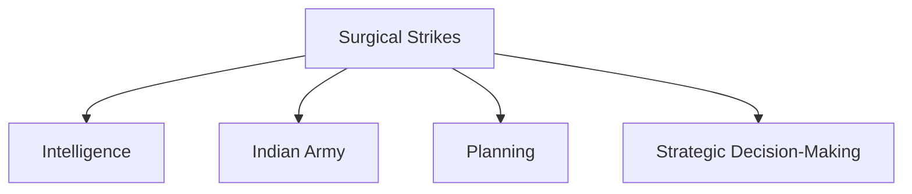

# Surgical Strikes (2016)

## Why It Matters

The 2016 Surgical Strikes marked an important moment in India's modern security and military response framework.

Conducted across the Line of Control (LoC), the operation demonstrated India's willingness to undertake precise, intelligence-driven military action against terrorist infrastructure while maintaining a limited operational scope.

The operation influenced strategic thinking, deterrence policy and future counter-terrorism responses.

---

## Quick Facts

| Item | Details |
|----------|----------|
| Operation | Surgical Strikes |
| Year | 2016 |
| Trigger | Uri Terror Attack |
| Location | Line of Control (LoC) |
| Type | Counter-Terrorism Operation |
| Objective | Target Terrorist Launch Infrastructure |
| Strategic Importance | Modern Response Doctrine |

---

## Background

In September 2016, a terrorist attack took place at an Indian Army installation in Uri, Jammu and Kashmir.

The attack resulted in significant casualties and generated strong national-security concerns.

Following intelligence assessments and operational planning, India conducted surgical strikes against terrorist launch infrastructure across the Line of Control.

---

## Objectives

- Target terrorist launch infrastructure
- Prevent future infiltration attempts
- Strengthen deterrence
- Demonstrate response capability
- Protect national security interests

---

## Operational Overview

---

## Planning and Intelligence

The operation relied heavily on:

- Intelligence gathering
- Surveillance inputs
- Target identification
- Operational secrecy
- Detailed mission planning

Accurate intelligence was critical to mission success.

---

## Execution

The strikes were designed as focused and limited military operations.

Key characteristics included:

- Precision targeting
- Limited objectives
- Careful planning
- Rapid execution
- Controlled escalation

---

## Components of the Operation

---

## Strategic Significance

The operation demonstrated:

- Precision-response capability
- Operational readiness
- Intelligence-led operations
- Counter-terrorism capability
- Strategic signaling

---

## Military Impact

The operation highlighted:

- Importance of special operations
- Value of intelligence integration
- Need for rapid decision-making
- Importance of operational secrecy

---

## Diplomatic Impact

The strikes attracted significant international attention and became an important development in discussions related to regional security and counter-terrorism.

---

## Long-Term Impact

The operation influenced future thinking regarding:

- Counter-terrorism responses
- Cross-border operations
- Strategic deterrence
- Military preparedness

---

## Key Lessons

- Intelligence is critical for modern operations.
- Precision can achieve strategic objectives.
- Rapid execution improves effectiveness.
- Joint planning enhances operational success.
- Controlled escalation remains important.

---

## Legacy

The 2016 Surgical Strikes are widely regarded as a significant example of modern precision military operations and an important milestone in India's evolving security doctrine.

---

## Quick Revision

- Conducted in 2016 after the Uri attack.
- Focused on terrorist launch infrastructure.
- Relied heavily on intelligence and planning.
- Demonstrated precision military capability.
- Influenced modern response doctrine.
- Highlighted the importance of special operations.

---

## Key Concepts

### What were the Surgical Strikes?

Precision counter-terrorism operations conducted across the Line of Control in 2016.

### What triggered the operation?

The Uri terror attack.

### Why were the strikes important?

They demonstrated India's precision-response capability.

### What was the key factor behind success?

Intelligence-driven planning and execution.

### What was the long-term impact?

The operation influenced India's modern counter-terrorism and deterrence framework.
