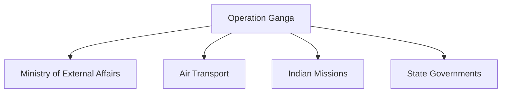

# Operation Ganga

## Why It Matters

Operation Ganga was a major evacuation mission conducted by India in 2022 to bring back Indian citizens stranded in Ukraine during the Russia-Ukraine conflict.

The operation demonstrated India's ability to conduct large-scale overseas evacuation missions, coordinate across multiple countries and provide assistance to citizens during an international crisis.

It is an important example of modern humanitarian and diplomatic operations involving multiple government agencies.

---

## Quick Facts

| Item | Details |
|----------|----------|
| Operation Name | Operation Ganga |
| Year | 2022 |
| Type | Evacuation Operation |
| Location | Ukraine and Neighbouring Countries |
| Objective | Evacuate Indian Citizens |
| Lead Agencies | Government of India, Ministry of External Affairs |
| Outcome | Successful Large-Scale Evacuation |

---

## Background

In February 2022, conflict escalated in Ukraine following the Russian military offensive.

Thousands of Indian citizens, particularly students, were present in different parts of Ukraine.

The rapidly changing security situation created an urgent need for evacuation.

---

## Objectives

- Ensure the safety of Indian citizens
- Facilitate evacuation from conflict zones
- Coordinate transportation through neighbouring countries
- Provide logistical and diplomatic support
- Bring citizens back to India safely

---

## Operational Overview

---

## Evacuation Strategy

### Movement to Border Areas

Citizens were advised to move toward neighbouring countries where evacuation arrangements could be organized more effectively.

### International Coordination

India coordinated with:

- Ukraine
- Poland
- Romania
- Hungary
- Slovakia
- Moldova

### Air Evacuation

Special flights were arranged to transport citizens back to India.

---

## Multi-Agency Coordination

---

## Challenges Faced

- Active conflict environment
- Rapidly changing security conditions
- Transportation disruptions
- Large number of citizens requiring assistance
- Cross-border movement coordination
- Communication challenges

---

## Role of Diplomacy

Diplomatic engagement helped:

- Coordinate evacuation routes
- Facilitate border crossings
- Support stranded citizens
- Maintain communication with partner countries

---

## Importance of the Operation

Operation Ganga demonstrated:

- Crisis-management capability
- International coordination effectiveness
- Consular support capacity
- Large-scale evacuation planning
- Citizen protection abroad

---

## Comparison with Other Evacuation Missions

| Operation | Year | Purpose |
|----------|----------|----------|
| Operation Rahat | 2015 | Yemen Evacuation |
| Operation Devi Shakti | 2021 | Afghanistan Evacuation |
| Operation Ganga | 2022 | Ukraine Evacuation |

---

## Key Lessons

- Importance of contingency planning
- Need for rapid coordination
- Value of diplomatic engagement
- Importance of transportation networks
- Effective communication with citizens abroad

---

## Legacy

Operation Ganga is regarded as one of India's largest and most complex overseas evacuation missions and demonstrated the country's ability to protect its citizens during an international crisis.

---

## Quick Revision

- Operation Ganga was conducted in 2022.
- It evacuated Indian citizens from Ukraine.
- Multiple neighbouring countries assisted evacuation efforts.
- Special flights brought citizens back to India.
- The operation highlighted India's crisis-response capability.
- It demonstrated effective diplomatic and logistical coordination.

---

## Key Concepts

### What was Operation Ganga?

India's evacuation mission for citizens stranded in Ukraine during the 2022 conflict.

### Why was Operation Ganga launched?

To ensure the safe return of Indian citizens from a conflict zone.

### Which ministry played a major role?

The Ministry of External Affairs.

### What was the biggest challenge?

Conducting evacuation during an active conflict.

### Why is Operation Ganga important?

It demonstrated India's ability to conduct large-scale overseas evacuation operations.
