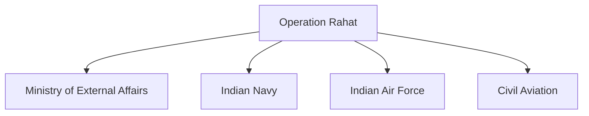

# Operation Rahat

## Why It Matters

Operation Rahat was one of India's largest overseas evacuation missions. Conducted in 2015 during the conflict in Yemen, the operation demonstrated India's ability to safely evacuate citizens from an active conflict zone through coordinated diplomatic, military and civilian efforts.

The mission highlighted India's growing capability to protect its citizens abroad and conduct complex humanitarian operations under challenging conditions.

---

## Quick Facts

| Item | Details |
|----------|----------|
| Operation Name | Operation Rahat |
| Year | 2015 |
| Location | Yemen |
| Type | Evacuation Operation |
| Objective | Evacuate Citizens from Conflict Zone |
| Participants | Indian Government, Navy, Air Force and Civil Agencies |
| Outcome | Successful Evacuation |

---

## Background

In 2015, the security situation in Yemen deteriorated rapidly due to armed conflict.

Thousands of Indian citizens were present in different parts of the country, creating an urgent need for evacuation.

The Government of India launched Operation Rahat to safely bring them home.

---

## Objectives

- Protect Indian citizens
- Evacuate people from conflict areas
- Coordinate international transit routes
- Provide humanitarian assistance
- Ensure safe return to India

---

## Operational Overview

---

## Multi-Agency Coordination

The operation required close coordination among multiple government agencies.

---

## Role of the Indian Navy

The Indian Navy played a major role by:

- Deploying naval vessels
- Transporting evacuees
- Supporting maritime evacuation routes
- Assisting humanitarian efforts

---

## Role of the Indian Air Force

The Indian Air Force supported:

- Airlift operations
- Transportation of evacuees
- Emergency logistical support
- Rapid movement of personnel

---

## Diplomatic Coordination

The operation depended heavily on diplomatic engagement to:

- Secure evacuation routes
- Coordinate with regional governments
- Facilitate safe movement
- Support citizens on the ground

---

## Challenges Faced

- Active conflict environment
- Rapidly changing security conditions
- Transportation disruptions
- Large-scale coordination requirements
- Humanitarian concerns
- Limited operational time windows

---

## Strategic Importance

Operation Rahat demonstrated:

- Overseas evacuation capability
- Crisis-response capacity
- Joint civil-military coordination
- Diplomatic effectiveness
- Humanitarian commitment

---

## Comparison with Other Evacuation Operations

| Operation | Year | Location |
|----------|----------|----------|
| Operation Rahat | 2015 | Yemen |
| Operation Devi Shakti | 2021 | Afghanistan |
| Operation Ganga | 2022 | Ukraine |

---

## Key Lessons

- Importance of contingency planning
- Need for rapid coordination
- Value of diplomatic engagement
- Importance of logistics and mobility
- Effective communication during crises

---

## Legacy

Operation Rahat is regarded as one of India's most successful overseas evacuation missions and remains an important example of humanitarian crisis response.

---

## Quick Revision

- Operation Rahat was conducted in 2015.
- It evacuated citizens from Yemen.
- The Navy and Air Force played major roles.
- It required extensive diplomatic coordination.
- The operation demonstrated India's evacuation capability.
- It remains a major humanitarian mission in India's history.

---

## Key Concepts

### What was Operation Rahat?

A large-scale evacuation operation conducted during the Yemen conflict.

### Why was Operation Rahat launched?

To safely evacuate citizens from a conflict zone.

### Which organizations played major roles?

The Ministry of External Affairs, Indian Navy, Indian Air Force and civil agencies.

### Why is Operation Rahat important?

It demonstrated India's ability to conduct complex overseas evacuation missions.

### What is the main lesson from Operation Rahat?

Successful crisis response requires military, diplomatic and logistical coordination.
