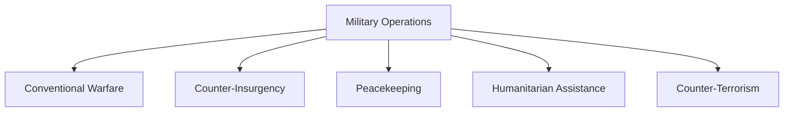

# Major Military Operations

## Why It Matters

Military operations provide valuable lessons about strategy, leadership, logistics, intelligence, technology and national security.

India's military history includes conventional wars, counter-insurgency operations, peacekeeping missions, humanitarian assistance operations and cross-border actions. Understanding these operations helps explain how India's defence doctrine and military capabilities evolved over time.

---

## Quick Facts

| Item | Details |
|----------|----------|
| Domain | Military History |
| Coverage | Wars, Operations and Campaigns |
| Period | 1947–Present |
| Participants | Army, Navy, Air Force and Joint Forces |
| Importance | National Security Learning |
| Strategic Value | Defence Doctrine Development |

---

## Evolution of Major Military Operations

---

## First Indo-Pak War (1947–48)

### Background

The conflict began after tribal forces and Pakistani-supported elements entered Jammu and Kashmir following independence.

### Objectives

- Defend Jammu and Kashmir
- Protect territorial integrity
- Secure key locations

### Outcome

- Indian forces secured major areas of Jammu and Kashmir.
- A ceasefire line was established.
- The issue later evolved into the Line of Control (LoC).

### Importance

India's first major military conflict after independence.

---

## Operation Vijay (Goa Liberation, 1961)

### Background

Goa, Daman and Diu remained under Portuguese control after Indian independence.

### Objectives

- End colonial rule
- Integrate Goa into India

### Outcome

- Portuguese rule ended.
- Goa became part of India.

### Importance

Completed the integration of major colonial territories into the Indian Union.

---

## Sino-Indian War (1962)

### Background

Border disputes along the Himalayan frontier led to armed conflict.

### Key Areas

- Ladakh
- North-East Frontier Agency (now Arunachal Pradesh)

### Lessons Learned

- Importance of military preparedness
- Need for infrastructure development
- Importance of intelligence and logistics

### Importance

A major turning point in India's defence modernization.

---

## Indo-Pak War (1965)

### Background

Conflict emerged primarily over Jammu and Kashmir.

### Objectives

- Defend territorial integrity
- Counter military aggression

### Outcome

- Large-scale military engagements occurred on multiple fronts.
- Ceasefire ended hostilities.

### Importance

Demonstrated India's ability to respond to conventional military threats.

---

## Indo-Pak War (1971)

### Background

Political and humanitarian crisis in East Pakistan led to conflict.

### Objectives

- Address regional security concerns
- Support stability in the region

### Outcome

- Creation of Bangladesh.
- One of India's most decisive military victories.

### Importance

Widely regarded as India's most successful conventional military campaign.

---

## Operation Meghdoot (1984)

### Background

Strategic competition emerged over the Siachen Glacier region.

### Objectives

- Secure key heights in Siachen
- Protect strategic territory

### Outcome

- India established control over critical positions.

### Importance

Created the world's highest battlefield.

---

## Indian Peace Keeping Force (IPKF) – Sri Lanka

### Background

India deployed forces to Sri Lanka under the Indo-Sri Lanka Accord.

### Objectives

- Support peace implementation
- Stabilize the security environment

### Lessons Learned

- Complexities of peacekeeping operations
- Challenges of counter-insurgency environments

---

## Operation Cactus (1988)

### Background

A coup attempt occurred in the Maldives.

### Objectives

- Support the Maldivian government
- Restore stability

### Outcome

- Rapid deployment successfully stabilized the situation.

### Importance

Demonstrated India's rapid military response capability in the Indian Ocean region.

---

## Kargil War (Operation Vijay, 1999)

### Background

Pakistani intrusions were detected in the Kargil sector.

### Objectives

- Evict infiltrators
- Restore territorial control

### Outcome

- Indian forces regained occupied positions.
- Territorial integrity was restored.

### Importance

Highlighted the importance of surveillance, intelligence and joint operations.

---

## Operation Parakram (2001–02)

### Background

Large-scale military mobilization occurred following the Parliament attack.

### Importance

- Demonstrated military readiness
- Influenced future military doctrines

---

## Operation Rahat (2013)

### Background

Major floods affected Uttarakhand.

### Objective

- Humanitarian assistance and disaster relief

### Importance

One of India's largest rescue operations.

---

## Operation Maitri (2015)

### Background

A devastating earthquake struck Nepal.

### Objective

- Humanitarian assistance and disaster relief

### Importance

Demonstrated regional humanitarian response capability.

---

## Surgical Strikes (2016)

### Background

Conducted in response to terrorist attacks.

### Objectives

- Target terrorist launch infrastructure
- Strengthen deterrence

### Importance

Highlighted India's evolving counter-terrorism response posture.

---

## Balakot Air Strike (2019)

### Background

Conducted after the Pulwama terror attack.

### Objectives

- Target terrorist infrastructure
- Demonstrate response capability

### Importance

Marked a significant modern air-power operation.

---

## Categories of Military Operations

---

## Key Lessons from Military History

- Importance of logistics
- Importance of intelligence
- Joint-force coordination
- Technological modernization
- Infrastructure development
- Strategic preparedness
- Rapid decision-making

---

## Quick Revision

- 1947–48: First Indo-Pak War.
- 1961: Goa Liberation.
- 1962: Sino-Indian War.
- 1965: Indo-Pak War.
- 1971: Creation of Bangladesh.
- 1984: Operation Meghdoot.
- 1988: Operation Cactus.
- 1999: Kargil War.
- 2016: Surgical Strikes.
- 2019: Balakot Air Strike.

---

## Key Concepts

### Why is military history important?

It provides lessons for future military planning and national security.

### Which was India's most decisive military victory?

The 1971 Indo-Pak War leading to the creation of Bangladesh.

### What was Operation Meghdoot?

The operation to secure key positions in the Siachen Glacier region.

### Why is the Kargil War important?

It highlighted the importance of surveillance, intelligence and joint military operations.

### What do modern military operations demonstrate?

The evolution of India's military capabilities, doctrine and strategic response options.
