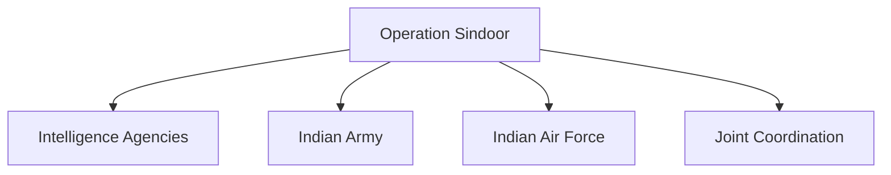

# Operation Sindoor

## Why It Matters

Operation Sindoor was one of India's most significant military operations in recent years. Conducted in 2025, it demonstrated India's capability to carry out precision strikes against terrorist infrastructure while combining intelligence, surveillance and coordinated military planning.

The operation became an important milestone in the evolution of India's modern counter-terrorism and national-security doctrine.

---

## Quick Facts

| Item | Details |
|----------|----------|
| Operation Name | Operation Sindoor |
| Year | 2025 |
| Type | Counter-Terrorism Military Operation |
| Objective | Target Terrorist Infrastructure |
| Nature | Precision Strike Operation |
| Strategic Importance | Modern Security Doctrine |
| Domain | National Security |

---

## Background

Operation Sindoor was launched following a major terrorist attack in Jammu and Kashmir that resulted in civilian casualties and generated significant national-security concerns.

The attack led to a coordinated security response involving intelligence assessment, operational planning and precision military action.

---

## Triggering Event

The operation was designed as a response to terrorist threats and aimed to strengthen deterrence against future attacks.

---

## Objectives

- Target terrorist infrastructure
- Disrupt terrorist networks
- Strengthen deterrence
- Demonstrate response capability
- Protect national security interests
- Reduce future threats

---

## Planning and Intelligence

The operation relied heavily on:

- Intelligence gathering
- Surveillance systems
- Target identification
- Risk assessment
- Mission planning
- Operational coordination

Accurate intelligence was essential to ensure precision and effectiveness.

---

## Operational Overview

---

## Role of the Armed Forces

The operation highlighted the importance of coordination among multiple security and military organizations.

---

## Precision Strike Capability

Operation Sindoor demonstrated:

- Precision targeting
- Rapid response capability
- Intelligence-driven operations
- Modern surveillance integration
- Controlled military action

---

## Strategic Significance

The operation demonstrated:

- National resolve against terrorism
- Operational readiness
- Advanced military capability
- Effective intelligence integration
- Strong deterrence posture

---

## Military Impact

Key military lessons included:

- Importance of intelligence dominance
- Value of precision engagement
- Need for rapid decision-making
- Benefits of joint-force coordination
- Importance of technological superiority

---

## Diplomatic Impact

Operation Sindoor attracted significant international attention and became an important development in discussions related to regional security, counter-terrorism and strategic stability.

---

## Long-Term Impact

The operation is expected to influence:

- Counter-terrorism strategy
- Military preparedness
- Intelligence coordination
- National-security planning
- Future response frameworks

---

## Key Lessons

- Intelligence is critical for modern operations.
- Precision strikes require extensive planning.
- Rapid response improves deterrence.
- Joint coordination enhances effectiveness.
- Technology plays a major role in modern warfare.

---

## Legacy

Operation Sindoor is expected to remain an important case study in India's modern security and counter-terrorism framework and will likely be studied alongside the Surgical Strikes of 2016 and the Balakot Air Strike of 2019.

---

## Quick Revision

- Operation Sindoor was conducted in 2025.
- It followed a major terrorist attack.
- The operation focused on terrorist infrastructure.
- Intelligence and surveillance played key roles.
- It demonstrated precision-strike capability.
- It became an important milestone in modern security doctrine.

---

## Key Concepts

### What was Operation Sindoor?

A military operation conducted by India in 2025 against terrorist infrastructure.

### Why was it launched?

In response to a major terrorist attack and associated security concerns.

### Why is Operation Sindoor important?

It demonstrated modern precision-strike and counter-terrorism capabilities.

### What role did intelligence play?

Intelligence supported target identification, planning and execution.

### What is the long-term significance of Operation Sindoor?

It contributes to the evolution of India's contemporary security and response doctrine.
