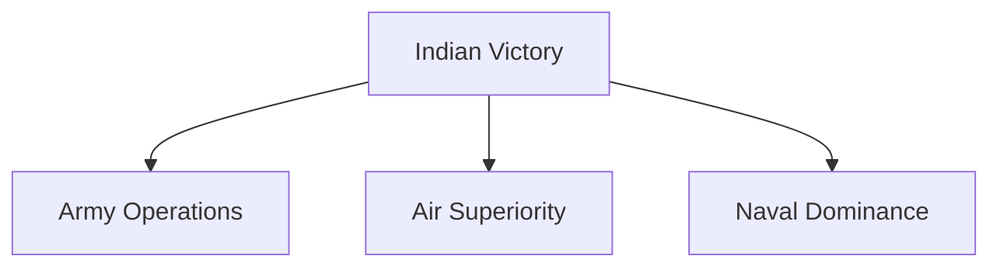

# 1971 Indo-Pak War and Liberation of Bangladesh

## Why It Matters

- Largest military victory in independent India's history.
- Led to the creation of Bangladesh.
- One of the fastest decisive military campaigns in modern warfare.
- Demonstrated successful joint operations by the Army, Navy, and Air Force.
- Resulted in the surrender of approximately 93,000 Pakistani personnel.
- Reshaped South Asian geopolitics.

---

## Quick Facts

| Item | Details |
|--------|---------|
| Conflict | Indo-Pak War of 1971 |
| Duration | 3–16 December 1971 |
| Countries | India and Pakistan |
| Main Theatre | East Pakistan and Western Front |
| Result | Decisive Indian victory |
| New Nation Created | Bangladesh |
| Pakistani Surrender | 16 December 1971 |
| Prisoners of War | ~93,000 |
| Indian Prime Minister | Indira Gandhi |
| Pakistani President | Yahya Khan |

---

## Background

### Partition of Pakistan

---

### Political and Economic Disparities

Although East Pakistan had a larger population, political power remained concentrated in West Pakistan.

Economic disparities, language disputes, and political marginalization created growing tensions between the two regions.

---

### Bangladesh Liberation Movement

The Awami League, led by Sheikh Mujibur Rahman, won the 1970 elections.

The refusal to transfer power led to widespread unrest in East Pakistan.

Pakistan launched military operations to suppress the movement, leading to a humanitarian crisis and a large refugee influx into India.

---

## Road to War

---

## Mukti Bahini

The Mukti Bahini was the Bengali resistance force fighting against Pakistani military rule in East Pakistan.

India provided training, logistical assistance, intelligence support, and operational coordination.

The resistance movement played a significant role in weakening Pakistani control before the full-scale war.

---

## Start of the War

On 3 December 1971, Pakistan launched pre-emptive air strikes against Indian airfields.

India formally entered the conflict and launched coordinated operations on both eastern and western fronts.

---

## Major Military Operations

### Eastern Front

India's primary objective was the liberation of East Pakistan.

Indian forces rapidly advanced toward Dhaka through multiple axes.

### Western Front

India conducted defensive and offensive operations to prevent Pakistani gains and maintain strategic pressure.

---

## Role of the Indian Armed Forces

### Indian Army

Led the ground campaign and achieved rapid advances across East Pakistan.

### Indian Air Force

Established air superiority and supported ground operations.

### Indian Navy

Conducted successful naval operations and blockades.

Important naval actions included:

- Operation Trident
- Operation Python
- Naval blockade of East Pakistan

---

## Fall of Dhaka

Indian and Mukti Bahini forces surrounded Dhaka.

Pakistani military resistance collapsed rapidly.

On 16 December 1971, Lieutenant General A. A. K. Niazi signed the Instrument of Surrender.

---

## Surrender of Pakistani Forces

| Item | Details |
| -------- | -------- |
| Date | 16 December 1971 |
| Location | Dhaka |
| Pakistani Commander | Lt Gen A. A. K. Niazi |
| Indian Commander | Lt Gen Jagjit Singh Aurora |
| POWs | Approximately 93,000 |

The surrender remains one of the largest military surrenders since World War II.

---

## Creation of Bangladesh

The war resulted in the emergence of Bangladesh as an independent nation.

It fundamentally altered the political and strategic landscape of South Asia.

---

## Impact on India

Major outcomes included:

- Decisive military victory
- Enhanced regional influence
- Demonstration of joint warfare capability
- Strengthening of military confidence
- Major strategic success against Pakistan

---

## Long-Term Significance

The 1971 war demonstrated:

- Effectiveness of joint military operations
- Importance of political and military coordination
- Strategic value of air superiority
- Role of naval blockades in warfare
- Importance of clear military objectives

---

## Quick Revision

- The war was fought in December 1971.
- Bangladesh emerged as an independent nation.
- India achieved a decisive military victory.
- Approximately 93,000 Pakistani personnel surrendered.
- The conflict remains India's most significant military success after independence.

---

## Key Concepts

### Easy

1. When was the 1971 Indo-Pak War fought?
2. Which country was created after the war?
3. What was the Mukti Bahini?
4. When did Pakistan surrender?

### Intermediate

1. What were the causes of the 1971 war?
2. Explain India's role in the Bangladesh Liberation movement.
3. Why was the Eastern Front decisive?
4. What role did the Indian Navy play?

### Advanced

1. Analyse the strategic reasons behind India's victory in 1971.
2. Evaluate the role of joint operations in the war.
3. Explain the geopolitical impact of Bangladesh's creation.
