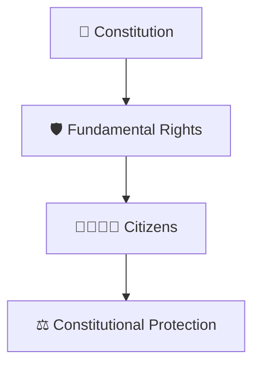
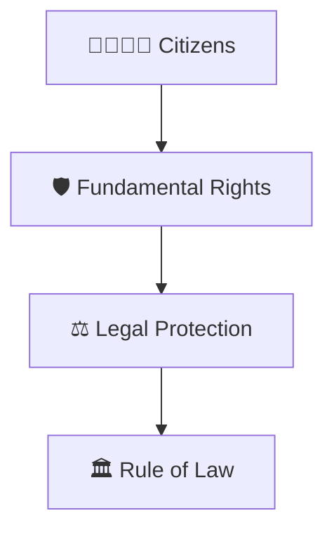
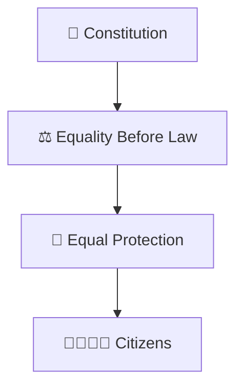
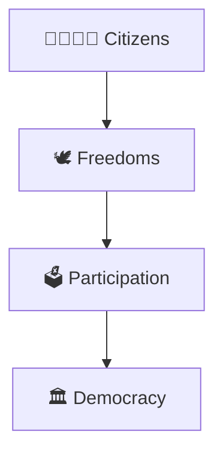
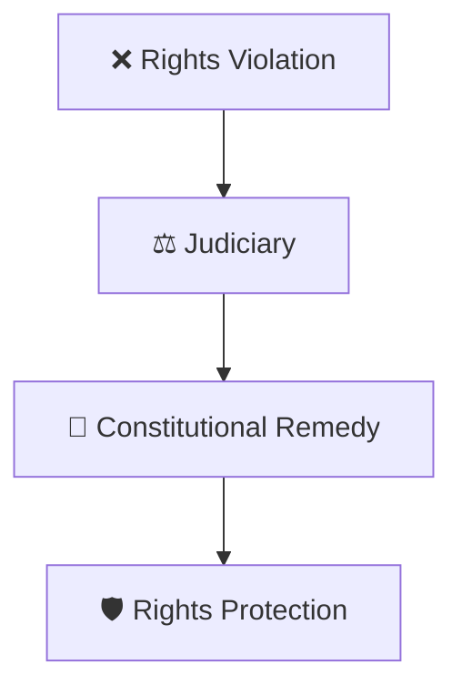
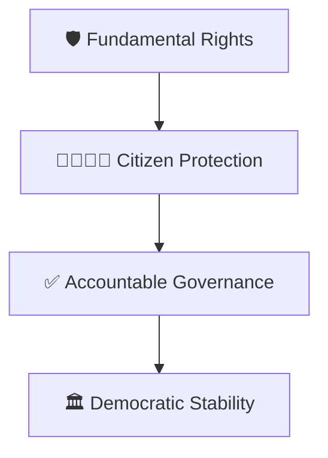
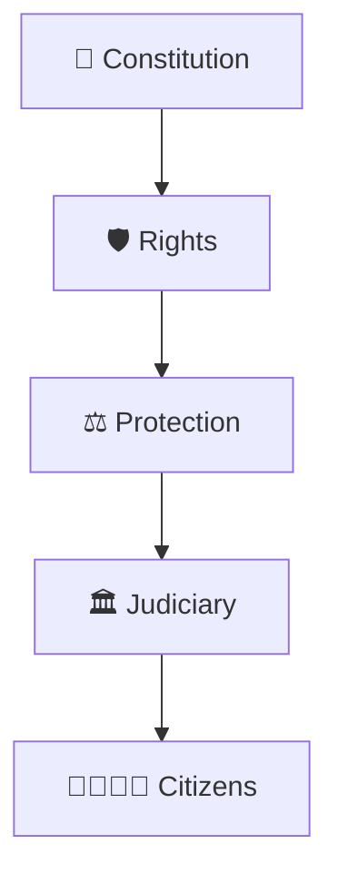

# Fundamental Rights Framework

## Overview

This diagram explains the Fundamental Rights guaranteed by the Constitution of India and how they protect citizens from arbitrary use of power.

It helps visualize the relationship between citizens, constitutional protections, institutions, and the rule of law.

---

## Why It Matters

Understanding Fundamental Rights helps explain:

- What rights citizens possess
- How liberty and equality are protected
- How constitutional democracy functions
- How citizens can challenge violations of rights
- How the Constitution protects individuals

---

## Fundamental Rights Framework

---

## Rights Protection Model

### Purpose

- Protect individual liberty
- Safeguard equality
- Strengthen democracy

---

## Equality Framework

### Significance

- Prevents discrimination
- Supports fairness
- Promotes equal opportunity

---

## Freedom Framework

### Significance

- Enables public participation
- Protects personal liberty
- Strengthens democratic society

---

## Constitutional Remedy Framework

### Purpose

- Enforce constitutional rights
- Protect citizens from abuse of power
- Maintain constitutional governance

---

## Rights and Governance Relationship

### Significance

- Limits arbitrary power
- Protects constitutional values
- Supports rule of law

---

## Citizen Protection Cycle

---

## Quick Revision

---

## Related Topics

- constitutional-governance-model.md
- constitution-amendment-process.md
- basic-structure-doctrine.md
- directive-principles-framework.md
- judicial-review-framework.md
- constitutional-development-timeline.md
