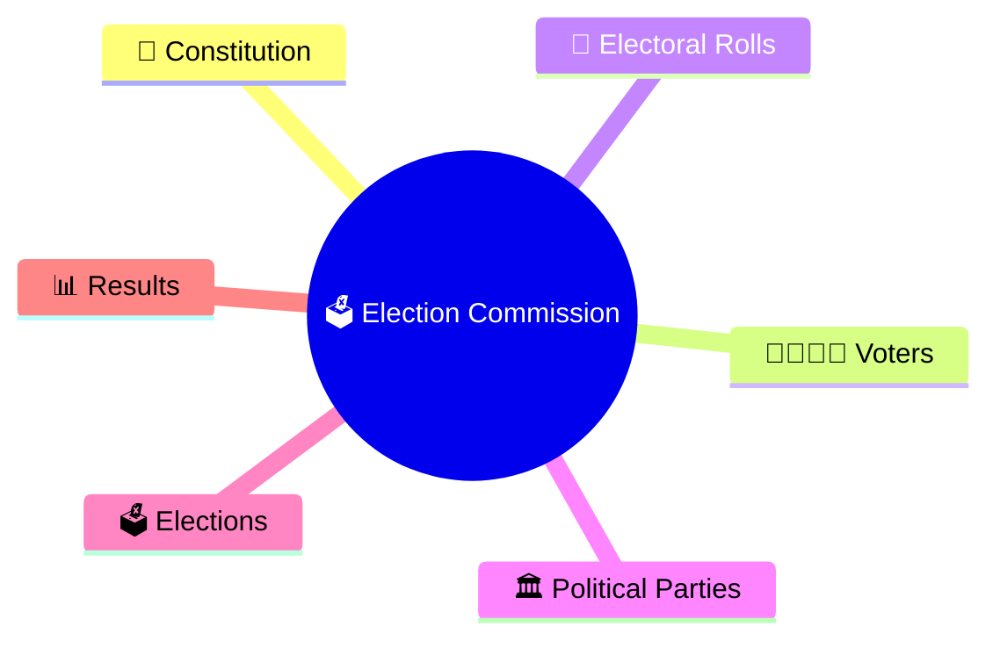
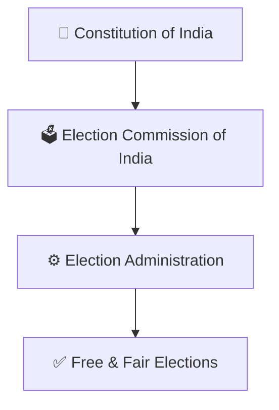
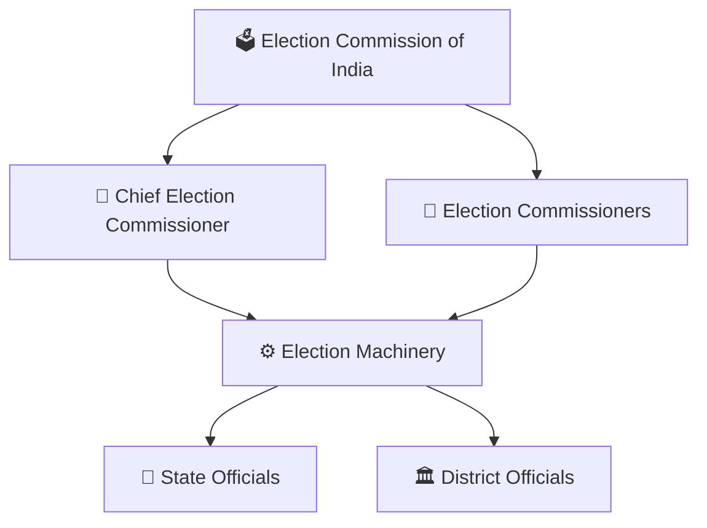
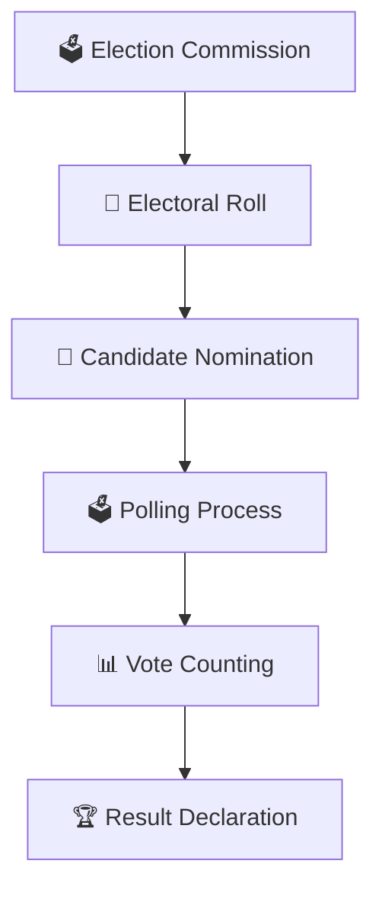
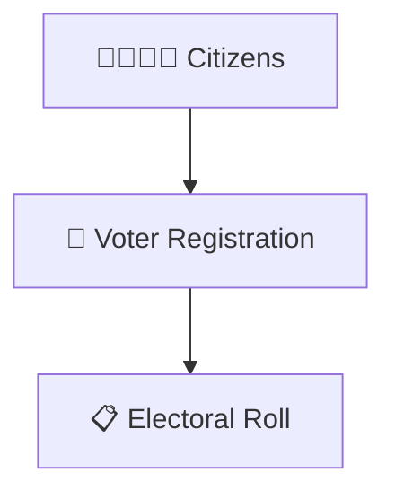
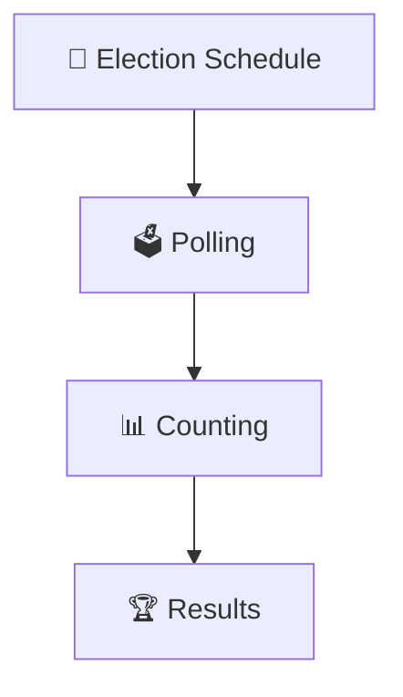
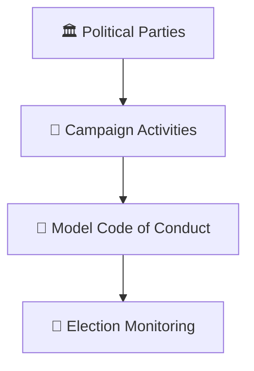
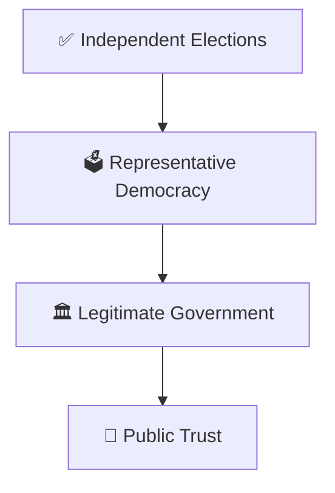

# Election Commission Structure

## Overview

This diagram explains the structure, role, and functioning of the Election Commission of India (ECI), the constitutional body responsible for conducting free and fair elections.

It helps visualize how elections are administered across the country.

---

## Why It Matters

Understanding the Election Commission helps explain:

- How elections are conducted
- How voter registration works
- How electoral processes are managed
- How election integrity is maintained
- How democratic legitimacy is protected

---

---

## Constitutional Position

---

## Election Commission Structure

---

## Election Management Framework

---

## Key Responsibilities

### Electoral Roll Management

### Election Conduct

### Monitoring & Oversight

---

## Democratic Significance

---

## Quick Revision

---

## Related Topics

- election-process-flow.md
- voter-to-government-journey.md
- government-formation-process.md
- constituency-representation-model.md
- elections-and-democracy.md
- election-terminology.md
